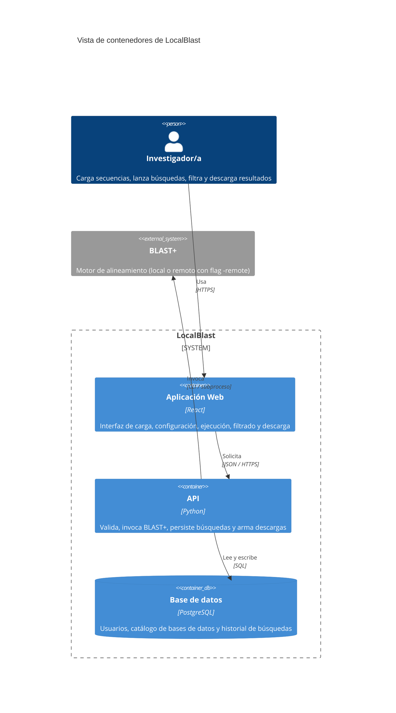
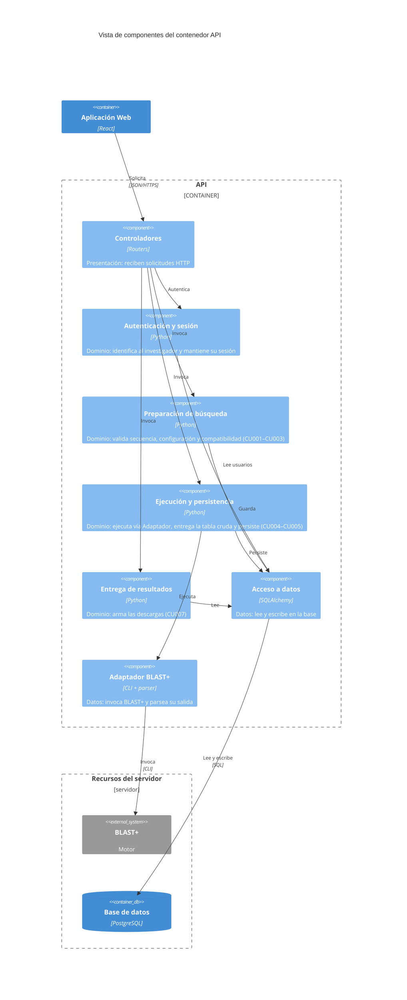
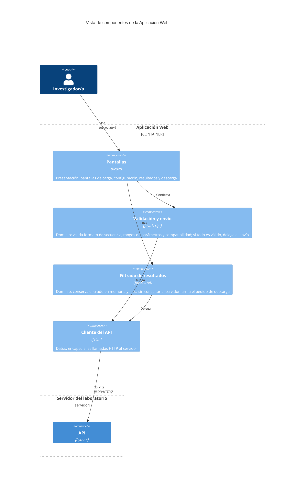

# Documento de Especificación de Arquitectura — LocalBlast

Este documento define la arquitectura de LocalBlast para los procesos de **ejecución de búsqueda BLAST (P1)** y **filtrado y entrega de resultados (P2)**. Representa las decisiones estructurales con las vistas de contenedores y componentes del modelo C4 (Context, Containers, Components, Code), apoyándose en los escenarios de atributo de calidad del sistema para justificar cada decisión.

---

## Índice

1. [Introducción](#1-introducción)
2. [Restricciones](#2-restricciones)
3. [Contexto](#3-contexto)
4. [Drivers arquitectónicos](#4-drivers-arquitectónicos)
5. [Estrategia de solución](#5-estrategia-de-solución)
6. [Vista de contenedores](#6-vista-de-contenedores)
7. [Vistas de componentes](#7-vistas-de-componentes)
8. [Historias de usuario sobre las vistas](#8-historias-de-usuario-sobre-las-vistas)
9. [Decisiones de arquitectura](#9-decisiones-de-arquitectura)
10. [Trazabilidad](#10-trazabilidad)
11. [Glosario](#11-glosario)

---

## 1. Introducción

### 1.1 Propósito

Describir las decisiones estructurales de LocalBlast que atienden los escenarios de calidad críticos del sistema, y representarlas con las vistas de contenedores y componentes del modelo C4. El documento es la línea base arquitectónica para el desarrollo iterativo del sistema.

### 1.2 Alcance

La arquitectura se define para los dos procesos del sistema que se desarrollan en el alcance actual:

- **P1 · Ejecutar búsqueda BLAST** (casos de uso CU001 a CU005).
- **P2 · Filtrar y entregar resultados** (casos de uso CU006 y CU007).

El proceso **P3 · Administrar bases de datos** queda fuera del alcance del cuatrimestre (ver [SRS, sección 1.4](../requeriments/srs.md#14-fuera-del-alcance)); su actor Administrador/a y el flujo de administración del catálogo no se detallan en estas vistas.

Las vistas de clases y de código, y los diagramas de despliegue, no forman parte de este documento: se desarrollarán en una iteración posterior.

### 1.3 Audiencia

- **Equipo de desarrollo** de LocalBlast: usa el documento como guía de construcción.
- **Integrantes futuros** del proyecto: lo consultan al incorporarse para entender rápidamente la estructura del sistema y las razones de cada decisión.

### 1.4 Siglas

Las siglas se definen la primera vez que se usan en el cuerpo del documento. El glosario completo está en la [sección 11](#11-glosario).

---

## 2. Restricciones

| Tipo | Restricción | Cómo condiciona la arquitectura |
|---|---|---|
| **Tecnología externa obligatoria** | BLAST+ (versión 2.14 o posterior) está instalado en el servidor; LocalBlast lo usa, no lo empaqueta ni lo reimplementa | BLAST+ es un sistema externo que se invoca, no un contenedor propio |
| **Técnica** | En modo remoto es BLAST+ quien contacta a NCBI (flag `-remote`); LocalBlast no dialoga con NCBI | No hay relación directa entre LocalBlast y NCBI en los diagramas |
| **Técnica** | El catálogo de bases locales (D1) se puebla por fuera del sistema (P3 fuera de alcance) | El catálogo se lee, no se escribe desde la aplicación |
| **Técnica** | Los usuarios se dan de alta por fuera del sistema; solo hay autenticación básica | La arquitectura incorpora unicamente un aspecto transversal simple de autenticacion (login/logout) para proteger y vincular el historial a cada investigador |
| **Equipo** | El equipo se compone por 3 estudiantes | No se adoptan arquitecturas de alta complejidad operativa |
| **Tiempo** | Duración disponible: un cuatrimestre | Se acota el alcance arquitectonico a los procesos criticos (P1 y P2) |
| **Tecnológica** | Lenguajes y frameworks que el equipo ya domina | El equipo domina lenguajes como Python y bases de datos relacionales. Para el frontend el equipo adopta **React**, con una curva de aprendizaje asumible dentro del cuatrimestre pero tiene tiempo limitado para aprender otras tecnologias o lenguajes completamente nuevos |

---

## 3. Contexto

El diagrama de contexto del sistema, con sus actores humanos (Investigador/a y Administrador/a) y el único sistema externo con el que dialoga (BLAST+), se desarrolla en el documento dedicado del repositorio:

👉 [`contexto-inicial.md`](contexto-inicial.md)

Para el alcance de este documento conviene retener dos aclaraciones del contexto, porque condicionan directamente las decisiones de arquitectura:

- **Local vs. remoto es transparente para LocalBlast.** La diferencia entre modo local y modo remoto queda enteramente del lado de BLAST+: en modo local lee índices del servidor del laboratorio; en modo remoto recibe la flag `-remote` y él mismo dialoga con NCBI. Nuestro sistema no implementa cliente HTTP hacia NCBI. Para LocalBlast, los dos modos son la misma operación —invocar BLAST+ con argumentos distintos— y la arquitectura los trata uniformemente.
- **Procesos profundizados.** Solo P1 y P2 entran en esta arquitectura; el actor Administrador/a y el proceso P3 quedan documentados en el contexto pero no se detallan acá.

---

**Descripción de elementos:**

| Elemento | Tipo | Responsabilidad |
|---|---|---|
| Investigador/a | Persona | Actor que hace uso del sistema |
| LocalBlast | Sistema | Sistema principal que permite la comunicacion con la API |
| BLAST+ | Sistema externo | Sistema encargado de ejecutar los alineamientos locales |

---

## 4. Drivers arquitectónicos

### 4.1 Elección del atributo de calidad como driver

De los cinco atributos de calidad priorizados en el documento de [escenarios de calidad](../requeriments/quality-scenarios/escenarios-calidad.md), elegimos un único atributo como **driver arquitectónico**: **Interoperabilidad** (Compatibilidad / Interoperabilidad en ISO/IEC 25010:2023).

**Por qué este y no otro:**

- **Es condición de existencia del producto.** LocalBlast *es*, por definición, una interfaz gráfica para BLAST+. Toda ejecución —local o remota— termina siendo una invocación al binario externo y un parseo de su salida. Sin interoperabilidad con BLAST+ el sistema no existe; con los otros atributos, LocalBlast puede ser menos ágil, menos robusto o menos modular, pero sigue siendo un sistema.
- **Fue el atributo más crítico en la matriz comparativa**, con 9 victorias sobre 9 posibles. Ningún otro atributo lo venció en ningún par.
- **Es el atributo que más condiciona la estructura.** La elección de cómo invocar a BLAST+, dónde alojar al adaptador, cómo aislar las versiones del binario del resto del código, y cómo manejar la concurrencia de subprocesos son decisiones estructurales. Los otros atributos se materializan sobre todo *dentro* de las piezas que la interoperabilidad obliga a crear:
  - *Operabilidad* se juega en la Aplicación Web (parte del cliente del estilo que vamos a elegir): la validación del formulario y el filtrado interactivo de los resultados se resuelven en el navegador (ver [DA-05](#da-05--validación-en-la-aplicación-web-además-de-en-el-servidor) y [DA-06](#da-06--filtrado-de-resultados-en-la-aplicación-web)).
  - *Confidencialidad* se resuelve con TLS en el canal cliente-servidor y con el componente **Autenticación y sesión** del API (ver sección 7.1), que acompaña al estilo elegido pero no es un estilo propio.
  - *Tolerancia a fallos* se trata, en nuestro caso, delegando a BLAST+ el reporte de errores remotos y propagándolos sin reinterpretarlos: una responsabilidad del adaptador que la interoperabilidad exige crear.
  - *Modularidad* se obtiene en gran medida como consecuencia del patrón que la interoperabilidad justifica (ver [sección 5.3](#53-patrón-arquitectónico-capas)): aislar BLAST+ en una capa dedicada deja el resto del sistema modular por diseño.

**Qué hacen los otros atributos en esta arquitectura.** No se descartan: se cubren mediante decisiones de implementación y restricciones de desarrollo dentro de los contenedores y componentes que la interoperabilidad justifica. La elección de un único driver es una **decisión de énfasis**, no una renuncia a los otros atributos.

### 4.2 Escenarios seleccionados como drivers

De los dos escenarios de interoperabilidad disponibles, ambos son drivers arquitectónicos: cada uno condiciona la estructura del sistema de un modo distinto.

#### EC-01 · Sobrecarga por concurrencia de invocaciones

| Campo | Contenido |
|---|---|
| **Estímulo** | Hasta cinco investigadores lanzan búsquedas concurrentes contra el sistema, mezclando modo local y remoto. |
| **Respuesta esperada** | Cada búsqueda corre como subproceso independiente de BLAST+; los resultados se entregan a la sesión que los originó, sin cruce con otras. |
| **Medida** | **Cero** cruces de resultados con hasta cinco búsquedas concurrentes. |
| **Por qué condiciona la estructura** | Exige un contenedor servidor capaz de alojar subprocesos independientes de BLAST+ (uno por búsqueda), con un componente dedicado a mantener la correspondencia entre subproceso y sesión del investigador. No se puede resolver dentro de un único componente, ni solo en la interfaz. |

#### EC-02 · Degradado por cambio menor de versión de BLAST+

| Campo | Contenido |
|---|---|
| **Estímulo** | El administrador de sistemas actualiza BLAST+ a una versión posterior que suma columnas o campos a la salida, sin coordinarlo con el equipo de desarrollo. |
| **Respuesta esperada** | El parser reconoce los campos conocidos, ignora los nuevos sin corromper los conocidos, no aborta y registra una advertencia. |
| **Medida** | **100%** de las búsquedas con salida "casi conocida" presentan intactos los campos obligatorios. |
| **Por qué condiciona la estructura** | Exige un componente adaptador aislado entre el núcleo del sistema y BLAST+. Los demás componentes **no deben saber** cómo es la salida real del binario, para que un cambio en esa salida no se propague por todo el código. Es una decisión de dependencia estructural, no de implementación interna. |

La especificación completa de ambos escenarios, con todos sus componentes (fuente del estímulo, estímulo, entorno, artefacto, respuesta, medida), está en la sección 5.1 de [`escenarios-calidad.md`](../requeriments/quality-scenarios/escenarios-calidad.md#51-interoperabilidad).

### 4.3 Restricciones del proyecto que acompañan a los drivers

Dos restricciones de la [sección 2](#2-restricciones) influyen directamente en cómo se traducen estos drivers en estructura:

- **Equipo de 3 personas con dedicación parcial.** Toda alternativa de arquitectura que atienda los drivers debe ser realizable con ese presupuesto. Esto descarta soluciones de alta complejidad operativa aunque sean técnicamente superiores (ver [DA-01](#da-01--estilo-base-cliente-servidor) y [DA-02](#da-02--patrón-capas-en-los-contenedores-con-lógica-propia)).
- **Tecnologías dominadas o adoptables por el equipo.** El estilo elegido se realiza del lado servidor con Python (que el equipo ya domina) y, del lado cliente, con React (que el equipo adopta en el cuatrimestre).

---

## 5. Estrategia de solución

Esta sección recorre, en orden de abstracción decreciente, las decisiones de la arquitectura: tácticas → estilo → patrón → cobertura de los drivers.

### 5.1 Tácticas elegidas y descartadas

Para los dos drivers del punto anterior, las tácticas seleccionadas y descartadas del catálogo de interoperabilidad son:

| Táctica | Decisión | Por qué |
|---|---|---|
| **Adaptar la interfaz** | ✅ Seleccionada | Es la táctica central para EC-02. Un componente dedicado traduce entre la salida real de BLAST+ (texto tabular, XML, código de salida) y la estructura interna del sistema. Si BLAST+ cambia, cambia solo ese componente. |
| **Respetar estándares de comunicación** | ✅ Seleccionada | Entre el navegador y el servidor usamos HTTPS con JSON (web estándar); con BLAST+ usamos la interfaz de línea de comandos estándar documentada en el manual oficial del motor. Nada propietario entre contenedores. |
| **Descubrir servicios** | ❌ Descartada | BLAST+ corre en el mismo servidor que el API, con ruta configurada. No hay universo de servicios por descubrir en tiempo de ejecución. |
| **Orquestar** | ❌ Descartada | No hay varios servicios que orquestar: hay un único sistema externo (BLAST+) invocado por una sola operación por búsqueda. |

**Tácticas de otros atributos adoptadas en apoyo a los drivers de interoperabilidad.** Dos tácticas que pertenecen a otros atributos sostienen el cumplimiento de los drivers:

| Táctica | Atributo origen | Por qué la adoptamos para interoperabilidad |
|---|---|---|
| **Introducir concurrencia** | Desempeño | Es la táctica que atiende el "cero cruces con cinco concurrentes" de EC-01. Lanzar cada búsqueda como subproceso independiente del binario BLAST+, con su propio contexto, es lo que garantiza el aislamiento. |
| **Encapsular** | Modificabilidad | Convierte al adaptador en el único punto de contacto con BLAST+. Es el mecanismo del patrón Capas (ver [sección 5.3](#53-patrón-arquitectónico-capas)) que materializa la táctica "adaptar la interfaz" dentro del contenedor API. |

### 5.2 Estilo arquitectónico base: Cliente-Servidor

**Decisión.** Adoptamos **Cliente-Servidor** como estilo arquitectónico base para todo el sistema (ver [DA-01](#da-01--estilo-base-cliente-servidor)).

**Por qué este estilo:**

- **BLAST+ corre del lado servidor por obligación.** El binario está instalado en el servidor del laboratorio, no en el navegador del investigador. Una vez aceptado que hace falta un servidor, cliente-servidor es la estructura más chica que lo acompaña: un cliente que presenta, un servidor que ejecuta BLAST+ y persiste. Cualquier otro estilo multiplica piezas sin agregar nada que resuelva mejor nuestros drivers.
- **Los dos drivers viven dentro de un único proceso servidor.** EC-01 se resuelve con subprocesos lanzados por el mismo API; EC-02 con un componente del mismo API. Ninguno exige estado distribuido, bus de eventos ni coordinación entre servicios. Un estilo que ofrezca esas capacidades sería un costo operativo pagado por algo que no necesitamos.
- **REST + JSON es el contrato estándar entre cliente y servidor.** Materializa la táctica "respetar estándares de comunicación" en el borde más visible del sistema y mantiene abierta la puerta a un segundo cliente —por ejemplo un script de automatización que un investigador quiera correr— sin tocar el servidor.
- **Permite evolucionar sin rehacer.** Si en el futuro aparece un escenario de procesamiento asincrónico pesado (lotes de 100 búsquedas, por ejemplo), se puede sumar una cola entre el servidor y un ejecutor dedicado sin romper el estilo base: cliente-servidor convive con esa evolución, mientras que elegir hoy un estilo más complejo nos obligaría a sostener su costo *desde el principio*.

**Restricciones del estilo que la arquitectura respeta:**

| Restricción del estilo cliente-servidor | Cómo se respeta en LocalBlast |
|---|---|
| Los clientes no se comunican entre sí | Solo hay un cliente (Aplicación Web); no hay comunicación cliente-cliente. |
| El cliente no accede directamente a la base de datos | La Aplicación Web nunca habla SQL. Todo acceso a datos pasa por el API. |
| El servidor no inicia la comunicación con el cliente | El API responde a las solicitudes del cliente; no empuja mensajes al navegador por iniciativa propia (el progreso de la búsqueda se consulta desde el cliente). |
| El cliente inicia siempre la comunicación | Todas las flechas entre contenedores salen del cliente o del API hacia abajo (BD, BLAST+); ninguna sale de la BD o de BLAST+ hacia el cliente. |

Esto se verifica directamente en la vista de contenedores de la [sección 6](#6-vista-de-contenedores).

**Alternativas consideradas y descartadas:**

| Alternativa | Por qué se descartó |
|---|---|
| **Microservicios** | Exigen complejidad operativa (varios despliegues, red interna, consistencia entre bases) que un equipo de tres personas con dedicación parcial no sostiene. No hay en LocalBlast partes con ritmos de cambio o de escala tan distintos como para justificar el costo. |
| **Orientada a eventos** | Resuelve picos y tareas lentas con desacople asincrónico. Con cinco búsquedas concurrentes y usuarios de un laboratorio chico, el acople síncrono alcanza. Sumar una cola es un contenedor más que operar sin beneficio para los drivers actuales. Queda como opción para una iteración futura si los escenarios cambian. |
| **SOA con bus** | Pensada para integrar sistemas existentes. En LocalBlast hay un único sistema externo (BLAST+) sin ningún bus de por medio y sin otros sistemas con los que integrarse. |

### 5.3 Patrón arquitectónico: Capas

**Decisión.** Adoptamos el **patrón de Capas** dentro de los dos contenedores que alojan lógica propia: la Aplicación Web y el API. El estilo cliente-servidor organiza el sistema entero; el patrón de Capas organiza la lógica interna de cada uno de esos contenedores (ver [DA-02](#da-02--patrón-capas-en-los-contenedores-con-lógica-propia)).

**Por qué este patrón:**

- **Materializa la táctica "adaptar la interfaz" de forma mínima y suficiente.** En el API, pone al adaptador de BLAST+ en la capa de datos, aislado detrás de una interfaz interna estable. Las capas superiores (dominio, presentación) no saben cómo es la salida real del binario; invocan al adaptador por sus métodos. Un cambio en la salida de BLAST+ se absorbe en el adaptador y no se propaga.
- **Cumple con las restricciones del equipo.** Capas es más chico que Hexagonal (puertos y adaptadores) y es el que un equipo de tres personas puede sostener sin sobreingeniería. Hexagonal también funcionaría —y queda como opción si el proyecto crece— pero introduce más piezas (puertos explícitos, inversión de dependencias) que no son necesarias para los drivers actuales.
- **Permite replicar la misma mentalidad en el cliente.** La Aplicación Web también tiene lógica interna (validaciones, filtrado de los resultados, llamadas al servidor); organizarla por capas la hace evolucionar al mismo ritmo que el servidor, con un modelo mental consistente.
- **Satisface tácticas de modificabilidad por diseño.** Separar en capas con dependencias hacia abajo mejora modularidad y capacidad de prueba.

**Las tres capas, aplicadas en cada contenedor:**

| Capa | En la Aplicación Web | En el API |
|---|---|---|
| **Presentación** | Pantallas que ve el investigador (carga, configuración, resultados, descarga). Componente: **Pantallas**. | Borde HTTP del servidor: recibe solicitudes, valida sintácticamente las entradas, serializa respuestas, devuelve códigos de estado. Componente: **Controladores**. |
| **Dominio** | Lógica de aplicación del cliente: valida formato de secuencia, rangos de parámetros y compatibilidad programa-query-base **antes** de pedir el envío al servidor, y filtra los resultados ya recibidos sin consultar al servidor. Componentes: **Validación y envío**, **Filtrado de resultados**. | Lógica del dominio del servidor. Tres componentes para las fases del ciclo de la búsqueda —antes de BLAST+, durante y después— más un componente para la identidad del investigador, que es parte del dominio porque el historial se corresponde a cada uno. Componentes: **Autenticación y sesión**, **Preparación de búsqueda**, **Ejecución y persistencia**, **Entrega de resultados**. |
| **Datos** | Acceso al mundo exterior del cliente (que para el cliente es el API). Componente: **Cliente del API**. | Acceso al mundo exterior del servidor: la base de datos y el binario BLAST+. Componentes: **Acceso a datos**, **Adaptador BLAST+**. |

**Validación en el cliente, además de en el servidor.** La capa de dominio de la Aplicación Web aloja la validación del formulario antes de enviar la configuración al servidor. Esta decisión se documenta aparte en [DA-05](#da-05--validación-en-la-aplicación-web-además-de-en-el-servidor): el cliente valida para que el investigador reciba feedback inmediato y para reducir solicitudes al servidor por configuraciones mal armadas; el servidor **repite** la validación completa sobre todo lo que recibe, porque la validación del cliente puede ser salteada por un actor malicioso y, por lo tanto, no es un control de seguridad.

**Filtrado de resultados en el cliente.** La capa de dominio de la Aplicación Web también aloja el filtrado post-búsqueda: al terminar la búsqueda el cliente recibe la tabla cruda, la conserva en memoria y recalcula la tabla visible en cada cambio de filtro, sin consultar al servidor. Esto es lo que permite sostener la respuesta en menos de 1 segundo del escenario de operabilidad aun cuando el servidor está ocupado con varias búsquedas concurrentes. Al descargar, el cliente le indica al servidor qué hits están visibles y el servidor arma el archivo. La decisión se documenta en [DA-06](#da-06--filtrado-de-resultados-en-la-aplicación-web).

**Restricciones del patrón que la arquitectura respeta en ambos contenedores:**

| Restricción del patrón de Capas | Cómo se respeta |
|---|---|
| Una capa no depende de las superiores | En el API, ningún componente de dominio llama a los Controladores; ningún componente de datos llama a los de dominio ni a los Controladores. En la Aplicación Web, el Cliente del API no llama a los componentes de dominio, y estos (Validación y envío, Filtrado de resultados) no llaman a Pantallas. |
| Cada capa usa solo a la inmediatamente inferior | En el API: Controladores → componentes de dominio → Acceso a datos / Adaptador BLAST+. En la Aplicación Web: Pantallas → Validación y envío / Filtrado de resultados → Cliente del API. |
| Cada capa tiene una responsabilidad clara | Ver la tabla de capas más arriba. Ninguna capa mezcla responsabilidades que correspondan a otra. |

Esto se verifica directamente en las vistas de componentes de la [sección 7](#7-vistas-de-componentes): todas las flechas entre capas van en la misma dirección.

**Alternativas consideradas y descartadas:**

| Alternativa | Por qué se descartó |
|---|---|
| **Hexagonal (puertos y adaptadores)** | Aísla más estrictamente, pero con un único sistema externo (BLAST+) las piezas extra (puertos explícitos, inversión de dependencias) son sobreingeniería para un equipo de 3 personas. Capas cubre nuestras necesidades con menos piezas. |
| **MVC** | Está pensado para separar presentación, lógica de interacción y modelo en una interfaz. Capas es más general y permite aplicar la misma mentalidad tanto en el cliente como en el servidor, cosa que MVC no cubre con la misma naturalidad. |
| **Broker** | Resuelve desacoplar emisores y receptores con un intermediario de mensajes. En LocalBlast, el API y el adaptador de BLAST+ viven en el mismo proceso: una cola de mensajes sería un contenedor más que operar sin beneficio. |

### 5.4 Aspectos transversales

Los aspectos transversales habituales en una arquitectura de este estilo —auditoría, gestión de excepciones, instrumentación— **no forman parte de esta entrega del documento de arquitectura**. Se incorporarán en una iteración posterior, cuando el sistema entre en una etapa en la que esas responsabilidades se vuelvan parte del alcance de desarrollo.

**La autenticación y gestión de sesión sí se modela, pero no como aspecto transversal**: se la trata como un componente de dominio propio en el API (**Autenticación y sesión**, visible en la [sección 7.1](#71-vista-de-componentes-del-api)). La razón es que en LocalBlast la identidad del investigador no es solo un chequeo invisible al código: el historial de búsquedas se corresponde a cada investigador y esa correspondencia es parte del dominio del sistema, no un detalle de infraestructura. Modelarla como componente la vuelve explícita y permite trazar cómo cada efecto sobre la base de datos queda asociado al investigador correcto.

### 5.5 Tabla de cobertura

Cómo la arquitectura cubre cada driver y qué sacrifica a cambio.

| Driver | Táctica(s) | Dónde se materializa en la arquitectura | Qué se sacrifica |
|---|---|---|---|
| **EC-01** · Hasta cinco invocaciones concurrentes a BLAST+ sin cruce de resultados | Introducir concurrencia + encapsular | Componente **Adaptador BLAST+** del API: cada invocación corre como subproceso independiente, con identificador propio y referencia a la sesión que la lanzó (ver [DA-04](#da-04--ejecutar-cada-búsqueda-como-subproceso-independiente-de-blast)). | Mayor consumo de CPU y memoria durante los picos de concurrencia (un proceso de BLAST+ por búsqueda). Aceptable en un laboratorio chico. |
| **EC-02** · Cambios menores de versión de BLAST+ sin romper el parseo de la salida | Adaptar la interfaz + encapsular | Componente **Adaptador BLAST+** del API: su parser reconoce los campos conocidos por nombre, ignora los no mapeados y descarta sin corromper los conocidos. El resto del sistema no cambia (ver [DA-03](#da-03--adaptador-blast-como-componente-dedicado-en-la-capa-de-datos)). | El equipo debe sostener el mapeo "campo de BLAST+ → entidad del dominio" al día en el adaptador cuando el motor evoluciona. Es un costo operativo bajo. |

**Conflictos entre tácticas: verificación.** Ninguna de las tácticas que adoptamos entra en conflicto con las demás. Encapsular el acceso a BLAST+ mejora modularidad y, al mismo tiempo, es lo que permite el aislamiento de concurrencia (cada subproceso lo lanza el mismo componente, con su propia correspondencia a la sesión). Respetar estándares de comunicación con el cliente (REST + JSON) no interfiere con el canal CLI hacia BLAST+ (son dos interfaces distintas, una por cada relación entre contenedores).

---

## 6. Vista de contenedores

### 6.1 Diagrama

### 6.2 Catálogo de contenedores

| Contenedor | Responsabilidad |
|---|---|
| **Aplicación Web** | Única interfaz humana del sistema. Formulario de carga, configuración, validación cliente y ejecución de búsquedas; vista de progreso y cancelación; tabla de resultados con filtrado interactivo, resuelto en el navegador sobre el conjunto crudo que mantiene en memoria; disparo de descargas. No contiene lógica de dominio del servidor: toda operación sobre BLAST+ o sobre la base de datos la hace el API. |
| **API** | Núcleo del sistema. Recibe solicitudes HTTP de la Aplicación Web, orquesta los servicios de dominio (carga, búsqueda, descarga), persiste en la base de datos y es el único contenedor que invoca a BLAST+. |
| **Base de datos** | Almacén único del sistema. Guarda los usuarios habilitados, el catálogo de bases de datos BLAST disponibles (D1 del DFD) y el historial de búsquedas con sus parámetros, timestamps y resultados crudos (D2 del DFD). |
| **BLAST+** *(sistema externo)* | Motor de alineamiento. En modo local lee índices del servidor del laboratorio; en modo remoto recibe la flag `-remote` y él mismo dialoga con NCBI. LocalBlast lo trata uniformemente en ambos modos: le pasa argumentos por CLI, recibe su salida por stdout y su código de retorno. |

### 6.3 Catálogo de relaciones

| Origen → Destino | Qué se comunica |
|---|---|
| Investigador/a → Aplicación Web | Interacciones de la UI: carga de archivo, formulario, botones. |
| Aplicación Web → API | Solicitudes REST: carga de secuencia (ya validada en el cliente), configuración, ejecución, consulta de progreso, obtención de la tabla cruda al terminar la búsqueda y descarga (con el id de la búsqueda, el formato y los hits visibles). El filtrado interactivo no genera solicitudes: se resuelve en la Aplicación Web. |
| API → Base de datos | Lectura y escritura: usuarios para asociar sesión, catálogo para listar bases disponibles, historial para persistir cada búsqueda ejecutada. |
| API → BLAST+ | Invocación como subproceso con los argumentos de la búsqueda (programa, modo, base de datos, parámetros, ruta a secuencia query). Lee la salida por stdout. |

### 6.4 Comprobación del estilo cliente-servidor

Verificando sobre el diagrama las reglas de la [sección 5.2](#52-estilo-arquitectónico-base-cliente-servidor):

- ✅ No hay flechas entre clientes (solo hay un cliente).
- ✅ No hay flechas de la base de datos hacia la Aplicación Web (toda escritura y lectura pasa por el API).
- ✅ No hay flechas del API hacia la Aplicación Web (el servidor no inicia la comunicación).
- ✅ El cliente inicia siempre la comunicación: la cadena Investigador/a → Web → API → BD y Web → API → BLAST+ fluye hacia abajo.

---

## 7. Vistas de componentes

Se hace una vista de componentes por cada contenedor del sistema con lógica propia: la **Aplicación Web** y el **API**. La Base de datos no se profundiza porque es un almacén sin lógica propia.

### 7.1 Vista de componentes del API

> **Nota sobre la disposición.** La sintaxis C4 de Mermaid tiene limitaciones de layout conocidas: por defecto dibuja todos los elementos externos en una fila superior, aunque las relaciones salgan hacia abajo. Para que las flechas hacia la Base de datos y hacia BLAST+ no atraviesen el diagrama, ambos se agrupan en un límite propio ("Recursos del servidor") que Mermaid ubica debajo del API; la Aplicación Web, que es quien llama, queda arriba. Ese límite es solo un recurso de dibujo: no es un contenedor del modelo. Por el mismo motivo de legibilidad, las etiquetas sobre las flechas son cortas (un verbo cada una) y el detalle completo —qué comunica cada relación— vive en el catálogo de la [sección 7.1.2](#712-catálogo-de-relaciones-del-api).

#### 7.1.1 Catálogo de componentes del API

| Componente | Capa | Responsabilidad |
|---|---|---|
| **Controladores** | Presentación | Exponen la interfaz HTTP del API: rutas, validación sintáctica de entradas, serialización de respuestas, códigos de estado. No contienen lógica del dominio: delegan en los componentes de dominio. En cada solicitud, antes de invocar a cualquier otro componente de dominio, consultan a **Autenticación y sesión** para saber qué investigador la originó y le pasan ese identificador como parámetro a los demás servicios. |
| **Autenticación y sesión** | Dominio | Verifica la identidad del investigador en cada solicitud y mantiene su sesión activa durante el trabajo con el sistema. Expone el "investigador actual" al resto del dominio para que los efectos sobre la base de datos (la secuencia que guarda Preparación de búsqueda, la búsqueda que persiste Ejecución y persistencia, el historial que lee Entrega de resultados) queden asociados al investigador correcto. **Por qué está en el documento aunque no haya una historia de usuario propia**: el historial de las búsquedas se corresponde a cada investigador y esa correspondencia es parte del dominio del sistema; sin este componente no se puede explicar cómo se mantiene la correspondencia entre búsqueda e investigador. |
| **Preparación de búsqueda** | Dominio | Todo lo que ocurre **antes** de invocar a BLAST+. Valida sintácticamente la secuencia query (RF-01, RF-02; implementa CU001) e infiere el alfabeto (ADN / ARN / proteína); recibe la configuración de la búsqueda (RF-03 a RF-06; CU002) y la valida semánticamente verificando compatibilidad entre programa, tipo de query y tipo de base de datos (RF-07; CU003). Esta validación repite la que ya hizo el cliente, porque la del cliente no es un control de confianza. |
| **Ejecución y persistencia** | Dominio | Lo que ocurre **durante** y **al cierre** de la ejecución de BLAST+. Lanza la ejecución asíncrona con posibilidad de cancelación pidiéndosela al Adaptador BLAST+ (RF-08; CU004), recibe los resultados crudos, los entrega al cliente como tabla —identificador del hit, score, E-value observado, % identidad, % cobertura y taxonomía cuando está disponible— para que la presente y la filtre (RF-09), y persiste la búsqueda completa en el historial (RF-10; CU005). Persistencia y presentación van juntas, como exige CU005: la tabla solo se entrega al cliente una vez que la búsqueda quedó registrada. Nunca llama directamente a BLAST+: lo hace a través del Adaptador. |
| **Entrega de resultados** | Dominio | Lo que ocurre **después** de la búsqueda, cuando el investigador se lleva lo encontrado. Arma los archivos descargables en los formatos soportados (RF-12; CU007) a partir de la búsqueda persistida, de los identificadores de los hits visibles que le envía el cliente y del formato elegido; incluye la sección de metadatos con parámetros pre-búsqueda, base de datos, timestamp y el texto de los filtros vigentes (que recibe como información, sin evaluarlo). Antes de armar el archivo verifica que la búsqueda pertenezca al investigador actual y que cada identificador recibido pertenezca a esa búsqueda: no confía en el cliente, así que el archivo nunca puede contener hits ajenos al conjunto crudo. No filtra: el filtrado interactivo (RF-11; CU006) vive en la Aplicación Web (ver [DA-06](#da-06--filtrado-de-resultados-en-la-aplicación-web)). |
| **Acceso a datos** | Datos | Único punto de acceso del API a la base de datos. Hace la traducción entre entidades del dominio y filas de SQL; agrupa las operaciones en transacciones cuando corresponde. |
| **Adaptador BLAST+** | Datos | **Componente clave de los drivers de interoperabilidad.** Único punto de contacto con BLAST+. Lanza cada invocación como subproceso independiente, mantiene la correspondencia entre subproceso y sesión que lo originó (EC-01), parsea la salida reconociendo los campos conocidos y descartando los no mapeados sin corromper los conocidos (EC-02). |

#### 7.1.2 Catálogo de relaciones del API

| Origen → Destino | Verbo en el diagrama | Qué comunica realmente |
|---|---|---|
| **Dentro del contenedor API** (llamadas internas, sin protocolo) | | |
| Controladores → Autenticación y sesión | Autentica | En cada solicitud, antes de delegar en otro componente de dominio, los Controladores le piden a Autenticación y sesión que verifique quién es el investigador. Si no hay sesión válida, los Controladores responden con 401/403 sin invocar nada más. |
| Controladores → Preparación de búsqueda | Invoca | Delega la carga y validación sintáctica de la secuencia, la recepción de la configuración y su validación semántica. Pasa el identificador del investigador que ya obtuvo de Autenticación y sesión. |
| Controladores → Ejecución y persistencia | Invoca | Delega la ejecución asíncrona de la búsqueda validada, la persistencia en el historial y la entrega de la tabla cruda al cliente cuando la búsqueda termina. Pasa el identificador del investigador. |
| Controladores → Entrega de resultados | Invoca | Delega la generación del archivo de descarga a partir de la búsqueda, los hits visibles y el formato elegido. Pasa el identificador del investigador para que solo se pueda descargar sobre sus propias búsquedas. |
| Autenticación y sesión → Acceso a datos | Lee usuarios | Lee los registros de usuarios para validar credenciales y, cuando corresponde, las sesiones vigentes. |
| Preparación de búsqueda → Acceso a datos | Guarda | Guarda la secuencia cargada (asociada al investigador actual) y lee el catálogo de bases de datos disponibles para validar la configuración. |
| Ejecución y persistencia → Acceso a datos | Persiste | Persiste cada búsqueda ejecutada en el historial (parámetros, timestamps, resultados crudos), asociada al investigador que la originó. |
| Ejecución y persistencia → Adaptador BLAST+ | Ejecuta | Pide la ejecución de una búsqueda validada, pasando la configuración completa. |
| Entrega de resultados → Acceso a datos | Lee | Lee los resultados crudos de una búsqueda persistida —restringida al investigador actual— para armar el archivo con los hits que indicó el cliente. |
| **Hacia contenedores vecinos** (con protocolo) | | |
| Aplicación Web → Controladores | Solicita | Solicitud REST (JSON / HTTPS). |
| Acceso a datos → Base de datos | Lee y escribe | Consultas y transacciones (SQL). |
| Adaptador BLAST+ → BLAST+ | Invoca | Invocación por línea de comandos; captura de stdout / stderr y código de salida (CLI / subproceso). |

> **Sobre por qué Preparación / Ejecución / Entrega no tienen flecha hacia Autenticación y sesión en el diagrama.** El identificador del investigador viaja como **parámetro** desde los Controladores hacia esos tres servicios, y de ahí hacia Acceso a datos; no viaja como una invocación de vuelta a Autenticación y sesión. Es decir, el "quién soy" se obtiene **una sola vez** por solicitud (en el borde del API, cuando los Controladores autentican) y después se propaga como dato por el resto del flujo. Dibujar tres flechas más —una desde cada servicio hacia Autenticación y sesión— ensuciaría el diagrama sin agregar información: no hay una invocación real.

#### 7.1.3 Comprobación del patrón de capas en el API

Verificando sobre el diagrama las restricciones de la [sección 5.3](#53-patrón-arquitectónico-capas):

- ✅ **Ninguna capa depende de las superiores.** Los componentes de datos (Acceso a datos, Adaptador BLAST+) no llaman a los componentes de dominio ni a los Controladores. Los componentes de dominio no llaman a los Controladores. Todas las flechas de dominio bajan hacia la capa de datos; todas las flechas de presentación bajan hacia la capa de dominio.
- ✅ **No se saltean capas.** Los Controladores no llaman a Acceso a datos ni al Adaptador BLAST+ directamente: delegan en los componentes de dominio.
- ✅ **Cada capa tiene su responsabilidad propia** (ver [sección 5.3](#53-patrón-arquitectónico-capas)).

### 7.2 Vista de componentes de la Aplicación Web

> **Nota sobre la disposición.** El API se dibuja dentro de un límite aparte ("Servidor del laboratorio") para que Mermaid lo ubique debajo de la Aplicación Web y la flecha de solicitud no cruce los componentes; es solo un recurso de dibujo.

#### 7.2.1 Catálogo de componentes de la Aplicación Web

| Componente | Capa | Responsabilidad |
|---|---|---|
| **Pantallas** | Presentación | Las pantallas que el investigador ve y manipula: carga de la secuencia (HU01), configuración y validación visible del formulario (HU03 a HU07), progreso y cancelación de la ejecución (HU08 a HU10), tabla de resultados y filtros interactivos (HU11, HU12), controles de descarga (HU13, HU14). |
| **Validación y envío** | Dominio | Centro de la lógica del cliente. Valida: formato sintáctico de la secuencia, rangos de los parámetros pre-búsqueda, compatibilidad entre programa BLAST, tipo de secuencia y tipo de base de datos. Si la validación falla, devuelve a Pantallas los errores para que los muestre inline; si pasa, delega el envío al Cliente del API. No interviene en el filtrado ni en la descarga de resultados. |
| **Filtrado de resultados** | Dominio | Dueño de los resultados en el cliente. Al terminar la búsqueda pide al servidor, a través del Cliente del API, la tabla cruda —identificador del hit, score, E-value observado, % identidad, % cobertura y taxonomía cuando está disponible; no los alineamientos completos— y la conserva intacta en memoria. Cada vez que el investigador cambia un filtro (identidad, cobertura, E-value, taxonomía; RF-11; CU006) recalcula el subconjunto visible **siempre sobre el crudo original, nunca sobre el filtrado anterior**, sin ninguna solicitud al servidor; así se sostiene la respuesta en menos de 1 segundo del escenario de operabilidad y el estado de los filtros se conserva durante la sesión. Valida localmente los rangos de los umbrales (por ejemplo, porcentajes entre 0 y 100). Al descargar, arma el pedido con el id de la búsqueda, el formato elegido, los identificadores de los hits visibles y el texto de los filtros vigentes, y se lo pasa al Cliente del API (RF-12; CU007). Ver [DA-06](#da-06--filtrado-de-resultados-en-la-aplicación-web). |
| **Cliente del API** | Datos | Encapsula el detalle de las llamadas HTTP (URL base, serialización de JSON, manejo de códigos de estado). Es la única pieza del cliente que conoce la forma concreta de la interfaz del API. |

#### 7.2.2 Catálogo de relaciones de la Aplicación Web

| Origen → Destino | Verbo en el diagrama | Qué comunica realmente |
|---|---|---|
| **Dentro de la Aplicación Web** (llamadas internas, sin protocolo) | | |
| Pantallas → Validación y envío | Confirma | Cuando el investigador presiona un botón que dispara una acción previa o durante la ejecución de la búsqueda (cargar secuencia, configurar, ejecutar, cancelar), Pantallas pasa el estado del formulario a Validación y envío para que valide y, si corresponde, dispare el envío. |
| Pantallas → Filtrado de resultados | Filtra | Cuando termina la búsqueda, Pantallas le pide los resultados para mostrarlos; cuando el investigador cambia un filtro, le pasa los criterios y recibe el subconjunto visible, sin pasar por el servidor; cuando presiona Descargar, le pide que arme el pedido de descarga. |
| Validación y envío → Cliente del API | Delega | Cuando la validación local pasa, Validación y envío arma el *payload* y le pide al Cliente del API que haga la llamada. |
| Filtrado de resultados → Cliente del API | Delega | Le pide al Cliente del API la tabla cruda de la búsqueda terminada y, al descargar, envía el pedido con los hits visibles. Son las únicas dos ocasiones en que el filtrado habla con el servidor. |
| **Hacia actores y contenedores vecinos** | | |
| Investigador/a → Pantallas | Usa | Interacciones de la UI mediante el navegador. |
| Cliente del API → API | Solicita | Solicitud REST (JSON / HTTPS). |

#### 7.2.3 Comprobación del patrón de capas en la Aplicación Web

- ✅ **Ninguna capa depende de las superiores.** Validación y envío y Filtrado de resultados no conocen a Pantallas (le devuelven datos, no la llaman) y no se llaman entre sí. Cliente del API no conoce a ninguno de los dos.
- ✅ **No se saltean capas.** Pantallas no llama al Cliente del API directamente: toda comunicación con el servidor pasa por un componente de dominio: Validación y envío (antes y durante la búsqueda) o Filtrado de resultados (resultados y descarga).
- ✅ **Cada capa tiene su responsabilidad propia** (ver [sección 5.3](#53-patrón-arquitectónico-capas)).

---

## 8. Historias de usuario sobre las vistas

Esta sección recorre, sobre las vistas, el *Given-When-Then* de cuatro historias representativas (la carga, la ejecución con BLAST+, el filtrado y la descarga). El objetivo es verificar que cada paso del criterio de aceptación tiene un lugar donde ocurre en la arquitectura.

| HU | Criterio recorrido | Contenedores que atraviesa | Componentes involucrados |
|---|---|---|---|
| **HU01_CU001_B** · Carga de la secuencia FASTA | **Given** un archivo FASTA bien formado · **When** el investigador lo sube · **Then** el sistema lo deja disponible con alfabeto inferido | Aplicación Web → API → Base de datos | **Web:** Pantallas → Validación y envío (chequea FASTA en el cliente) → Cliente del API · **API:** Controladores → Preparación de búsqueda → Acceso a datos |
| **HU08_CU004_B** · Ejecución asíncrona de la búsqueda | **Given** una búsqueda ya configurada y validada · **When** el investigador presiona "Ejecutar" · **Then** la interfaz muestra progreso y permanece navegable; al terminar se dispara CU005 (presentación + persistencia) | Aplicación Web → API → BLAST+ (ejecución) · API → Base de datos (persistencia) | **Web:** Pantallas → Validación y envío → Cliente del API · **API:** Controladores → Ejecución y persistencia → Adaptador BLAST+ (invoca BLAST+ como subproceso independiente, EC-01) → Ejecución y persistencia → Acceso a datos |
| **HU12_CU006_B** · Filtrado post-búsqueda | **Given** resultados crudos ya devueltos por BLAST+ · **When** el investigador modifica los umbrales de filtro · **Then** la tabla se refresca sobre el crudo original, en menos de 1 segundo | Aplicación Web (no invoca al servidor) | **Web:** Pantallas → Filtrado de resultados (filtra el crudo que mantiene en memoria) · **API:** no interviene |
| **HU13_CU007_B** · Descarga de lo visible | **Given** una tabla con o sin filtros aplicados · **When** el investigador elige el formato y presiona "Descargar" · **Then** recibe un archivo con exactamente los hits visibles, con metadatos de la búsqueda y de los filtros | Aplicación Web → API → Base de datos | **Web:** Pantallas → Filtrado de resultados (arma el pedido con los hits visibles) → Cliente del API · **API:** Controladores → Entrega de resultados (verifica que la búsqueda sea del investigador y que los hits pertenezcan a ella) → Acceso a datos |

**Lectura del escenario de EC-02 sobre las vistas.** Cuando BLAST+ devuelve una salida con un campo adicional no mapeado, la respuesta del sistema queda contenida enteramente dentro del **Adaptador BLAST+**: reconoce los campos conocidos, descarta el nuevo sin romper los conocidos, y devuelve los resultados a Ejecución y persistencia como si el formato fuera el esperado. Ni los Controladores, ni los otros componentes de dominio, ni la Aplicación Web se enteran del cambio. Esta es la propiedad arquitectónica concreta que el patrón de Capas, con el Adaptador BLAST+ en su capa de datos, aporta.

**Lectura del escenario de EC-01 sobre las vistas.** Cinco investigadores lanzan búsquedas concurrentes: cada una entra como una solicitud HTTP distinta a los Controladores, llega a Ejecución y persistencia, que a su vez le pide al Adaptador BLAST+ ejecutar la búsqueda. El Adaptador lanza un subproceso independiente de BLAST+ por cada una, con su propio identificador y una referencia a la sesión; cuando cada subproceso termina, el Adaptador entrega el resultado a Ejecución y persistencia, que lo guarda en el historial correspondiente y lo devuelve a los Controladores que respondieron esa solicitud. No hay un punto en el que los resultados de dos búsquedas puedan cruzarse porque no comparten ni estado interno ni canal.

**Lectura del escenario de filtrado interactivo sobre las vistas.** Cuando termina la búsqueda, la Aplicación Web recibe una sola vez la tabla cruda y Filtrado de resultados la conserva intacta en memoria. A partir de ahí, cada cambio de umbral se resuelve dentro del navegador, recalculando el subconjunto visible siempre sobre ese crudo original, sin ninguna solicitud al API ni a la base de datos. Por eso el tiempo de actualización no depende de la red ni de que el servidor esté atendiendo varias búsquedas concurrentes, y los filtros aplicados se conservan durante toda la sesión. El servidor solo vuelve a intervenir al descargar, para armar el archivo con los hits que el cliente indica y que él verifica.

---

## 9. Decisiones de arquitectura

### DA-01 · Estilo base cliente-servidor

- **Escenario que la motiva:** EC-01 y EC-02 (ambos de interoperabilidad). El sistema entero necesita un estilo que permita alojar un servidor con BLAST+ invocado del lado del servidor, mientras el investigador usa una interfaz web del lado del cliente.
- **Contexto:** LocalBlast es una interfaz gráfica para BLAST+. El equipo tiene 3 integrantes con dedicación parcial y domina Python; para el frontend adopta React. Hasta diez investigadores concurrentes.
- **Decisión:**
  - **Tácticas:** respetar estándares de comunicación (JSON sobre HTTPS entre cliente y servidor); encapsular el acceso a BLAST+ del lado del servidor.
  - **Estilo:** Cliente-Servidor como estilo base, aplicado a todo el sistema.
  - **Patrón:** se decide en DA-02.
- **Alternativas consideradas:**
  - **Microservicios** — descartado: alta complejidad operativa para el presupuesto del equipo; sin partes con ritmos de cambio distintos que lo justifiquen.
  - **Orientada a eventos** — descartado: con cinco búsquedas concurrentes el acople síncrono alcanza; una cola sería un contenedor más que operar sin beneficio para los drivers actuales.
  - **SOA** — descartado: no hay varios sistemas que integrar.
- **Consecuencias:**
  - **A favor:** modelo simple y familiar; comunicación entre cliente y servidor estándar y bien soportada por los frameworks; pocas piezas que desplegar.
  - **En contra:** el servidor es punto único de falla; si el servidor cae, el sistema deja de responder. Aceptable para un laboratorio pequeño sin exigencia de 24/7.
- **Elementos afectados:** contenedores "Aplicación Web", "API" y "Base de datos".

### DA-02 · Patrón Capas en los contenedores con lógica propia

- **Escenario que la motiva:** EC-02 principalmente, y secundariamente EC-01. El API necesita aislar el acceso a BLAST+ (que puede cambiar) del resto del código. La Aplicación Web necesita separar las pantallas de la lógica de validación y de filtrado y de las llamadas al servidor, para que una modificación en la interfaz no obligue a tocar la lógica, y viceversa.
- **Contexto:** Se eligió cliente-servidor como estilo base (DA-01). Tanto el API como la Aplicación Web alojan varias responsabilidades que conviene separar.
- **Decisión:**
  - **Tácticas:** encapsular (del atributo modificabilidad) y adaptar la interfaz (de interoperabilidad).
  - **Patrón:** Capas, con tres capas (Presentación, Dominio, Datos), aplicado dentro de los dos contenedores con lógica propia:
    - **API:** Controladores (presentación) → Autenticación y sesión, Preparación de búsqueda, Ejecución y persistencia, Entrega de resultados (dominio) → Acceso a datos, Adaptador BLAST+ (datos).
    - **Aplicación Web:** Pantallas (presentación) → Validación y envío, Filtrado de resultados (dominio) → Cliente del API (datos).
- **Alternativas consideradas:**
  - **Hexagonal** — descartado: aisla más estrictamente, pero con un único sistema externo (BLAST+) las piezas extra son sobreingeniería.
  - **MVC** — descartado: útil para la UI, pero Capas permite aplicar la misma mentalidad en el cliente y en el servidor con un vocabulario único.
  - **Broker** — descartado: resuelve desacoplar emisores y receptores en procesos distintos; API y Adaptador BLAST+ viven en el mismo proceso.
- **Consecuencias:**
  - **A favor:** modificabilidad (un cambio en BLAST+ no se propaga más allá del Adaptador; un cambio en la UI no afecta a la validación); capacidad de prueba (cada capa se prueba por separado); claridad del código (cada módulo tiene una responsabilidad por capa).
  - **En contra:** cierta indirección (una acción del usuario atraviesa tres capas antes de llegar al servidor); algo de rendimiento (despreciable en el régimen de uso de LocalBlast).
- **Elementos afectados:** todos los componentes de los contenedores API y Aplicación Web (sección 7).

### DA-03 · Adaptador BLAST+ como componente dedicado en la capa de datos

- **Escenario que la motiva:** EC-02 (cambio menor de versión de BLAST+ sin romper el parseo).
- **Contexto:** BLAST+ es externo, lo mantiene el administrador de sistemas del laboratorio con sus propios criterios, y su salida puede evolucionar (campos nuevos en formato tabular, atributos nuevos en XML).
- **Decisión:**
  - **Tácticas:** adaptar la interfaz; encapsular.
  - **Estilo:** respeta el cliente-servidor base (vive dentro del servidor).
  - **Patrón:** aplicado dentro del patrón Capas (DA-02), en la capa de datos del API.
- **Alternativas consideradas:**
  - **Parsear BLAST+ directamente en los Servicios** — descartado: cada cambio de BLAST+ obligaría a tocar varios servicios; viola la táctica de encapsular.
  - **Un microservicio aparte "Executor"** — descartado por los mismos motivos que microservicios en DA-01.
- **Consecuencias:**
  - **A favor:** cambios de versión de BLAST+ se absorben en un único componente; el resto del API no sabe cómo es la salida real del binario y es inmune a sus cambios menores; EC-02 se cumple como propiedad arquitectónica.
  - **En contra:** una capa de indirección entre Ejecución y persistencia y BLAST+; obligación de mantener el mapeo "campo de BLAST+ → entidad del dominio" al día en el Adaptador.
- **Elementos afectados:** componente "Adaptador BLAST+" del API.

### DA-04 · Ejecutar cada búsqueda como subproceso independiente de BLAST+

- **Escenario que la motiva:** EC-01 (cinco búsquedas concurrentes sin cruce de resultados).
- **Contexto:** BLAST+ es un binario de línea de comandos. Cada invocación es un proceso del sistema operativo con su propia memoria y su propio stdout/stderr. Lanzar varias en paralelo requiere decidir dónde se guarda la correspondencia entre proceso y sesión del investigador.
- **Decisión:**
  - **Tácticas:** introducir concurrencia (del atributo desempeño, aplicada acá al escenario de interoperabilidad).
  - **Estilo:** respeta el cliente-servidor base.
  - **Patrón:** la correspondencia proceso↔sesión vive dentro del Adaptador BLAST+ (DA-03), no en los Controladores ni en los componentes de dominio.
- **Alternativas consideradas:**
  - **Un único proceso BLAST+ en el que se encolan las búsquedas** — descartado: serializa las invocaciones y el escenario pedía cinco concurrentes; además, BLAST+ no está pensado para recibir "jobs" por una API persistente.
  - **Una cola de mensajes externa y un pool de workers** — descartado: suma un contenedor (broker) que no es necesario para la escala actual (ver DA-01).
- **Consecuencias:**
  - **A favor:** aislamiento natural entre búsquedas (cada subproceso tiene su propia memoria); si BLAST+ falla en una invocación, las otras no se ven afectadas; cumple EC-01 por diseño.
  - **En contra:** consumo de CPU y memoria crece linealmente con la concurrencia; cada subproceso implica el overhead de cargar BLAST+ en memoria. Aceptable para el régimen de uso previsto.
- **Elementos afectados:** componente "Adaptador BLAST+" (en el API).

### DA-05 · Validación en la Aplicación Web, además de en el servidor

- **Escenario que la motiva:** la operabilidad del formulario de configuración de la búsqueda. La configuración es compleja (compatibilidad programa-query-base, rangos de parámetros, formato de la secuencia): si el investigador recibe el feedback de "esta configuración no es válida" después de un round-trip al servidor por cada campo que ajusta, la experiencia se degrada rápido. Secundariamente, cada round-trip evitado es una solicitud menos que el servidor atiende.
- **Contexto:** La Aplicación Web ya tiene su propia capa de dominio (ver DA-02). La validación del formulario es la lógica del cliente más visible y más repetida en la interacción.
- **Decisión:**
  - **Táctica:** mantener modelos de tarea y de usuario del lado del cliente (del grupo de usabilidad): el cliente conoce las reglas de validación y las aplica localmente para asistir al investigador antes de pedirle nada al servidor.
  - **Estilo:** respeta cliente-servidor. **El cliente propone, el servidor dispone**: la validación del cliente mejora la experiencia pero no reemplaza a la del servidor.
  - **Patrón:** vive en la capa de dominio de la Aplicación Web (componente **Validación y envío**).
- **Alternativas consideradas:**
  - **Validar solo en el servidor** — descartada: cada error en el formulario exigiría un round-trip, con una experiencia frustrante y una carga innecesaria al servidor por configuraciones que el cliente podría descartar antes.
- **Consecuencias:**
  - **A favor:** feedback inmediato al investigador; menos carga en el servidor; descartes temprano de configuraciones mal armadas.
  - **En contra:** la lógica de validación queda duplicada entre cliente y servidor y debe mantenerse coherente. **La validación del cliente no es un control de seguridad**: un actor malicioso puede saltearla hablando directamente con el API. Por eso el servidor **repite** su propia validación completa sobre todo lo que recibe, independientemente de lo que haya hecho el cliente.
- **Elementos afectados:** componente "Validación y envío" de la Aplicación Web; también el componente "Preparación de búsqueda" del API, que mantiene las validaciones completas (sintácticas de la secuencia, semánticas de la configuración) aun cuando el cliente ya haya validado.

### DA-06 · Filtrado de resultados en la Aplicación Web

- **Escenario que la motiva:** el escenario 1 de operabilidad (sección 5.2 de [`escenarios-calidad.md`](../requeriments/quality-scenarios/escenarios-calidad.md#52-operabilidad)): el investigador ajusta umbrales varias veces por minuto sobre tablas de hasta 500 hits, y cada actualización debe verse en menos de 1 segundo, siempre sobre el conjunto crudo original y con los filtros visibles y editables durante toda la sesión. El propio escenario ubica el artefacto en el navegador.
- **Contexto:** al terminar la búsqueda el cliente ya recibe la tabla cruda para mostrarla (CU005). Los picos de EC-01 (hasta cinco subprocesos de BLAST+ en el servidor) son justo el momento en que el servidor está más ocupado: si cada ajuste de un umbral fuera una solicitud, el tiempo de respuesta quedaría atado a la red y a esa carga.
- **Decisión:**
  - **Táctica:** mantener copias de datos (del atributo desempeño): el cliente conserva en memoria una copia del conjunto crudo y filtra sobre ella, sin consultar al servidor.
  - **Estilo:** respeta cliente-servidor. El cliente es dueño de lo que se ve; el servidor sigue siendo dueño de los datos persistidos y de los archivos.
  - **Patrón:** vive en la capa de dominio de la Aplicación Web (componente **Filtrado de resultados**).
  - **Descarga:** el cliente envía al servidor el id de la búsqueda, el formato y los **identificadores de los hits visibles**, más el texto de los filtros vigentes solo como metadato informativo (tratado como texto, nunca evaluado). El servidor verifica que la búsqueda sea del investigador y que cada identificador pertenezca a ella, y arma el archivo a partir del crudo persistido, que es el único lugar con los alineamientos completos que necesitan formatos como FASTA y XML.
- **Alternativas consideradas:**
  - **Filtrar en el servidor** — descartada: cada ajuste sería una solicitud, con latencia de red y dependiente de la carga del servidor, justo en los picos de concurrencia; pone en riesgo el segundo del escenario.
  - **Enviar los parámetros del filtro y que el servidor vuelva a filtrar al descargar** — descartada: la regla de filtrado existiría en dos lenguajes (JavaScript y Python) y cualquier diferencia en un borde (umbrales inclusivos, redondeo de porcentajes, E-value muy chicos, hits sin taxonomía) haría que el archivo no coincidiera con la tabla, violando la garantía de CU007.
  - **Generar también los archivos en el navegador** — descartada: formatos como FASTA y XML requieren los alineamientos y las secuencias completos, lo que obligaría a enviar al cliente mucho más que la tabla de columnas mínimas.
- **Consecuencias:**
  - **A favor:** respuesta inmediata e independiente de la red y de la carga del servidor; el filtrado no genera solicitudes; la regla de filtrado existe en una sola implementación y el archivo coincide con lo visible por construcción (CU007); el servidor no puede ser inducido a incluir hits ajenos a la búsqueda.
  - **En contra:** el cliente mantiene en memoria la tabla cruda (liviana para el volumen del escenario, hasta 500 hits; si el volumen creciera mucho más, el cuello de botella sería dibujar la tabla y habría que paginarla); el servidor debe validar cada pedido de descarga porque el cliente no es un control de confianza (mismo criterio que en DA-05); en cada descarga viaja del cliente al servidor la lista de identificadores visibles.
- **Elementos afectados:** componente "Filtrado de resultados" de la Aplicación Web; componente "Entrega de resultados" del API (arma las descargas y valida los pedidos); componente "Ejecución y persistencia" del API (entrega la tabla cruda al cliente al terminar la búsqueda); componente "Cliente del API".

---

## 10. Trazabilidad

### 10.1 Escenario → táctica → estilo o patrón → decisión → elemento C4

| Escenario | Atributo | Tácticas | Estilo / Patrón | Decisión | Elemento C4 |
|---|---|---|---|---|---|
| **EC-01** · Concurrencia de invocaciones | Interoperabilidad | Introducir concurrencia; Encapsular | Estilo cliente-servidor (DA-01) + Patrón capas (DA-02) | DA-04 | Componente **Adaptador BLAST+** del contenedor API |
| **EC-02** · Cambio menor de versión de BLAST+ | Interoperabilidad | Adaptar la interfaz; Encapsular | Patrón capas (DA-02) | DA-03 | Componente **Adaptador BLAST+** del contenedor API |

### 10.2 Historia de usuario → elementos C4

| Historia de usuario | Contenedores | Componentes |
|---|---|---|
| HU01_CU001_B · Cargar secuencia | Aplicación Web → API → Base de datos | **Web:** Pantallas → Validación y envío → Cliente del API · **API:** Controladores → Preparación de búsqueda → Acceso a datos |
| HU02_CU001_E1 · Rechazo de secuencia inválida | Aplicación Web (rechazo local) o Aplicación Web → API (rechazo tras validación del servidor) | **Web:** Pantallas → Validación y envío (devuelve error, no delega) · **API:** si la validación local fue salteada, Controladores → Preparación de búsqueda (rechaza) |
| HU03_CU002_B · Configurar la búsqueda | Aplicación Web → API → Base de datos (al leer catálogo) | **Web:** Pantallas → Validación y envío → Cliente del API · **API:** Controladores → Preparación de búsqueda → Acceso a datos (lee catálogo) |
| HU05_CU003_B · Validar la búsqueda | Aplicación Web → API | **Web:** Pantallas → Validación y envío · **API:** Controladores → Preparación de búsqueda (validación semántica en memoria) |
| HU08_CU004_B · Ejecutar búsqueda | Aplicación Web → API → BLAST+ · API → Base de datos | **Web:** Pantallas → Validación y envío → Cliente del API · **API:** Controladores → Ejecución y persistencia → **Adaptador BLAST+** → Ejecución y persistencia → Acceso a datos |
| HU09_CU004_A1 · Cancelación | Aplicación Web → API → BLAST+ | **Web:** Pantallas → Validación y envío → Cliente del API · **API:** Controladores → Ejecución y persistencia → **Adaptador BLAST+** (termina el subproceso) |
| HU10_CU004_E1 · Fallo del modo remoto | Aplicación Web → API | **API:** Controladores → Ejecución y persistencia → **Adaptador BLAST+** → Controladores (propagan el error literal al cliente) |
| HU11_CU005_B · Presentar y persistir | Aplicación Web → API → Base de datos | **Web:** Pantallas → Filtrado de resultados → Cliente del API (obtiene la tabla cruda y la conserva en memoria) · **API:** Controladores → Ejecución y persistencia → Acceso a datos (persiste y entrega la tabla cruda) |
| HU12_CU006_B · Filtrado | Aplicación Web (no invoca al servidor) | **Web:** Pantallas → Filtrado de resultados (filtra el crudo en memoria) · **API:** no interviene |
| HU13_CU007_B · Descarga | Aplicación Web → API → Base de datos | **Web:** Pantallas → Filtrado de resultados → Cliente del API · **API:** Controladores → Entrega de resultados → Acceso a datos |

Todo driver llega a al menos un contenedor y un componente. Todo componente de las vistas corresponde a una responsabilidad del sistema o a una decisión de arquitectura de este documento.

**Nota sobre Autenticación y sesión.** No aparece en la columna de componentes porque no existe una historia de usuario propia para la autenticación en el alcance actual, pero el componente participa en **todas** las historias de la tabla que llegan al API (es decir, todas salvo los rechazos locales y HU12, que se resuelven por completo en el navegador): los Controladores lo consultan al inicio de cada solicitud HTTP para identificar al investigador y recién después delegan en el servicio de dominio correspondiente. Agregarlo en cada fila sería redundante; su participación es uniforme.

---

## 11. Glosario

### 11.1 Siglas usadas en este documento

| Sigla | Significado |
|---|---|
| API | Interfaz de programación de aplicaciones; en este documento, además, el nombre del contenedor servidor |
| C4 | Modelo de documentación de arquitectura en cuatro niveles: contexto, contenedores, componentes y código |
| CLI | Interfaz de línea de comandos (*command-line interface*) |
| CU | Caso de uso |
| CSV | Formato de texto con valores separados por comas |
| DA | Decisión de arquitectura |
| DFD | Diagrama de flujo de datos |
| EC | Escenario de calidad |
| HTTP / HTTPS | Protocolo de la web / HTTP sobre una conexión cifrada |
| HU | Historia de usuario |
| ISO/IEC 25010:2023 | Norma del modelo de calidad del producto de software |
| JSON | Formato de texto para intercambiar datos estructurados |
| NCBI | *National Center for Biotechnology Information*, proveedor del BLAST remoto |
| REST | Estilo de diseño de APIs sobre HTTP |
| RF | Requerimiento funcional |
| SOA | Arquitectura orientada a servicios (mencionada solo para descartarla) |
| SQL | Lenguaje para consultar y modificar bases de datos relacionales |
| TLS | *Transport Layer Security*: la "S" de HTTPS |
| XML | Formato de datos estructurados con etiquetas, usado por BLAST+ como una de sus salidas |

### 11.2 Términos del dominio

Los términos del dominio (BLAST, BLAST+, query, base de datos BLAST, FASTA, E-value, etc.) están definidos en el [Glosario del SRS](../requeriments/srs.md#10-glosario). Se usan en este documento con el mismo significado, para preservar la coherencia entre el modelo del dominio y la arquitectura.

---

## Documentos relacionados

- [SRS, procesos y requerimientos](../requeriments/srs.md)
- [Diagrama de contexto del sistema](contexto-inicial.md) *(incluye el actor Administrador/a y el proceso P3, fuera del alcance del cuatrimestre actual)*
- [Escenarios de atributo de calidad](../requeriments/quality-scenarios/escenarios-calidad.md)
- [Casos de uso](../requeriments/casos-de-uso.md) e [Historias de usuario](../requeriments/historias-usuario.md)
- [Bitácora de uso de IA](../uso-ia.md)
