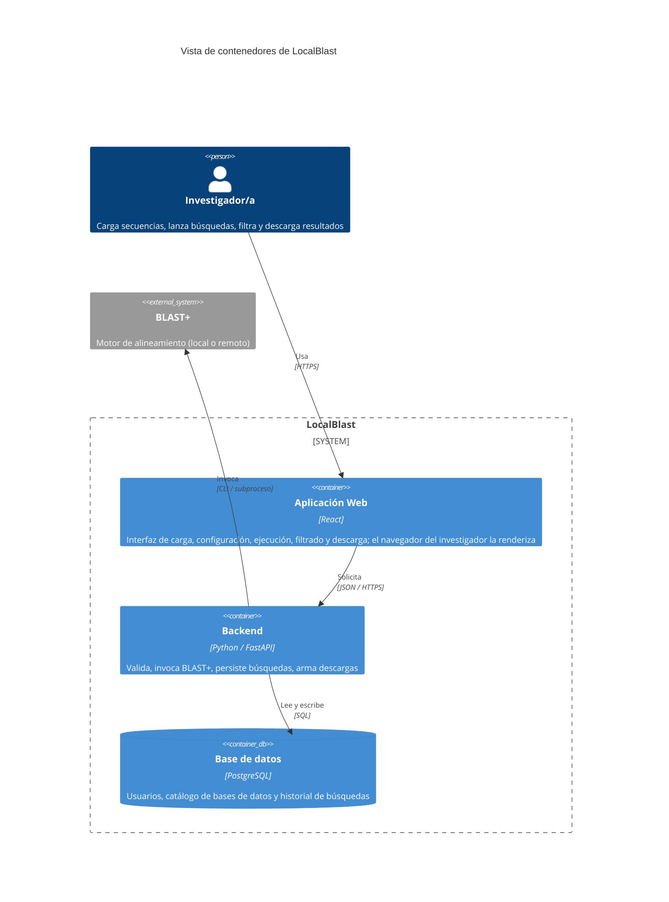
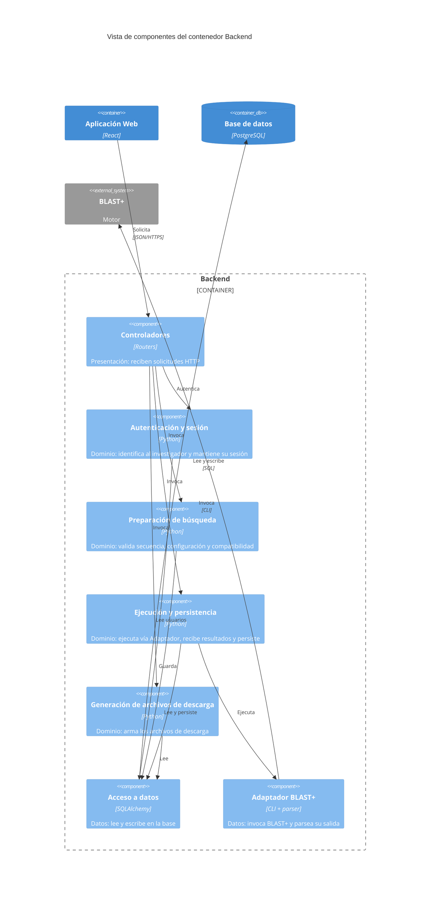
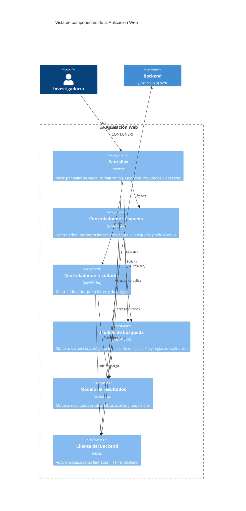
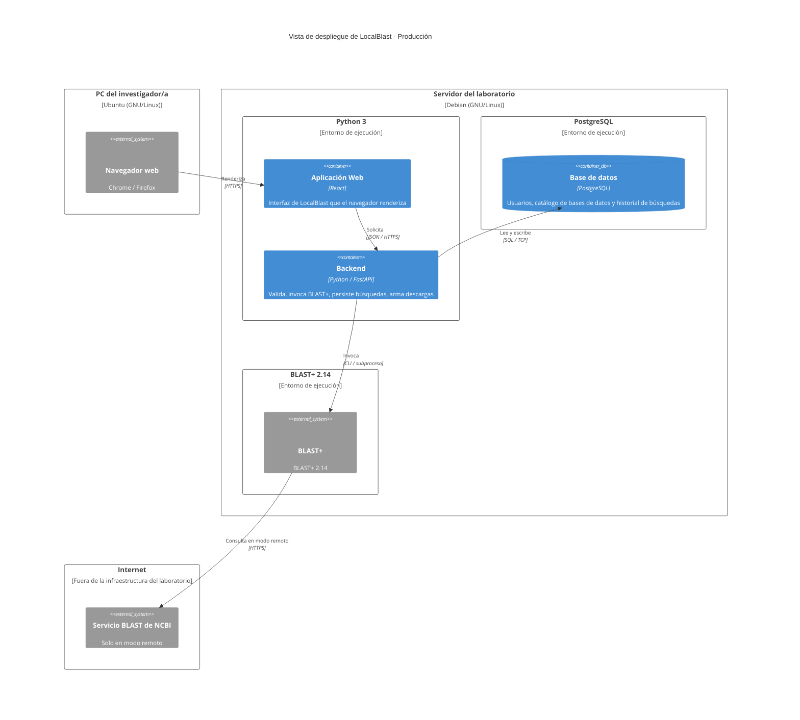

# Documento de Especificación de Arquitectura — LocalBlast

Este documento define la arquitectura de LocalBlast para los procesos de **ejecución de búsqueda BLAST (P1)** y **filtrado y entrega de resultados (P2)**. Representa las decisiones estructurales con las vistas de contenedores, de componentes y de despliegue del modelo C4 (Context, Containers, Components, Code), apoyándose en los escenarios de atributo de calidad del sistema para justificar cada decisión.

---

## Índice

1. [Introducción](#1-introducción)
2. [Restricciones](#2-restricciones)
3. [Contexto](#3-contexto)
4. [Drivers arquitectónicos](#4-drivers-arquitectónicos)
5. [Estrategia de solución](#5-estrategia-de-solución)
6. [Vista de contenedores](#6-vista-de-contenedores)
7. [Vistas de componentes](#7-vistas-de-componentes)
8. [Vista de despliegue](#8-vista-de-despliegue)
9. [Historias de usuario sobre las vistas](#9-historias-de-usuario-sobre-las-vistas)
10. [Decisiones de arquitectura](#10-decisiones-de-arquitectura)
11. [Trazabilidad](#11-trazabilidad)
12. [Glosario](#12-glosario)

---

## 1. Introducción

### 1.1 Propósito

Describir las decisiones estructurales de LocalBlast que atienden los escenarios de calidad críticos del sistema, y representarlas con las vistas de contenedores, de componentes y de despliegue del modelo C4. El documento es la línea base arquitectónica para el desarrollo iterativo del sistema.

### 1.2 Alcance

La arquitectura se define para los dos procesos del sistema que se desarrollan en el alcance actual:

- **P1 · Ejecutar búsqueda BLAST** (casos de uso CU001 a CU004).
- **P2 · Filtrar y entregar resultados** (casos de uso CU005 y CU006).

El proceso **P3 · Administrar bases de datos** queda fuera del alcance del cuatrimestre (ver [SRS, sección 1.4](../requeriments/srs.md#14-fuera-del-alcance)); su actor Administrador/a y el flujo de administración del catálogo no se detallan en estas vistas.

Se documenta una única vista de despliegue, la del entorno de producción. Las vistas de clases y de código no forman parte de este documento: se desarrollarán en una iteración posterior.

### 1.3 Audiencia

- **Equipo de desarrollo** de LocalBlast: usa el documento como guía de construcción.
- **Integrantes futuros** del proyecto: lo consultan al incorporarse para entender rápidamente la estructura del sistema y las razones de cada decisión.

### 1.4 Siglas

Las siglas se definen la primera vez que se usan en el cuerpo del documento. El glosario completo está en la [sección 12](#12-glosario).

---

## 2. Restricciones

| Tipo | Restricción | Cómo condiciona la arquitectura |
|---|---|---|
| **Tecnología externa obligatoria** | BLAST+ (versión 2.14 o posterior) está instalado en el servidor; LocalBlast lo usa, no lo empaqueta ni lo reimplementa | BLAST+ es un sistema externo que se invoca, no un contenedor propio |
| **Técnica** | En modo remoto es BLAST+ quien contacta a NCBI (flag `-remote`); LocalBlast no dialoga con NCBI | No hay relación directa entre LocalBlast y NCBI en los diagramas |
| **Técnica** | El catálogo de bases locales (D1) se puebla por fuera del sistema (P3 fuera de alcance) | El catálogo se lee, no se escribe desde la aplicación |
| **Técnica** | Los usuarios se dan de alta por fuera del sistema; solo hay autenticación básica | La arquitectura incorpora unicamente un aspecto transversal simple de autenticacion (login/logout) para proteger y vincular el historial a cada investigador |
| **Equipo** | El equipo se compone por 3 estudiantes | No se adoptan arquitecturas de alta complejidad operativa |
| **Tiempo** | Duración disponible: un cuatrimestre | Se acota el alcance arquitectonico a los procesos criticos (P1 y P2) |
| **Tecnológica** | Lenguajes y frameworks que el equipo ya domina | El equipo domina lenguajes como Python y bases de datos relacionales. Para el frontend el equipo adopta **React**, con una curva de aprendizaje asumible dentro del cuatrimestre pero tiene tiempo limitado para aprender otras tecnologias o lenguajes completamente nuevos |
| **Infraestructura** | El laboratorio cuenta con un único servidor (Debian GNU/Linux) donde BLAST+ ya está instalado; en su PC, el investigador solo dispone de un navegador web | No se instala nada en la PC del investigador y no hay otros servidores que operar: la Aplicación Web se aloja en el servidor y el navegador la descarga y ejecuta (ver [DA-08](#da-08--despliegue-en-un-único-servidor-del-laboratorio)) |

---

## 3. Contexto

El diagrama de contexto del sistema, con sus actores humanos (Investigador/a y Administrador/a) y el único sistema externo con el que dialoga (BLAST+), se desarrolla en el documento dedicado del repositorio:

👉 [`contexto-inicial.md`](contexto-inicial.md)

Para el alcance de este documento conviene retener dos aclaraciones del contexto, porque condicionan directamente las decisiones de arquitectura:

- **Local vs. remoto es transparente para LocalBlast.** La diferencia entre modo local y modo remoto queda enteramente del lado de BLAST+: en modo local lee índices del servidor del laboratorio; en modo remoto recibe la flag `-remote` y él mismo dialoga con NCBI. Nuestro sistema no implementa cliente HTTP hacia NCBI. Para LocalBlast, los dos modos son la misma operación —invocar BLAST+ con argumentos distintos— y la arquitectura los trata uniformemente.
- **Procesos profundizados.** Solo P1 y P2 entran en esta arquitectura; el actor Administrador/a y el proceso P3 quedan documentados en el contexto pero no se detallan acá.

---

**Descripción de elementos:**

| Elemento | Tipo | Responsabilidad |
|---|---|---|
| Investigador/a | Persona | Actor que hace uso del sistema |
| LocalBlast | Sistema | Sistema principal: interfaz web para ejecutar búsquedas con BLAST+ y trabajar con sus resultados |
| BLAST+ | Sistema externo | Sistema encargado de ejecutar los alineamientos locales |

---

## 4. Drivers arquitectónicos

### 4.1 Elección del atributo de calidad como driver

De los cinco atributos de calidad priorizados en el documento de [escenarios de calidad](../requeriments/quality-scenarios/escenarios-calidad.md), elegimos un único atributo como **driver arquitectónico**: **Interoperabilidad** (Compatibilidad / Interoperabilidad en ISO/IEC 25010:2023).

**Por qué este y no otro:**

- **Es condición de existencia del producto.** LocalBlast *es*, por definición, una interfaz gráfica para BLAST+. Toda ejecución —local o remota— termina siendo una invocación al binario externo y un parseo de su salida. Sin interoperabilidad con BLAST+ el sistema no existe; con los otros atributos, LocalBlast puede ser menos ágil, menos robusto o menos modular, pero sigue siendo un sistema.
- **Fue el atributo más crítico en la matriz comparativa**, con 9 victorias sobre 9 posibles. Ningún otro atributo lo venció en ningún par.
- **Es el atributo que más condiciona la estructura.** La elección de cómo invocar a BLAST+, dónde alojar al adaptador, cómo aislar las versiones del binario del resto del código, y cómo manejar la concurrencia de subprocesos son decisiones estructurales. Los otros atributos se materializan sobre todo *dentro* de las piezas que la interoperabilidad obliga a crear:
  - *Operabilidad* se juega en la Aplicación Web (parte del cliente del estilo que vamos a elegir), que valida el formulario y filtra los resultados sin ir al Backend (ver [DA-05](#da-05--validación-en-la-aplicación-web-además-de-en-el-servidor) y [DA-06](#da-06--filtrado-de-resultados-en-la-aplicación-web)). Su estructura interna sigue el patrón MVC (Modelo-Vista-Controlador; ver [DA-07](#da-07--patrón-mvc-en-la-aplicación-web)).
  - *Confidencialidad* se resuelve con TLS en el canal cliente-servidor y con el componente **Autenticación y sesión** del Backend (ver sección 7.1), que acompaña al estilo elegido pero no es un estilo propio.
  - *Tolerancia a fallos* se trata, en nuestro caso, delegando a BLAST+ el reporte de errores remotos y propagándolos sin reinterpretarlos: una responsabilidad del adaptador que la interoperabilidad exige crear.
  - *Modularidad* se obtiene en gran medida como consecuencia del patrón de Capas que la interoperabilidad justifica en el Backend (ver [sección 5.3.1](#531-capas-en-el-backend)): aislar BLAST+ en una capa dedicada deja el resto del sistema modular por diseño.

**Qué hacen los otros atributos en esta arquitectura.** No se descartan: se cubren mediante decisiones de implementación y restricciones de desarrollo dentro de los contenedores y componentes que la interoperabilidad justifica. La elección de un único driver es una **decisión de énfasis**, no una renuncia a los otros atributos.

### 4.2 Escenarios seleccionados como drivers

De los dos escenarios de interoperabilidad disponibles, ambos son drivers arquitectónicos: cada uno condiciona la estructura del sistema de un modo distinto.

#### EC-01 · Sobrecarga por concurrencia de invocaciones

| Campo | Contenido |
|---|---|
| **Estímulo** | Hasta cinco investigadores lanzan búsquedas concurrentes contra el sistema, mezclando modo local y remoto. |
| **Respuesta esperada** | Cada búsqueda corre como subproceso independiente de BLAST+; los resultados se entregan a la sesión que los originó, sin cruce con otras. |
| **Medida** | **Cero** cruces de resultados con hasta cinco búsquedas concurrentes. |
| **Por qué condiciona la estructura** | Exige un contenedor servidor capaz de alojar subprocesos independientes de BLAST+ (uno por búsqueda), con un componente dedicado a mantener la correspondencia entre subproceso y sesión del investigador. No se puede resolver dentro de un único componente, ni solo en la interfaz. |

#### EC-02 · Degradado por cambio menor de versión de BLAST+

| Campo | Contenido |
|---|---|
| **Estímulo** | El administrador de sistemas actualiza BLAST+ a una versión posterior que suma columnas o campos a la salida, sin coordinarlo con el equipo de desarrollo. |
| **Respuesta esperada** | El parser reconoce los campos conocidos, ignora los nuevos sin corromper los conocidos, no aborta y registra una advertencia. |
| **Medida** | **100%** de las búsquedas con salida "casi conocida" presentan intactos los campos obligatorios. |
| **Por qué condiciona la estructura** | Exige un componente adaptador aislado entre el núcleo del sistema y BLAST+. Los demás componentes **no deben saber** cómo es la salida real del binario, para que un cambio en esa salida no se propague por todo el código. Es una decisión de dependencia estructural, no de implementación interna. |

La especificación completa de ambos escenarios, con todos sus componentes (fuente del estímulo, estímulo, entorno, artefacto, respuesta, medida), está en la sección 5.1 de [`escenarios-calidad.md`](../requeriments/quality-scenarios/escenarios-calidad.md#51-interoperabilidad).

### 4.3 Restricciones del proyecto que acompañan a los drivers

Dos restricciones de la [sección 2](#2-restricciones) influyen directamente en cómo se traducen estos drivers en estructura:

- **Equipo de 3 personas con dedicación parcial.** Toda alternativa de arquitectura que atienda los drivers debe ser realizable con ese presupuesto. Esto descarta soluciones de alta complejidad operativa aunque sean técnicamente superiores (ver [DA-01](#da-01--estilo-base-cliente-servidor) y [DA-02](#da-02--patrón-capas-en-el-backend)).
- **Tecnologías dominadas o adoptables por el equipo.** El estilo elegido se realiza del lado servidor con Python (que el equipo ya domina) y, del lado cliente, con React (que el equipo adopta en el cuatrimestre).

---

## 5. Estrategia de solución

Esta sección recorre, en orden de abstracción decreciente, las decisiones de la arquitectura: tácticas → estilo → patrón → cobertura de los drivers.

### 5.1 Tácticas elegidas y descartadas

Para los dos drivers del punto anterior, las tácticas seleccionadas y descartadas del catálogo de interoperabilidad son:

| Táctica | Decisión | Por qué |
|---|---|---|
| **Adaptar la interfaz** | ✅ Seleccionada | Es la táctica central para EC-02. Un componente dedicado traduce entre la salida real de BLAST+ (texto tabular, XML, código de salida) y la estructura interna del sistema. Si BLAST+ cambia, cambia solo ese componente. |
| **Respetar estándares de comunicación** | ✅ Seleccionada | Entre el navegador y la Aplicación Web usamos HTTPS, y entre la Aplicación Web y el Backend, JSON sobre HTTPS (web estándar); con BLAST+ usamos la interfaz de línea de comandos estándar documentada en el manual oficial del motor. Nada propietario entre contenedores. |
| **Descubrir servicios** | ❌ Descartada | BLAST+ corre en el mismo servidor que el Backend, con ruta configurada. No hay universo de servicios por descubrir en tiempo de ejecución. |
| **Orquestar** | ❌ Descartada | No hay varios servicios que orquestar: hay un único sistema externo (BLAST+) invocado por una sola operación por búsqueda. |

**Tácticas de otros atributos adoptadas en apoyo a los drivers de interoperabilidad.** Dos tácticas que pertenecen a otros atributos sostienen el cumplimiento de los drivers:

| Táctica | Atributo origen | Por qué la adoptamos para interoperabilidad |
|---|---|---|
| **Introducir concurrencia** | Desempeño | Es la táctica que atiende el "cero cruces con cinco concurrentes" de EC-01. Lanzar cada búsqueda como subproceso independiente del binario BLAST+, con su propio contexto, es lo que garantiza el aislamiento. |
| **Encapsular** | Modificabilidad | Convierte al adaptador en el único punto de contacto con BLAST+. Es el mecanismo del patrón Capas (ver [sección 5.3.1](#531-capas-en-el-backend)) que materializa la táctica "adaptar la interfaz" dentro del contenedor Backend. |

### 5.2 Estilo arquitectónico base: Cliente-Servidor

**Decisión.** Adoptamos **Cliente-Servidor** como estilo arquitectónico base para todo el sistema (ver [DA-01](#da-01--estilo-base-cliente-servidor)).

**Por qué este estilo:**

- **BLAST+ corre del lado servidor por obligación.** El binario está instalado en el servidor del laboratorio, no en el navegador del investigador. Una vez aceptado que hace falta un servidor, cliente-servidor es la estructura más chica que lo acompaña: un cliente que presenta, un servidor que ejecuta BLAST+ y persiste. Cualquier otro estilo multiplica piezas sin agregar nada que resuelva mejor nuestros drivers.
- **Los dos drivers viven dentro de un único proceso servidor.** EC-01 se resuelve con subprocesos lanzados por el mismo Backend; EC-02 con un componente del mismo Backend. Ninguno exige estado distribuido, bus de eventos ni coordinación entre servicios. Un estilo que ofrezca esas capacidades sería un costo operativo pagado por algo que no necesitamos.
- **REST + JSON es el contrato estándar entre cliente y servidor.** Materializa la táctica "respetar estándares de comunicación" en el borde más visible del sistema y mantiene abierta la puerta a un segundo cliente —por ejemplo un script de automatización que un investigador quiera correr— sin tocar el servidor.
- **Permite evolucionar sin rehacer.** Si en el futuro aparece un escenario de procesamiento asincrónico pesado (lotes de 100 búsquedas, por ejemplo), se puede sumar una cola entre el servidor y un ejecutor dedicado sin romper el estilo base: cliente-servidor convive con esa evolución, mientras que elegir hoy un estilo más complejo nos obligaría a sostener su costo *desde el principio*.
- **El cliente se aloja en el servidor y el navegador lo renderiza.** La Aplicación Web corre en el mismo servidor que el Backend, y el navegador del investigador solo muestra lo que ella le entrega. En la PC del investigador no se instala nada, y actualizar la aplicación es actualizar un único lugar. Ver [DA-08](#da-08--despliegue-en-un-único-servidor-del-laboratorio) y la [sección 8](#8-vista-de-despliegue).

**Restricciones del estilo que la arquitectura respeta:**

| Restricción del estilo cliente-servidor | Cómo se respeta en LocalBlast |
|---|---|
| Los clientes no se comunican entre sí | Solo hay un cliente (Aplicación Web); no hay comunicación cliente-cliente. |
| El cliente no accede directamente a la base de datos | La Aplicación Web nunca habla SQL. Todo acceso a datos pasa por el Backend. |
| El servidor no inicia la comunicación con el cliente | El Backend responde a las solicitudes del cliente; no empuja mensajes al navegador por iniciativa propia (el progreso de la búsqueda se consulta desde el cliente). |
| El cliente inicia siempre la comunicación | Todas las flechas entre contenedores salen del cliente o del Backend hacia abajo (BD, BLAST+); ninguna sale de la BD o de BLAST+ hacia el cliente. |

Esto se verifica directamente en la vista de contenedores de la [sección 6](#6-vista-de-contenedores).

**Alternativas consideradas y descartadas:**

| Alternativa | Por qué se descartó |
|---|---|
| **Microservicios** | Exigen complejidad operativa (varios despliegues, red interna, consistencia entre bases) que un equipo de tres personas con dedicación parcial no sostiene. No hay en LocalBlast partes con ritmos de cambio o de escala tan distintos como para justificar el costo. |
| **Orientada a eventos** | Resuelve picos y tareas lentas con desacople asincrónico. Con cinco búsquedas concurrentes y usuarios de un laboratorio chico, el acople síncrono alcanza. Sumar una cola es un contenedor más que operar sin beneficio para los drivers actuales. Queda como opción para una iteración futura si los escenarios cambian. |
| **SOA con bus** | Pensada para integrar sistemas existentes. En LocalBlast hay un único sistema externo (BLAST+) sin ningún bus de por medio y sin otros sistemas con los que integrarse. |

### 5.3 Patrones arquitectónicos: Capas en el Backend y MVC en la Aplicación Web

**Decisión.** El estilo cliente-servidor organiza el sistema entero; los patrones organizan el interior de cada contenedor que aloja lógica propia. Los dos contenedores resuelven problemas de naturaleza distinta, por lo que adoptamos un patrón para cada uno: **Capas** en el Backend (ver [DA-02](#da-02--patrón-capas-en-el-backend)) y **MVC** (Modelo-Vista-Controlador) en la Aplicación Web (ver [DA-07](#da-07--patrón-mvc-en-la-aplicación-web)).

**Por qué no el mismo patrón en ambos.** La fuerza dominante en cada contenedor es distinta:

- El **Backend** recibe una solicitud, la procesa y dialoga con piezas que están fuera de él (la base de datos y BLAST+). Su flujo es una cadena vertical, y lo que más importa es aislar esas dependencias externas del resto del código. Eso es lo que modela Capas.
- La **Aplicación Web** es una interfaz interactiva: el investigador dispara acciones todo el tiempo (ajusta un campo, mueve un umbral, cancela una búsqueda) y la misma información —la configuración validada, los resultados— se muestra a la vez en varias partes de la pantalla. Su flujo es un ciclo (acción → cambio de estado → refresco de lo que se ve), y lo que más importa es separar lo que se muestra, la interpretación de la acción del usuario y la información que se maneja. Eso es lo que modela MVC.

#### 5.3.1 Capas en el Backend

**Por qué este patrón en el Backend:**

- **Materializa la táctica "adaptar la interfaz" de forma mínima y suficiente.** Pone al adaptador de BLAST+ en la capa de datos, aislado detrás de una interfaz interna estable. Las capas superiores (dominio, presentación) no saben cómo es la salida real del binario; invocan al adaptador por sus métodos. Un cambio en la salida de BLAST+ se absorbe en el adaptador y no se propaga.
- **Cumple con las restricciones del equipo.** Capas es más chico que Hexagonal (puertos y adaptadores) y es el que un equipo de tres personas puede sostener sin sobreingeniería. Hexagonal también funcionaría —y queda como opción si el proyecto crece— pero introduce más piezas (puertos explícitos, inversión de dependencias) que no son necesarias para los drivers actuales.
- **Satisface tácticas de modificabilidad por diseño.** Separar en capas con dependencias hacia abajo mejora modularidad y capacidad de prueba.

**Las tres capas del Backend:**

| Capa | Responsabilidad | Componentes |
|---|---|---|
| **Presentación** | Borde HTTP del servidor: recibe solicitudes, valida sintácticamente las entradas, serializa respuestas, devuelve códigos de estado. | **Controladores** |
| **Dominio** | Lógica del dominio del servidor. Tres componentes para las fases del ciclo de la búsqueda —antes de BLAST+, durante y después— más un componente para la identidad del investigador, que es parte del dominio porque el historial se corresponde a cada uno. | **Autenticación y sesión**, **Preparación de búsqueda**, **Ejecución y persistencia**, **Generación de archivos de descarga** |
| **Datos** | Acceso al mundo exterior del servidor: la base de datos y el binario BLAST+. | **Acceso a datos**, **Adaptador BLAST+** |

**Restricciones del patrón que el Backend respeta:**

| Restricción del patrón de Capas | Cómo se respeta |
|---|---|
| Una capa no depende de las superiores | Ningún componente de dominio llama a los Controladores; ningún componente de datos llama a los de dominio ni a los Controladores. |
| Cada capa usa solo a la inmediatamente inferior | Controladores → componentes de dominio → Acceso a datos / Adaptador BLAST+. |
| Cada capa tiene una responsabilidad clara | Ver la tabla de capas más arriba. Ninguna capa mezcla responsabilidades que correspondan a otra. |

Esto se verifica directamente en la vista de componentes de la [sección 7.1](#71-vista-de-componentes-del-backend): todas las flechas entre capas van en la misma dirección.

**Alternativas consideradas y descartadas para el Backend:**

| Alternativa | Por qué se descartó |
|---|---|
| **Hexagonal (puertos y adaptadores)** | Aísla más estrictamente, pero con un único sistema externo (BLAST+) las piezas extra (puertos explícitos, inversión de dependencias) son sobreingeniería para un equipo de 3 personas. Capas cubre nuestras necesidades con menos piezas. |
| **MVC** | Está pensado para separar presentación, lógica de interacción y modelo en una interfaz. El Backend no tiene vista que separar: responde datos en JSON. Por eso MVC se aplica al contenedor que sí tiene interfaz, la Aplicación Web (sección 5.3.2). |
| **Broker** | Resuelve desacoplar emisores y receptores con un intermediario de mensajes. En LocalBlast, el Backend y el adaptador de BLAST+ viven en el mismo proceso: una cola de mensajes sería un contenedor más que operar sin beneficio. |

#### 5.3.2 MVC en la Aplicación Web

**Por qué este patrón en la Aplicación Web:**

- **El estado que se muestra tiene un dueño explícito.** La secuencia cargada, la configuración y los resultados los muestran varias pantallas a la vez. MVC los pone en el **Modelo**, y la **Vista** se limita a mostrarlos. Esto es lo que permite cumplir los dos escenarios de operabilidad de la [sección 5.2 de `escenarios-calidad.md`](../requeriments/quality-scenarios/escenarios-calidad.md#52-operabilidad): el filtrado recalcula sobre el crudo guardado en el Modelo de resultados y la Vista se redibuja en menos de 1 segundo (escenario 1), y la marca "configuración validada / no validada" vive en el Modelo de búsqueda, de modo que cualquier cambio posterior la invalida y la Vista lo refleja de inmediato (escenario 2).
- **Separa piezas que cambian por motivos distintos.** Las pantallas cambian cuando se ajusta la usabilidad; las reglas de validación y de filtrado, cuando cambia el dominio; el flujo de interacción, cuando cambia el recorrido del investigador. Con MVC cada una puede modificarse sin tocar a las otras.
- **Las reglas se prueban sin pantallas.** Los Modelos no dependen de React ni de la Vista: la validación del formulario y el filtrado se prueban con datos, sin montar la interfaz.
- **Es un patrón pensado para interfaces.** Sostiene de forma natural acciones como cancelar una búsqueda en curso (HU09): el Controlador interpreta la acción, el Modelo refleja el nuevo estado de la ejecución y la Vista lo muestra.
- **Costo asumido:** más piezas que en una aplicación simple (dos Controladores y dos Modelos para cuatro pantallas). Aceptable porque cada pieza tiene una responsabilidad acotada y el equipo ya domina la idea de separar interacción y estado.

**Los roles del patrón en la Aplicación Web:**

| Rol | Componentes | Responsabilidad |
|---|---|---|
| **Vista** | **Pantallas** | Las pantallas que el investigador ve (carga, configuración, ejecución, resultados, descarga). Muestra el estado de los Modelos y delega las acciones del usuario en los Controladores. |
| **Controlador** | **Controlador de búsqueda**, **Controlador de resultados** | Interpretan las acciones del investigador y actualizan los Modelos. Cuando hace falta hablar con el servidor, lo hacen a través del Cliente del Backend. |
| **Modelo** | **Modelo de búsqueda**, **Modelo de resultados** | La información que maneja el cliente y sus reglas: secuencia, configuración, estado de la ejecución y reglas de validación (Modelo de búsqueda); resultados crudos, criterios de filtro y hits visibles (Modelo de resultados). |
| *(apoyo, fuera de la tríada)* | **Cliente del Backend** | Encapsula las llamadas HTTP al Backend. Solo lo usan los Controladores. |

**Variante adoptada.** Usamos MVC con **notificación de cambios por suscripción**: la Vista observa a los Modelos (en React, el estado que renderiza) y se vuelve a dibujar cuando cambian; los Modelos no conocen a la Vista ni a los Controladores. La Vista nunca modifica un Modelo directamente: toda acción pasa por un Controlador. Además dividimos Controlador y Modelo en dos (búsqueda y resultados) porque corresponden a los dos momentos del trabajo del investigador —preparar y lanzar la búsqueda, y explorar lo que devolvió— y comparten poco estado.

**Validación en el cliente, además de en el servidor.** Las reglas de validación del formulario viven en el Modelo de búsqueda, y el Controlador de búsqueda las aplica antes de pedir el envío al servidor. Esta decisión se documenta aparte en [DA-05](#da-05--validación-en-la-aplicación-web-además-de-en-el-servidor): el cliente valida para que el investigador reciba feedback inmediato y para reducir solicitudes al servidor por configuraciones mal armadas; el servidor **repite** la validación completa sobre todo lo que recibe, porque la validación del cliente puede ser salteada por un actor malicioso y, por lo tanto, no es un control de seguridad.

**Filtrado en el cliente.** El Modelo de resultados conserva los resultados crudos y calcula los hits visibles sin consultar al servidor (ver [DA-06](#da-06--filtrado-de-resultados-en-la-aplicación-web)).

**Restricciones del patrón que la Aplicación Web respeta:**

| Restricción del patrón MVC | Cómo se respeta |
|---|---|
| El Modelo no conoce a la Vista ni al Controlador | Ninguno de los dos Modelos llama a las Pantallas ni a los Controladores; la Vista los observa por suscripción, sin que ellos la referencien. |
| La Vista no modifica el Modelo directamente | Las Pantallas solo leen el estado de los Modelos; toda acción del usuario se delega en un Controlador. |
| El Controlador interpreta las acciones del usuario y actualiza el Modelo | Cada acción llega a un Controlador, que actualiza el Modelo correspondiente y, si hace falta, pide algo al Backend. |
| La Vista muestra el estado del Modelo | Las Pantallas se dibujan a partir del estado de los dos Modelos y no guardan reglas propias. |

Esto se verifica directamente en la vista de componentes de la [sección 7.2](#72-vista-de-componentes-de-la-aplicación-web): no sale ninguna flecha de los Modelos hacia la Vista ni hacia los Controladores.

**Alternativas consideradas y descartadas para la Aplicación Web:**

| Alternativa | Por qué se descartó |
|---|---|
| **Capas** | Es el patrón del Backend, pero en una interfaz no define quién es dueño del estado que varias pantallas muestran a la vez ni cómo se refresca lo que se ve cuando ese estado cambia. Cada refresco tendría que resolverse a mano atravesando capas, y el flujo cíclico de una interfaz no se parece a una cadena vertical. |
| **MVVM (Modelo-Vista-Modelo de Vista)** | Pensado para interfaces con estado complejo y enlace automático entre vista y modelo de vista. El estado de LocalBlast (una secuencia, una configuración y una tabla de resultados) es acotado: el enlace automático sumaría una pieza más y haría más difícil depurar, sin un beneficio proporcional. |

### 5.4 Aspectos transversales

Los aspectos transversales habituales en una arquitectura de este estilo —auditoría, gestión de excepciones, instrumentación— **no forman parte de esta entrega del documento de arquitectura**. Se incorporarán en una iteración posterior, cuando el sistema entre en una etapa en la que esas responsabilidades se vuelvan parte del alcance de desarrollo.

**La autenticación y gestión de sesión sí se modela, pero no como aspecto transversal**: se la trata como un componente de dominio propio en el Backend (**Autenticación y sesión**, visible en la [sección 7.1](#71-vista-de-componentes-del-backend)). La razón es que en LocalBlast la identidad del investigador no es solo un chequeo invisible al código: el historial de búsquedas se corresponde a cada investigador y esa correspondencia es parte del dominio del sistema, no un detalle de infraestructura. Modelarla como componente la vuelve explícita y permite trazar cómo cada efecto sobre la base de datos queda asociado al investigador correcto.

### 5.5 Tabla de cobertura

Cómo la arquitectura cubre cada driver y qué sacrifica a cambio.

| Driver | Táctica(s) | Dónde se materializa en la arquitectura | Qué se sacrifica |
|---|---|---|---|
| **EC-01** · Hasta cinco invocaciones concurrentes a BLAST+ sin cruce de resultados | Introducir concurrencia + encapsular | Componente **Adaptador BLAST+** del Backend: cada invocación corre como subproceso independiente, con identificador propio y referencia a la sesión que la lanzó (ver [DA-04](#da-04--ejecutar-cada-búsqueda-como-subproceso-independiente-de-blast)). En el despliegue, corre en el entorno Python 3 del Servidor del laboratorio, junto al entorno de BLAST+ (ver [sección 8](#8-vista-de-despliegue)). | Mayor consumo de CPU y memoria durante los picos de concurrencia (un proceso de BLAST+ por búsqueda). Aceptable en un laboratorio chico. |
| **EC-02** · Cambios menores de versión de BLAST+ sin romper el parseo de la salida | Adaptar la interfaz + encapsular | Componente **Adaptador BLAST+** del Backend: su parser reconoce los campos conocidos por nombre, ignora los no mapeados y descarta sin corromper los conocidos. El resto del sistema no cambia (ver [DA-03](#da-03--adaptador-blast-como-componente-dedicado-en-la-capa-de-datos)). En el despliegue, BLAST+ es un entorno de ejecución propio dentro del servidor, que mantiene el administrador de sistemas (ver [sección 8](#8-vista-de-despliegue)). | El equipo debe sostener el mapeo "campo de BLAST+ → entidad del dominio" al día en el adaptador cuando el motor evoluciona. Es un costo operativo bajo. |

**Conflictos entre tácticas: verificación.** Ninguna de las tácticas que adoptamos entra en conflicto con las demás. Encapsular el acceso a BLAST+ mejora modularidad y, al mismo tiempo, es lo que permite el aislamiento de concurrencia (cada subproceso lo lanza el mismo componente, con su propia correspondencia a la sesión). Respetar estándares de comunicación con el cliente (REST + JSON) no interfiere con el canal CLI hacia BLAST+ (son dos interfaces distintas, una por cada relación entre contenedores).

---

## 6. Vista de contenedores

### 6.1 Diagrama

### 6.2 Catálogo de contenedores

| Contenedor | Responsabilidad |
|---|---|
| **Aplicación Web** | Única interfaz humana del sistema. Formulario de carga, configuración, validación cliente y ejecución de búsquedas; vista de progreso y cancelación; tabla de resultados con filtros interactivos; disparo de descargas. No contiene lógica de dominio del servidor: toda operación sobre BLAST+ o sobre la base de datos la hace el Backend. Se aloja y se ejecuta en el Servidor del laboratorio, junto al Backend; el navegador del investigador solo la renderiza, por lo que en la PC del investigador no se instala nada (ver [sección 8](#8-vista-de-despliegue)). |
| **Backend** | Núcleo del sistema, del lado servidor. Expone una API REST que consume la Aplicación Web, recibe sus solicitudes HTTP, orquesta los servicios de dominio (carga, búsqueda, descarga), persiste en la base de datos y es el único contenedor que invoca a BLAST+. |
| **Base de datos** | Almacén único del sistema. Guarda los usuarios habilitados, el catálogo de bases de datos BLAST disponibles (D1 del DFD) y el historial de búsquedas con sus parámetros, timestamps y resultados crudos (D2 del DFD). |
| **BLAST+** *(sistema externo)* | Motor de alineamiento. En modo local lee índices del servidor del laboratorio; en modo remoto recibe la flag `-remote` y él mismo dialoga con NCBI. LocalBlast lo trata uniformemente en ambos modos: le pasa argumentos por CLI, recibe su salida por stdout y su código de retorno. |

**Por qué se llama Backend y no API.** La API REST es solo la interfaz que este contenedor expone hacia la Aplicación Web (corresponde a su capa de presentación). El contenedor es bastante más que eso: contiene la lógica del dominio, la persistencia y la integración con BLAST+. Llamarlo «API» daría a entender que es una simple fachada de acceso y llevaría a confundir el contenedor con su interfaz; «Backend» nombra su rol en el sistema, el lado servidor. En este documento, «API» (o «API REST») se refiere únicamente a esa interfaz.

### 6.3 Catálogo de relaciones

| Origen → Destino | Qué se comunica |
|---|---|
| Investigador/a → Aplicación Web | Interacciones de la UI: carga de archivo, formulario, botones. |
| Aplicación Web → Backend | Solicitudes REST: carga de secuencia (ya validada en el cliente), configuración, ejecución, consulta de progreso, obtención de resultados y descarga. |
| Backend → Base de datos | Lectura y escritura: usuarios para asociar sesión, catálogo para listar bases disponibles, historial para persistir cada búsqueda ejecutada. |
| Backend → BLAST+ | Invocación como subproceso con los argumentos de la búsqueda (programa, modo, base de datos, parámetros, ruta a secuencia query). Lee la salida por stdout. |

### 6.4 Comprobación del estilo cliente-servidor

Verificando sobre el diagrama las reglas de la [sección 5.2](#52-estilo-arquitectónico-base-cliente-servidor):

- ✅ No hay flechas entre clientes (solo hay un cliente).
- ✅ No hay flechas de la base de datos hacia la Aplicación Web (toda escritura y lectura pasa por el Backend).
- ✅ No hay flechas del Backend hacia la Aplicación Web (el servidor no inicia la comunicación).
- ✅ El cliente inicia siempre la comunicación: la cadena Investigador/a → Web → Backend → BD y Web → Backend → BLAST+ fluye hacia abajo.

---

## 7. Vistas de componentes

Se hace una vista de componentes por cada contenedor del sistema con lógica propia: la **Aplicación Web** y el **Backend**. La Base de datos no se profundiza porque es un almacén sin lógica propia.

### 7.1 Vista de componentes del Backend

> **Nota sobre la disposición.** La sintaxis C4 de Mermaid tiene limitaciones de layout conocidas: coloca los contenedores vecinos (Aplicación Web, Base de datos, BLAST+) por encima del límite del Backend aunque las relaciones salgan hacia abajo. Las flechas que van del Backend a la Base de datos y a BLAST+ se leen entonces como "sube hacia el contenedor vecino que está arriba" en el dibujo, aunque conceptualmente la dependencia es *desde* el Backend *hacia* esos vecinos. Por el mismo motivo, las etiquetas sobre las flechas se mantuvieron cortas (un verbo cada una) y el detalle completo —qué comunica cada relación— vive en el catálogo de la [sección 7.1.2](#712-catálogo-de-relaciones-del-backend).

#### 7.1.1 Catálogo de componentes del Backend

| Componente | Capa | Responsabilidad |
|---|---|---|
| **Controladores** | Presentación | Exponen la interfaz HTTP del Backend: rutas, validación sintáctica de entradas, serialización de respuestas, códigos de estado. No contienen lógica del dominio: delegan en los componentes de dominio. En cada solicitud, antes de invocar a cualquier otro componente de dominio, consultan a **Autenticación y sesión** para saber qué investigador la originó y le pasan ese identificador como parámetro a los demás servicios. |
| **Autenticación y sesión** | Dominio | Verifica la identidad del investigador en cada solicitud y mantiene su sesión activa durante el trabajo con el sistema. Expone el "investigador actual" al resto del dominio para que los efectos sobre la base de datos (la secuencia que guarda Preparación de búsqueda, la búsqueda que persiste Ejecución y persistencia, el historial que lee Generación de archivos de descarga) queden asociados al investigador correcto. **Por qué está en el documento aunque no haya una historia de usuario propia**: el historial de las búsquedas se corresponde a cada investigador y esa correspondencia es parte del dominio del sistema; sin este componente no se puede explicar cómo se mantiene la correspondencia entre búsqueda e investigador. |
| **Preparación de búsqueda** | Dominio | Todo lo que ocurre **antes** de invocar a BLAST+. Valida sintácticamente la secuencia query (RF-01, RF-02; implementa CU001) e infiere el alfabeto (ADN / ARN / proteína); recibe la configuración de la búsqueda (RF-03 a RF-06; CU002) y la valida semánticamente verificando compatibilidad entre programa, tipo de query y tipo de base de datos (RF-07; CU003). Esta validación repite la que ya hizo el cliente, porque la del cliente no es un control de confianza. |
| **Ejecución y persistencia** | Dominio | Lo que ocurre **durante** y **al cierre** de la ejecución de BLAST+. Lanza la ejecución asíncrona con posibilidad de cancelación pidiéndosela al Adaptador BLAST+ (RF-08), recibe los resultados crudos, los entrega al cliente para su presentación (RF-09) y persiste la búsqueda completa en el historial (RF-10); implementa CU004. Nunca llama directamente a BLAST+: lo hace a través del Adaptador. |
| **Generación de archivos de descarga** | Dominio | Lo que ocurre **después** de la búsqueda, cuando el investigador se lleva lo encontrado. Arma los archivos descargables en los formatos soportados (RF-12; CU006) a partir de los resultados persistidos y de los hits visibles que indica el cliente, e incluye los metadatos de la búsqueda y de los filtros aplicados. Verifica que la búsqueda sea del investigador actual y que los hits pertenezcan a ella. |
| **Acceso a datos** | Datos | Único punto de acceso del Backend a la base de datos. Hace la traducción entre entidades del dominio y filas de SQL; agrupa las operaciones en transacciones cuando corresponde. |
| **Adaptador BLAST+** | Datos | **Componente clave de los drivers de interoperabilidad.** Único punto de contacto con BLAST+. Lanza cada invocación como subproceso independiente, mantiene la correspondencia entre subproceso y sesión que lo originó (EC-01), parsea la salida reconociendo los campos conocidos y descartando los no mapeados sin corromper los conocidos (EC-02). |

#### 7.1.2 Catálogo de relaciones del Backend

| Origen → Destino | Verbo en el diagrama | Qué comunica realmente |
|---|---|---|
| **Dentro del contenedor Backend** (llamadas internas, sin protocolo) | | |
| Controladores → Autenticación y sesión | Autentica | En cada solicitud, antes de delegar en otro componente de dominio, los Controladores le piden a Autenticación y sesión que verifique quién es el investigador. Si no hay sesión válida, los Controladores responden con 401/403 sin invocar nada más. |
| Controladores → Preparación de búsqueda | Invoca | Delega la carga y validación sintáctica de la secuencia, la recepción de la configuración y su validación semántica. Pasa el identificador del investigador que ya obtuvo de Autenticación y sesión. |
| Controladores → Ejecución y persistencia | Invoca | Delega la ejecución asíncrona de la búsqueda validada, la consulta del estado de la ejecución (progreso y, al terminar, resultados), la recepción de resultados crudos y la persistencia en el historial. Pasa el identificador del investigador. |
| Controladores → Generación de archivos de descarga | Invoca | Delega la generación del archivo de descarga. Pasa el identificador del investigador para que la lectura del historial se restrinja a sus propias búsquedas. |
| Autenticación y sesión → Acceso a datos | Lee usuarios | Lee los registros de usuarios para validar credenciales y, cuando corresponde, las sesiones vigentes. |
| Preparación de búsqueda → Acceso a datos | Guarda | Guarda la secuencia cargada (asociada al investigador actual) y lee el catálogo de bases de datos disponibles para validar la configuración. |
| Ejecución y persistencia → Acceso a datos | Lee y persiste | Lee la búsqueda validada que se va a ejecutar o cuyo estado se consulta, siempre acotada al investigador actual, y persiste cada búsqueda ejecutada en el historial (parámetros, timestamps, resultados crudos), asociada al investigador que la originó. |
| Ejecución y persistencia → Adaptador BLAST+ | Ejecuta | Pide la ejecución de una búsqueda validada, pasando la configuración completa. |
| Generación de archivos de descarga → Acceso a datos | Lee | Lee los resultados crudos de una búsqueda del historial —filtrada al investigador actual— para prepararlos para descarga. |
| **Hacia contenedores vecinos** (con protocolo) | | |
| Aplicación Web → Controladores | Solicita | Solicitud REST (JSON / HTTPS). |
| Acceso a datos → Base de datos | Lee y escribe | Consultas y transacciones (SQL). |
| Adaptador BLAST+ → BLAST+ | Invoca | Invocación por línea de comandos; captura de stdout / stderr y código de salida (CLI / subproceso). |

> **Sobre por qué Preparación / Ejecución / Generación no tienen flecha hacia Autenticación y sesión en el diagrama.** El identificador del investigador viaja como **parámetro** desde los Controladores hacia esos tres servicios, y de ahí hacia Acceso a datos; no viaja como una invocación de vuelta a Autenticación y sesión. Es decir, el "quién soy" se obtiene **una sola vez** por solicitud (en el borde del Backend, cuando los Controladores autentican) y después se propaga como dato por el resto del flujo. Dibujar tres flechas más —una desde cada servicio hacia Autenticación y sesión— ensuciaría el diagrama sin agregar información: no hay una invocación real.

#### 7.1.3 Comprobación del patrón de capas en el Backend

Verificando sobre el diagrama las restricciones de la [sección 5.3.1](#531-capas-en-el-backend):

- ✅ **Ninguna capa depende de las superiores.** Los componentes de datos (Acceso a datos, Adaptador BLAST+) no llaman a los componentes de dominio ni a los Controladores. Los componentes de dominio no llaman a los Controladores. Todas las flechas de dominio bajan hacia la capa de datos; todas las flechas de presentación bajan hacia la capa de dominio.
- ✅ **No se saltean capas.** Los Controladores no llaman a Acceso a datos ni al Adaptador BLAST+ directamente: delegan en los componentes de dominio.
- ✅ **Cada capa tiene su responsabilidad propia** (ver [sección 5.3.1](#531-capas-en-el-backend)).

### 7.2 Vista de componentes de la Aplicación Web

> **Nota sobre la lectura.** Las flechas "Muestra" van de la Vista hacia los Modelos y son de lectura: la Vista se suscribe al estado del Modelo y se redibuja cuando cambia. No existe la flecha inversa porque, en esta variante de MVC, los Modelos no conocen a la Vista (ver [sección 5.3.2](#532-mvc-en-la-aplicación-web)).

#### 7.2.1 Catálogo de componentes de la Aplicación Web

| Componente | Rol MVC | Responsabilidad |
|---|---|---|
| **Pantallas** | Vista | Las pantallas que el investigador ve y manipula: carga de la secuencia (HU01), configuración y validación visible del formulario (HU03 a HU07), progreso y cancelación de la ejecución y tabla de resultados (HU08 a HU10), filtros interactivos (HU11), controles de descarga (HU12, HU13). Se dibujan a partir del estado de los Modelos y se redibujan cuando este cambia. Capturan las acciones del investigador y las delegan en los Controladores. No contienen reglas del dominio ni llaman al Backend. |
| **Controlador de búsqueda** | Controlador | Interpreta las acciones del investigador sobre la búsqueda: cargar la secuencia, ajustar la configuración, pedir la validación, ejecutar y cancelar. Actualiza el Modelo de búsqueda y, si este indica que la configuración es válida, arma el envío y se lo pide al Cliente del Backend. Con las respuestas del servidor actualiza el estado de ejecución (progreso, cancelación, error) y, al terminar la búsqueda, carga los resultados crudos en el Modelo de resultados. |
| **Controlador de resultados** | Controlador | Interpreta las acciones sobre los resultados: modificar o quitar un filtro, elegir el formato y pedir la descarga. Actualiza los criterios de filtro en el Modelo de resultados (RF-11; CU005). Para descargar, arma el pedido con la búsqueda, el formato y los hits visibles y se lo pide al Cliente del Backend (RF-12; CU006). |
| **Modelo de búsqueda** | Modelo | Información de la búsqueda que se está preparando o ejecutando: secuencia, configuración, marca "validada / no validada" y estado de ejecución. Contiene las **reglas de validación**: formato sintáctico de la secuencia, rangos de los parámetros pre-búsqueda y compatibilidad entre programa BLAST, tipo de secuencia y tipo de base de datos (RF-01 a RF-07; CU001 a CU003). Cualquier cambio en un campo relevante posterior a la validación invalida la marca. |
| **Modelo de resultados** | Modelo | Conserva en memoria los resultados crudos recibidos del servidor y el identificador de la búsqueda a la que pertenecen, los criterios de filtro activos (identidad, cobertura, E-value y taxonomía) y calcula los **hits visibles**, siempre desde el crudo original y sin consultar al servidor. |
| **Cliente del Backend** | Apoyo (fuera de la tríada) | Encapsula el detalle de las llamadas HTTP (URL base, serialización de JSON, manejo de códigos de estado). Es la única pieza del cliente que conoce la forma concreta de la interfaz REST del Backend. Solo lo usan los Controladores. |

#### 7.2.2 Catálogo de relaciones de la Aplicación Web

| Origen → Destino | Verbo en el diagrama | Qué comunica realmente |
|---|---|---|
| **Dentro de la Aplicación Web** (llamadas internas, sin protocolo) | | |
| Pantallas → Controlador de búsqueda | Delega | Las acciones del investigador sobre la carga, la configuración, la validación, la ejecución y la cancelación de la búsqueda. |
| Pantallas → Controlador de resultados | Delega | Los cambios de filtro, la elección del formato y el pedido de descarga. |
| Pantallas → Modelo de búsqueda | Muestra | Lectura del estado de la búsqueda (campos, marca de validación, progreso, errores) para dibujarlo y redibujarlo cuando cambia. Es solo de lectura. |
| Pantallas → Modelo de resultados | Muestra | Lectura de los hits visibles y de los filtros activos para dibujar la tabla. Es solo de lectura. |
| Controlador de búsqueda → Modelo de búsqueda | Actualiza | Escribe en el modelo lo que el investigador cargó o cambió, y le pide validar según las reglas del modelo. |
| Controlador de búsqueda → Modelo de resultados | Carga resultados | Al terminar la búsqueda, entrega al Modelo de resultados los resultados crudos recibidos y el identificador de la búsqueda. |
| Controlador de resultados → Modelo de resultados | Actualiza filtros | Cambia los criterios de filtro; el modelo recalcula los hits visibles desde el crudo. |
| Controlador de búsqueda → Cliente del Backend | Envía | Carga de la secuencia, configuración, ejecución, consulta de progreso, cancelación y obtención de resultados. |
| Controlador de resultados → Cliente del Backend | Pide descarga | Pedido de descarga con el identificador de la búsqueda, el formato y los hits visibles. |
| **Hacia actores y contenedores vecinos** | | |
| Investigador/a → Pantallas | Usa | Interacciones de la UI mediante el navegador. |
| Cliente del Backend → Backend | Solicita | Solicitud REST (JSON / HTTPS). |

#### 7.2.3 Comprobación del patrón MVC en la Aplicación Web

Verificando sobre el diagrama las restricciones de la [sección 5.3.2](#532-mvc-en-la-aplicación-web):

- ✅ **El Modelo no conoce a la Vista ni al Controlador.** No sale ninguna flecha desde el Modelo de búsqueda ni desde el Modelo de resultados.
- ✅ **La Vista no modifica el Modelo directamente.** Las únicas flechas de las Pantallas hacia los Modelos son de lectura ("Muestra"); toda acción se delega en un Controlador.
- ✅ **El Controlador interpreta las acciones y actualiza el Modelo.** Cada Controlador tiene flechas "Actualiza" hacia el Modelo que le corresponde.
- ✅ **La Vista muestra el estado del Modelo.** Las Pantallas dependen de los dos Modelos y no guardan reglas propias.
- ✅ **El Cliente del Backend solo es usado por los Controladores.** Ni la Vista ni los Modelos lo conocen, de modo que el detalle de la interfaz REST queda aislado en un único componente.

---

## 8. Vista de despliegue

Esta vista muestra en qué infraestructura se ejecuta cada contenedor de la [sección 6](#6-vista-de-contenedores) en el **entorno de producción**: el entorno real en el que LocalBlast funciona para los investigadores. No se documentan otros entornos.

### 8.1 Diagrama

> **Nota sobre la notación.** Mermaid no admite nodos vacíos: todo nodo debe contener al menos un elemento. Como la PC del investigador no ejecuta ningún contenedor de LocalBlast (solo el navegador), el navegador se dibuja como un elemento de software de terceros (`System_Ext`) dentro del nodo. **No es un contenedor nuevo ni forma parte del sistema que construimos**: es el programa que renderiza la Aplicación Web.

### 8.2 Cómo se despliega la Aplicación Web

La Aplicación Web es un contenedor de la vista de contenedores, y en producción **se aloja y se ejecuta en el Servidor del laboratorio** junto con el Backend, dentro del entorno de ejecución Python 3.

La **PC del investigador solo tiene un navegador web**, que se conecta a la Aplicación Web por HTTPS y renderiza lo que ella le entrega. **El navegador no se comunica con el Backend**: cuando el investigador carga, valida o ejecuta una búsqueda, es la Aplicación Web la que le envía al Backend las solicitudes REST (JSON sobre HTTPS) y la que recibe sus respuestas. El investigador no instala nada en su máquina.

Esto es coherente con el estilo cliente-servidor ([sección 5.2](#52-estilo-arquitectónico-base-cliente-servidor)): cada cliente inicia siempre la comunicación, el navegador con la Aplicación Web y la Aplicación Web con el Backend. La decisión se justifica en [DA-08](#da-08--despliegue-en-un-único-servidor-del-laboratorio).

### 8.3 Catálogo de nodos

| Nodo | Tipo o tecnología | Qué ejecuta o aloja | Artefactos | Instancias | Escenario o decisión que lo justifica |
|---|---|---|---|---|---|
| **PC del investigador/a** | Ubuntu (GNU/Linux), con navegador web | Solo el navegador, que renderiza la Aplicación Web. No tiene contenedores de LocalBlast instalados. | — | Una por investigador (hasta diez concurrentes) | [DA-01](#da-01--estilo-base-cliente-servidor) y [DA-08](#da-08--despliegue-en-un-único-servidor-del-laboratorio): es el cliente del estilo; no requiere instalar nada, solo un navegador. |
| **Servidor del laboratorio** | Debian (GNU/Linux) | Los tres entornos de ejecución siguientes. | — | 1 | [DA-08](#da-08--despliegue-en-un-único-servidor-del-laboratorio): un único servidor, ya existente, donde BLAST+ está instalado. |
| **Python 3** *(dentro del servidor)* | Entorno de ejecución | **Backend** y **Aplicación Web** (ejecuta los dos) | Paquete Python `localblast-api` y sus bibliotecas; código de la Aplicación Web (HTML, JS y CSS) | 1 | EC-01 y [DA-04](#da-04--ejecutar-cada-búsqueda-como-subproceso-independiente-de-blast): el Backend lanza cada búsqueda como subproceso local de BLAST+ en este mismo servidor. |
| **PostgreSQL** *(dentro del servidor)* | Entorno de ejecución | **Base de datos** | Base de datos de LocalBlast: usuarios, catálogo de bases de datos e historial de búsquedas | 1 | [DA-08](#da-08--despliegue-en-un-único-servidor-del-laboratorio): comparte el servidor para no sumar un nodo que operar; solo el Backend accede a ella (restricción del estilo, [sección 5.2](#52-estilo-arquitectónico-base-cliente-servidor)). |
| **BLAST+ 2.14** *(dentro del servidor)* | Entorno de ejecución | **BLAST+** (sistema externo instalado, no un contenedor propio) | Binarios de BLAST+ (`blastn`, `blastp`, `blastx`, etc.) y secuencias locales del laboratorio (las bases de datos BLAST locales, cuyas rutas registra el catálogo de la Base de datos) | 1 | Restricción de la [sección 2](#2-restricciones) y EC-02: lo instala y actualiza el administrador de sistemas, por lo que su versión puede cambiar sin coordinarse con el equipo; el Adaptador BLAST+ absorbe esos cambios. |

El **Servicio BLAST de NCBI** no es un nodo de nuestra infraestructura: es un sistema externo, usado solo en modo remoto. En el diagrama se dibuja dentro de un nodo **Internet** solo para ubicarlo fuera del servidor del laboratorio; ese nodo no lo operamos ni lo desplegamos nosotros.

### 8.4 Catálogo de relaciones del despliegue

| Origen → Destino | Qué se comunica | Protocolo | Dónde ocurre | Corresponde en la vista de contenedores a |
|---|---|---|---|---|
| Navegador web → Aplicación Web | Las pantallas que el navegador renderiza y las acciones del investigador sobre ellas | HTTPS | Red entre la PC del investigador y el servidor | Investigador/a → Aplicación Web (el investigador usa la aplicación a través del navegador) |
| Aplicación Web → Backend | Solicitudes REST con los datos de la búsqueda, el progreso, los resultados y las descargas | JSON / HTTPS | Local, dentro del servidor (en el entorno Python 3) | Aplicación Web → Backend |
| Backend → Base de datos | Lectura y escritura de usuarios, catálogo e historial | SQL / TCP | Local, dentro del servidor (de Python 3 a PostgreSQL) | Backend → Base de datos |
| Backend → BLAST+ | Invocación como subproceso con los argumentos de la búsqueda; lectura de la salida | CLI / subproceso | Local, dentro del servidor (de Python 3 a BLAST+ 2.14) | Backend → BLAST+ |
| BLAST+ → Servicio BLAST de NCBI | Búsqueda remota, solo cuando el investigador elige el modo remoto | HTTPS | Salida del servidor hacia Internet | No figura en la vista de contenedores: la origina BLAST+, no LocalBlast (ver nota siguiente) |

> **Por qué NCBI aparece acá y no en la vista de contenedores.** LocalBlast no dialoga con NCBI: en modo remoto es BLAST+ quien lo contacta ([sección 2](#2-restricciones)), y por eso no hay relación entre LocalBlast y NCBI en la vista de contenedores. En el despliegue sí importa dónde nace ese tráfico: sale del servidor del laboratorio, de modo que el servidor necesita salida HTTPS a Internet para que el modo remoto funcione.

### 8.5 Qué se ve en esta vista

- **EC-01 (concurrencia).** Backend y BLAST+ comparten nodo: cada búsqueda es un subproceso del sistema operativo del servidor, sin red de por medio. Con cinco búsquedas concurrentes habrá cinco procesos de BLAST+ en el mismo servidor.
- **EC-02 (cambio de versión de BLAST+).** BLAST+ es un entorno de ejecución propio dentro del servidor, mantenido por el administrador de sistemas. El único contacto con él es el Backend (a través del Adaptador BLAST+), y por eso una actualización no se propaga a los demás nodos.
- **Qué cruza la red.** Solo hay un cruce de red entre nodos propios: el del navegador de la PC del investigador hacia la Aplicación Web en el servidor, siempre por HTTPS. El Backend no queda expuesto a la PC: solo lo invoca la Aplicación Web, dentro del servidor. Todo lo demás también es comunicación local dentro del servidor. Al servidor se le suma, en modo remoto, la salida hacia NCBI.

**Sacrificios asumidos.** Con un único servidor, si el servidor cae se detienen el Backend, la base de datos y BLAST+, y el investigador no puede ni abrir la aplicación; es el mismo punto único de falla que ya aceptó [DA-01](#da-01--estilo-base-cliente-servidor). Además, el Backend, la base de datos y los procesos de BLAST+ comparten procesador y memoria: durante un pico de cinco búsquedas concurrentes puede degradarse el tiempo de respuesta del Backend y de la base. Si esto ocurriera en la práctica, el paso siguiente sería sacar la base de datos a un nodo propio. El grupo acepta estos riesgos para no multiplicar la infraestructura que debe operar y lo registra en DA-08.

### 8.6 Comprobación de consistencia con la vista de contenedores

- ✅ **Todo contenedor aparece una vez, dentro de un nodo:** Aplicación Web y Backend en el entorno Python 3, Base de datos en el entorno PostgreSQL.
- ✅ **No se crean contenedores nuevos.** El navegador y BLAST+ se dibujan como software de terceros (`System_Ext`), igual que BLAST+ en la vista de contenedores.
- ✅ **Las relaciones corresponden a las de la vista de contenedores** y llevan el mismo protocolo (con el detalle de transporte "SQL / TCP"). El navegador solo se relaciona con la Aplicación Web, nunca con el Backend; la única relación adicional, BLAST+ → NCBI, se explica en la nota de la [sección 8.4](#84-catálogo-de-relaciones-del-despliegue).
- ✅ **Un solo entorno (producción) y dos niveles de anidamiento** (servidor → entorno de ejecución).
- ✅ **Cada nodo tiene nombre y tecnología**, y el número de instancias figura en el catálogo de nodos.

> **Nota sobre la disposición.** Como en las otras vistas, la disposición automática de Mermaid puede superponer las etiquetas de las flechas. Si ocurre al renderizar, se corrige con `UpdateRelStyle(origen, destino, $offsetX="…", $offsetY="…")` sin cambiar el contenido del diagrama.

---

## 9. Historias de usuario sobre las vistas

Esta sección recorre, sobre las vistas, el *Given-When-Then* de cuatro historias representativas (carga, ejecución con BLAST+, filtrado y descarga). El objetivo es verificar que cada paso del criterio de aceptación tiene un lugar donde ocurre en la arquitectura.

| HU | Criterio recorrido | Contenedores que atraviesa | Componentes involucrados |
|---|---|---|---|
| **HU01_CU001_B** · Carga de la secuencia FASTA | **Given** un archivo FASTA bien formado · **When** el investigador lo sube · **Then** el sistema lo deja disponible con alfabeto inferido | Aplicación Web → Backend | **Web:** Pantallas → Controlador de búsqueda (actualiza y valida con el Modelo de búsqueda el formato FASTA en el cliente) → Cliente del Backend · **Backend:** Controladores → Preparación de búsqueda (repite la validación sintáctica e infiere el alfabeto en memoria; la secuencia queda en la sesión y no se persiste) |
| **HU08_CU004_B** · Ejecución asíncrona de la búsqueda y presentación de sus resultados | **Given** una búsqueda ya configurada y validada · **When** el investigador presiona "Ejecutar" · **Then** la interfaz muestra progreso y permanece navegable; al terminar presenta la tabla de alineamientos y la búsqueda queda persistida en el historial | Aplicación Web → Backend → BLAST+ (ejecución) · Backend → Base de datos (persistencia) | **Web:** Pantallas → Controlador de búsqueda → Cliente del Backend (el progreso se refleja en el Modelo de búsqueda y las Pantallas lo muestran) → Controlador de búsqueda → Modelo de resultados (carga los resultados crudos; las Pantallas dibujan la tabla) · **Backend:** Controladores → Ejecución y persistencia → Adaptador BLAST+ (invoca BLAST+ como subproceso independiente, EC-01) → Ejecución y persistencia → Acceso a datos |
| **HU11_CU005_B** · Filtrado post-búsqueda | **Given** resultados crudos ya devueltos por BLAST+ · **When** el investigador modifica los umbrales de filtro · **Then** la tabla se refresca sobre el crudo original, en menos de 1 segundo | Aplicación Web | **Web:** Pantallas → Controlador de resultados → Modelo de resultados (recalcula los hits visibles desde el crudo; las Pantallas se redibujan al cambiar) · **Backend:** no interviene |
| **HU12_CU006_B** · Descarga | **Given** una tabla con o sin filtros aplicados · **When** el investigador elige el formato y presiona "Descargar" · **Then** recibe un archivo con los hits visibles y los metadatos de la búsqueda | Aplicación Web → Backend → Base de datos | **Web:** Pantallas → Controlador de resultados (arma el pedido con los hits visibles del Modelo de resultados) → Cliente del Backend · **Backend:** Controladores → Generación de archivos de descarga → Acceso a datos |

**Lectura del escenario de EC-02 sobre las vistas.** Cuando BLAST+ devuelve una salida con un campo adicional no mapeado, la respuesta del sistema queda contenida enteramente dentro del **Adaptador BLAST+**: reconoce los campos conocidos, descarta el nuevo sin romper los conocidos, y devuelve los resultados a Ejecución y persistencia como si el formato fuera el esperado. Ni los Controladores, ni los otros componentes de dominio, ni la Aplicación Web se enteran del cambio. Esta es la propiedad arquitectónica concreta que el patrón de Capas, con el Adaptador BLAST+ en su capa de datos, aporta al Backend.

**Lectura del escenario de EC-01 sobre las vistas.** Cinco investigadores lanzan búsquedas concurrentes: cada una entra como una solicitud HTTP distinta a los Controladores, llega a Ejecución y persistencia, que a su vez le pide al Adaptador BLAST+ ejecutar la búsqueda. El Adaptador lanza un subproceso independiente de BLAST+ por cada una, con su propio identificador y una referencia a la sesión; cuando cada subproceso termina, el Adaptador entrega el resultado a Ejecución y persistencia, que lo guarda en el historial correspondiente y lo devuelve a los Controladores que respondieron esa solicitud. No hay un punto en el que los resultados de dos búsquedas puedan cruzarse porque no comparten ni estado interno ni canal.

**Lectura del escenario de filtrado sobre las vistas.** La Aplicación Web recibe la tabla cruda una sola vez, y el Modelo de resultados recalcula los hits visibles en cada cambio de umbral que le informa el Controlador de resultados; las Pantallas se redibujan al observar el cambio, sin pasar por el Backend ni por la base de datos. Por eso el tiempo de respuesta no depende de la red ni de la carga del servidor.

**Lectura de HU08 sobre el despliegue.** El navegador de la PC del investigador le envía por HTTPS a la Aplicación Web la acción de ejecutar, y la Aplicación Web le pide la ejecución al Backend (los dos en el entorno Python 3 del Servidor del laboratorio). El Backend lanza BLAST+ como subproceso local (entorno BLAST+ 2.14, del mismo servidor), que en modo local lee las secuencias locales del laboratorio y en modo remoto consulta a NCBI por HTTPS. Al terminar, el Backend persiste la búsqueda en PostgreSQL (mismo servidor) y responde a la Aplicación Web, que le entrega al navegador la tabla de resultados para renderizar. Ver la [sección 8](#8-vista-de-despliegue).

---

## 10. Decisiones de arquitectura

### DA-01 · Estilo base cliente-servidor

- **Escenario que la motiva:** EC-01 y EC-02 (ambos de interoperabilidad). El sistema entero necesita un estilo que permita alojar un servidor con BLAST+ invocado del lado del servidor, mientras el investigador usa una interfaz web del lado del cliente.
- **Contexto:** LocalBlast es una interfaz gráfica para BLAST+. El equipo tiene 3 integrantes con dedicación parcial y domina Python; para el frontend adopta React. Hasta diez investigadores concurrentes.
- **Decisión:**
  - **Tácticas:** respetar estándares de comunicación (JSON sobre HTTPS entre cliente y servidor); encapsular el acceso a BLAST+ del lado del servidor.
  - **Estilo:** Cliente-Servidor como estilo base, aplicado a todo el sistema. El cliente es la Aplicación Web, alojada en el servidor junto al Backend; el navegador del investigador la renderiza (ver [DA-08](#da-08--despliegue-en-un-único-servidor-del-laboratorio)).
  - **Patrón:** se decide en DA-02.
- **Alternativas consideradas:**
  - **Microservicios** — descartado: alta complejidad operativa para el presupuesto del equipo; sin partes con ritmos de cambio distintos que lo justifiquen.
  - **Orientada a eventos** — descartado: con cinco búsquedas concurrentes el acople síncrono alcanza; una cola sería un contenedor más que operar sin beneficio para los drivers actuales.
  - **SOA** — descartado: no hay varios sistemas que integrar.
- **Consecuencias:**
  - **A favor:** modelo simple y familiar; comunicación entre cliente y servidor estándar y bien soportada por los frameworks; pocas piezas que desplegar.
  - **En contra:** el servidor es punto único de falla; si el servidor cae, el sistema deja de responder. Aceptable para un laboratorio pequeño sin exigencia de 24/7.
- **Elementos afectados:** contenedores "Aplicación Web", "Backend" y "Base de datos".

### DA-02 · Patrón Capas en el Backend

- **Escenario que la motiva:** EC-02 principalmente, y secundariamente EC-01. El Backend necesita aislar el acceso a BLAST+ (que puede cambiar) y a la base de datos del resto del código.
- **Contexto:** Se eligió cliente-servidor como estilo base (DA-01). El Backend aloja varias responsabilidades (recibir solicitudes, identificar al investigador, preparar y ejecutar búsquedas, generar descargas, acceder a datos y a BLAST+) que conviene separar. Su flujo es una cadena vertical: cada solicitud entra por el borde HTTP, atraviesa el dominio y termina en la base de datos o en BLAST+.
- **Decisión:**
  - **Tácticas:** encapsular (del atributo modificabilidad) y adaptar la interfaz (de interoperabilidad).
  - **Estilo:** respeta el cliente-servidor base (vive dentro del servidor).
  - **Patrón:** Capas, con tres capas (Presentación, Dominio, Datos), aplicado dentro del Backend: Controladores (presentación) → Autenticación y sesión, Preparación de búsqueda, Ejecución y persistencia, Generación de archivos de descarga (dominio) → Acceso a datos, Adaptador BLAST+ (datos). La Aplicación Web, que tiene un problema de otra naturaleza (una interfaz interactiva), usa otro patrón (ver DA-07).
- **Alternativas consideradas:**
  - **Hexagonal** — descartado: aísla más estrictamente, pero con un único sistema externo (BLAST+) las piezas extra son sobreingeniería.
  - **MVC** — descartado para el Backend: separa presentación, interacción y modelo en una interfaz; el Backend no tiene vista, responde JSON. Se aplica a la Aplicación Web (DA-07).
  - **Broker** — descartado: resuelve desacoplar emisores y receptores en procesos distintos; el Backend y el Adaptador BLAST+ viven en el mismo proceso.
- **Consecuencias:**
  - **A favor:** modificabilidad (un cambio en BLAST+ no se propaga más allá del Adaptador); capacidad de prueba (cada capa se prueba por separado); claridad del código (cada módulo tiene una responsabilidad por capa).
  - **En contra:** cierta indirección (una solicitud atraviesa tres capas antes de llegar a la base de datos o a BLAST+); algo de rendimiento (despreciable en el régimen de uso de LocalBlast).
- **Elementos afectados:** todos los componentes del contenedor Backend (sección 7.1).
- **Cómo se verifica:** revisión de dependencias del código (ningún módulo de una capa importa de una capa superior) y prueba del escenario EC-02 sobre el Adaptador BLAST+ con una salida que incluye un campo adicional: los campos obligatorios llegan intactos al dominio.

### DA-03 · Adaptador BLAST+ como componente dedicado en la capa de datos

- **Escenario que la motiva:** EC-02 (cambio menor de versión de BLAST+ sin romper el parseo).
- **Contexto:** BLAST+ es externo, lo mantiene el administrador de sistemas del laboratorio con sus propios criterios, y su salida puede evolucionar (campos nuevos en formato tabular, atributos nuevos en XML).
- **Decisión:**
  - **Tácticas:** adaptar la interfaz; encapsular.
  - **Estilo:** respeta el cliente-servidor base (vive dentro del servidor).
  - **Patrón:** aplicado dentro del patrón Capas (DA-02), en la capa de datos del Backend.
- **Alternativas consideradas:**
  - **Parsear BLAST+ directamente en los Servicios** — descartado: cada cambio de BLAST+ obligaría a tocar varios servicios; viola la táctica de encapsular.
  - **Un microservicio aparte "Executor"** — descartado por los mismos motivos que microservicios en DA-01.
- **Consecuencias:**
  - **A favor:** cambios de versión de BLAST+ se absorben en un único componente; el resto del Backend no sabe cómo es la salida real del binario y es inmune a sus cambios menores; EC-02 se cumple como propiedad arquitectónica.
  - **En contra:** una capa de indirección entre Ejecución y persistencia y BLAST+; obligación de mantener el mapeo "campo de BLAST+ → entidad del dominio" al día en el Adaptador.
- **Elementos afectados:** componente "Adaptador BLAST+" del Backend.

### DA-04 · Ejecutar cada búsqueda como subproceso independiente de BLAST+

- **Escenario que la motiva:** EC-01 (cinco búsquedas concurrentes sin cruce de resultados).
- **Contexto:** BLAST+ es un binario de línea de comandos. Cada invocación es un proceso del sistema operativo con su propia memoria y su propio stdout/stderr. Lanzar varias en paralelo requiere decidir dónde se guarda la correspondencia entre proceso y sesión del investigador.
- **Decisión:**
  - **Tácticas:** introducir concurrencia (del atributo desempeño, aplicada acá al escenario de interoperabilidad).
  - **Estilo:** respeta el cliente-servidor base.
  - **Patrón:** la correspondencia proceso↔sesión vive dentro del Adaptador BLAST+ (DA-03), no en los Controladores ni en los componentes de dominio.
- **Alternativas consideradas:**
  - **Un único proceso BLAST+ en el que se encolan las búsquedas** — descartado: serializa las invocaciones y el escenario pedía cinco concurrentes; además, BLAST+ no está pensado para recibir "jobs" por una API persistente.
  - **Una cola de mensajes externa y un pool de workers** — descartado: suma un contenedor (broker) que no es necesario para la escala actual (ver DA-01).
- **Consecuencias:**
  - **A favor:** aislamiento natural entre búsquedas (cada subproceso tiene su propia memoria); si BLAST+ falla en una invocación, las otras no se ven afectadas; cumple EC-01 por diseño.
  - **En contra:** consumo de CPU y memoria crece linealmente con la concurrencia; cada subproceso implica el overhead de cargar BLAST+ en memoria. Aceptable para el régimen de uso previsto.
- **Elementos afectados:** componente "Adaptador BLAST+" (en el Backend).
- **Precisión en el diseño detallado:** la correspondencia entre subproceso y búsqueda viaja con los datos: el Adaptador etiqueta la salida de cada subproceso con el identificador de la búsqueda que lo originó, y la entidad `Busqueda` rechaza una salida que no es suya. No hay estado compartido entre ejecuciones. Ver [`diseno-detallado.md`](../design/diseno-detallado.md#52-decisiones-de-diseño), decisión D2.

### DA-05 · Validación en la Aplicación Web, además de en el servidor

- **Escenario que la motiva:** la operabilidad del formulario de configuración de la búsqueda. La configuración es compleja (compatibilidad programa-query-base, rangos de parámetros, formato de la secuencia): si el investigador recibe el feedback de "esta configuración no es válida" después de un round-trip al servidor por cada campo que ajusta, la experiencia se degrada rápido. Secundariamente, cada round-trip evitado es una solicitud menos que el servidor atiende.
- **Contexto:** La Aplicación Web se organiza con el patrón MVC (ver DA-07). La validación del formulario es la lógica del cliente más visible y más repetida en la interacción.
- **Decisión:**
  - **Táctica:** mantener modelos de tarea y de usuario del lado del cliente (del grupo de usabilidad): el cliente conoce las reglas de validación y las aplica localmente para asistir al investigador antes de pedirle nada al servidor.
  - **Estilo:** respeta cliente-servidor. **El cliente propone, el servidor dispone**: la validación del cliente mejora la experiencia pero no reemplaza a la del servidor.
  - **Patrón:** las reglas de validación viven en el Modelo de la Aplicación Web (componente **Modelo de búsqueda**) y las aplica el Controlador de búsqueda antes de pedir el envío al servidor (ver DA-07).
- **Alternativas consideradas:**
  - **Validar solo en el servidor** — descartada: cada error en el formulario exigiría un round-trip, con una experiencia frustrante y una carga innecesaria al servidor por configuraciones que el cliente podría descartar antes.
- **Consecuencias:**
  - **A favor:** feedback inmediato al investigador; menos carga en el servidor; descartes temprano de configuraciones mal armadas.
  - **En contra:** la lógica de validación queda duplicada entre cliente y servidor y debe mantenerse coherente. **La validación del cliente no es un control de seguridad**: un actor malicioso puede saltearla hablando directamente con el Backend. Por eso el servidor **repite** su propia validación completa sobre todo lo que recibe, independientemente de lo que haya hecho el cliente.
- **Elementos afectados:** componentes "Modelo de búsqueda" y "Controlador de búsqueda" de la Aplicación Web; también el componente "Preparación de búsqueda" del Backend, que mantiene las validaciones completas (sintácticas de la secuencia, semánticas de la configuración) aun cuando el cliente ya haya validado.

### DA-06 · Filtrado de resultados en la Aplicación Web

- **Escenario que la motiva:** el escenario 1 de operabilidad (sección 5.2 de [`escenarios-calidad.md`](../requeriments/quality-scenarios/escenarios-calidad.md#52-operabilidad)): cada cambio de filtro debe reflejarse en menos de 1 segundo sobre tablas de hasta 500 hits.
- **Contexto:** el cliente ya recibe la tabla cruda al terminar la búsqueda (CU004). Con varias búsquedas en curso (EC-01) el servidor está ocupado, y una solicitud por cada ajuste de umbral no garantizaría ese tiempo.
- **Decisión:**
  - **Táctica:** mantener copias de datos (del atributo desempeño): el cliente conserva el crudo en memoria y filtra sobre él.
  - **Estilo:** respeta cliente-servidor: el cliente muestra, el servidor persiste y genera los archivos.
  - **Patrón:** el filtrado vive en el Modelo de la Aplicación Web (componente **Modelo de resultados**, que calcula los hits visibles) y lo dispara el Controlador de resultados (ver DA-07). Para descargar, el cliente envía el id de la búsqueda, el formato y los hits visibles; el servidor verifica que pertenezcan a la búsqueda del investigador y genera el archivo.
- **Alternativas consideradas:**
  - **Filtrar en el servidor** — descartada: cada ajuste sería una solicitud, atada a la red y a la carga del servidor.
  - **Reenviar los parámetros del filtro para que el servidor filtre al descargar** — descartada: la regla existiría en dos lenguajes y el archivo podría no coincidir con lo visible (CU006).
- **Consecuencias:**
  - **A favor:** respuesta inmediata y sin solicitudes; una sola implementación de la regla de filtrado; el archivo coincide con lo visible.
  - **En contra:** el cliente guarda la tabla cruda en memoria (aceptable hasta 500 hits); el servidor debe validar cada pedido de descarga, porque el cliente no es un control de confianza (como en DA-05).
- **Elementos afectados:** componentes "Modelo de resultados" y "Controlador de resultados" de la Aplicación Web y componente "Generación de archivos de descarga" del Backend.

---

### DA-07 · Patrón MVC en la Aplicación Web

- **Escenario que la motiva:** los dos escenarios de operabilidad (sección 5.2 de [`escenarios-calidad.md`](../requeriments/quality-scenarios/escenarios-calidad.md#52-operabilidad)): cada cambio de filtro debe reflejarse en menos de 1 segundo sobre tablas de hasta 500 hits (escenario 1), y cualquier cambio en el formulario posterior a la validación debe invalidar la marca "lista para ejecutar" y deshabilitar el botón de ejecución en menos de 500 ms (escenario 2). No son drivers arquitectónicos (ver sección 4.1), pero determinan la estructura interna del cliente.
- **Contexto:** La Aplicación Web tiene cuatro pantallas que comparten estado: la secuencia cargada, la configuración (con su marca de validada o no) y los resultados. La misma información se muestra a la vez en varias partes de la interfaz y cambia varias veces por minuto por acciones del investigador. A diferencia del Backend, cuyo flujo es una cadena vertical, el de la interfaz es un ciclo: acción → cambio de estado → refresco de lo que se ve.
- **Decisión:**
  - **Tácticas:** dividir módulos y encapsular (del atributo modificabilidad); cancelar (del atributo usabilidad), cuya acción interpreta el Controlador de búsqueda y refleja el Modelo de búsqueda (HU09).
  - **Estilo:** respeta cliente-servidor: el patrón vive enteramente dentro del cliente.
  - **Patrón:** MVC (Modelo-Vista-Controlador) aplicado dentro de la Aplicación Web, en la variante con notificación de cambios por suscripción (la Vista observa a los Modelos; los Modelos no conocen a la Vista). Vista: Pantallas. Controladores: Controlador de búsqueda y Controlador de resultados. Modelos: Modelo de búsqueda y Modelo de resultados. El Cliente del Backend es un componente de apoyo que usan solo los Controladores.
- **Alternativas consideradas:**
  - **Capas** — descartado para el cliente: no define quién es dueño del estado que varias pantallas muestran a la vez ni cómo se refresca lo que se ve cuando cambia; el flujo cíclico de una interfaz no se parece a una cadena vertical.
  - **MVVM** — descartado: pensado para interfaces con estado complejo y enlace automático entre vista y modelo de vista. El estado de LocalBlast es acotado, y el enlace automático sumaría una pieza más y dificultaría la depuración sin un beneficio proporcional.
- **Consecuencias:**
  - **A favor:** modificabilidad (cambiar una pantalla no obliga a tocar las reglas, y viceversa); capacidad de prueba (la validación y el filtrado, que viven en los Modelos, se prueban sin pantallas); respuesta inmediata de la interfaz ante un cambio de estado.
  - **En contra:** más piezas que en una aplicación simple (dos Controladores y dos Modelos para cuatro pantallas); exige disciplina para que la Vista no modifique los Modelos directamente; con la notificación por suscripción, seguir qué cambió y por qué es algo más difícil de depurar.
- **Elementos afectados:** todos los componentes de la Aplicación Web (sección 7.2).
- **Cómo se verifica:** pruebas de los Modelos sin montar la interfaz (aplicar cuatro filtros sobre 500 hits recalcula los hits visibles en menos de 1 segundo; modificar un campo después de validar invalida la marca) y revisión de dependencias del código (ningún módulo de Modelo importa de la Vista ni de los Controladores).

### DA-08 · Despliegue en un único servidor del laboratorio

- **Escenario que la motiva:** EC-01 (cinco búsquedas concurrentes, cada una como subproceso de BLAST+) y EC-02 (BLAST+ lo actualiza el administrador de sistemas, sin coordinar con el equipo). Secundariamente, la restricción de equipo y de tiempo de la sección 2.
- **Contexto:** BLAST+ ya está instalado en el servidor del laboratorio y se invoca por línea de comandos como subproceso local (DA-04). El laboratorio es chico (hasta diez investigadores) y el equipo tiene tres integrantes con dedicación parcial. Los investigadores usan LocalBlast desde sus PC, donde solo cuentan con un navegador web.
- **Decisión:**
  - **Tácticas:** respetar estándares de comunicación (HTTPS con JSON en el único cruce de red entre nodos propios, de la PC del investigador al servidor).
  - **Estilo:** respeta cliente-servidor: un nodo cliente (la PC del investigador) y un nodo servidor.
  - **Patrón:** no aplica; es una decisión de infraestructura.
  - **Despliegue:** un único Servidor del laboratorio (Debian GNU/Linux) con tres entornos de ejecución: Python 3 (Backend y Aplicación Web), PostgreSQL (Base de datos) y BLAST+ 2.14. La **Aplicación Web se aloja y se ejecuta en el servidor**, junto al Backend: el navegador del investigador se conecta a ella por HTTPS y renderiza lo que le entrega, sin comunicarse con el Backend. La PC del investigador no ejecuta ningún contenedor de LocalBlast: solo el navegador.
- **Alternativas consideradas:**
  - **Instalar la Aplicación Web en la PC de cada investigador** — descartada: obligaría a instalar y mantener el cliente en cada máquina y a distribuir cada versión nueva. Alojada en el servidor, el investigador solo necesita un navegador y actualizar la aplicación es actualizar un único lugar.
  - **Servidor de base de datos separado** — descartada: ningún driver lo exige, y sumaría un nodo más que operar para un equipo de tres personas. Queda como paso siguiente si el consumo conjunto se vuelve un problema.
  - **BLAST+ en un nodo de cómputo aparte** — descartada: BLAST+ ya está instalado en el servidor y se invoca como subproceso local (DA-04). Un nodo aparte convertiría esa invocación en comunicación por red y cambiaría el Adaptador BLAST+, sin que ningún escenario lo pida.
- **Consecuencias:**
  - **A favor:** nada que instalar en las PC; una única versión de la Aplicación Web; los subprocesos de BLAST+ son locales (EC-01); pocos nodos que operar; el único cruce de red propio viaja cifrado.
  - **En contra:** el servidor es punto único de falla (ya aceptado en DA-01) y, si cae, el investigador ni siquiera puede abrir la aplicación; el Backend, la base de datos y los procesos de BLAST+ comparten procesador y memoria, por lo que un pico de búsquedas concurrentes puede degradar el tiempo de respuesta; el investigador necesita conectividad con el servidor para usar LocalBlast; en modo remoto el servidor necesita salida HTTPS a Internet.
- **Elementos afectados:** nodos "PC del investigador/a", "Servidor del laboratorio" (entornos Python 3, PostgreSQL y BLAST+ 2.14); contenedores "Aplicación Web", "Backend" y "Base de datos" (sección 8).
- **Cómo se verifica:** abrir LocalBlast desde una PC que solo tiene navegador, sin instalar nada, y completar una búsqueda local de punta a punta; con cinco búsquedas concurrentes (EC-01) comprobar que los subprocesos de BLAST+ corren en el servidor y que ningún resultado se cruza; con la búsqueda remota, comprobar que el tráfico hacia NCBI sale del servidor y no de la PC.

---

## 11. Trazabilidad

### 11.1 Escenario → táctica → estilo o patrón → decisión → elemento C4

| Escenario | Atributo | Tácticas | Estilo / Patrón | Decisión | Elemento C4 |
|---|---|---|---|---|---|
| **EC-01** · Concurrencia de invocaciones | Interoperabilidad | Introducir concurrencia; Encapsular | Estilo cliente-servidor (DA-01) + Patrón capas en el Backend (DA-02) | DA-04, DA-08 | Componente **Adaptador BLAST+** del contenedor Backend; nodo **Python 3** del Servidor del laboratorio, junto al nodo **BLAST+ 2.14** |
| **EC-02** · Cambio menor de versión de BLAST+ | Interoperabilidad | Adaptar la interfaz; Encapsular | Patrón capas en el Backend (DA-02) | DA-03, DA-08 | Componente **Adaptador BLAST+** del contenedor Backend; nodo **BLAST+ 2.14** del Servidor del laboratorio |

Las decisiones que sostienen la estructura interna de la Aplicación Web se trazan a los escenarios de operabilidad de la sección 5.2 de [`escenarios-calidad.md`](../requeriments/quality-scenarios/escenarios-calidad.md#52-operabilidad), que no son drivers pero condicionan el cliente:

| Escenario de operabilidad | Táctica | Patrón | Decisión | Elemento C4 |
|---|---|---|---|---|
| Escenario 1 · Filtrado interactivo sobre muchos resultados | Mantener copias de datos | MVC en la Aplicación Web | DA-06, DA-07 | Componentes **Modelo de resultados** y **Controlador de resultados** de la Aplicación Web |
| Escenario 2 · Modificación posterior a la validación | Mantener modelos de tarea y de usuario | MVC en la Aplicación Web | DA-05, DA-07 | Componentes **Modelo de búsqueda** y **Controlador de búsqueda** de la Aplicación Web |

### 11.2 Historia de usuario → elementos C4

| Historia de usuario | Contenedores | Componentes |
|---|---|---|
| HU01_CU001_B · Cargar secuencia | Aplicación Web → Backend | **Web:** Pantallas → Controlador de búsqueda (Modelo de búsqueda) → Cliente del Backend · **Backend:** Controladores → Preparación de búsqueda (en memoria, sin persistir) |
| HU02_CU001_E1 · Rechazo de secuencia inválida | Aplicación Web (rechazo local) o Aplicación Web → Backend (rechazo tras validación del servidor) | **Web:** Pantallas → Controlador de búsqueda (el Modelo de búsqueda marca el error, no se envía) · **Backend:** si la validación local fue salteada, Controladores → Preparación de búsqueda (rechaza) |
| HU03_CU002_B · Configurar la búsqueda | Aplicación Web → Backend → Base de datos (al leer catálogo) | **Web:** Pantallas → Controlador de búsqueda (Modelo de búsqueda) → Cliente del Backend · **Backend:** Controladores → Preparación de búsqueda → Acceso a datos (lee catálogo) |
| HU04_CU002_A1 · Base de datos local no disponible | Aplicación Web → Backend → Base de datos (al leer el estado del catálogo) | **Web:** Pantallas → Controlador de búsqueda (el Modelo de búsqueda registra la base como no utilizable y no habilita la validación) → Cliente del Backend · **Backend:** Controladores → Preparación de búsqueda → Acceso a datos (lee el catálogo con el estado de cada base) |
| HU05_CU003_B · Validar la búsqueda | Aplicación Web → Backend | **Web:** Pantallas → Controlador de búsqueda (Modelo de búsqueda: marca validada) · **Backend:** Controladores → Preparación de búsqueda (validación semántica en memoria) |
| HU06_CU003_E1 · Rechazo de parámetros fuera de rango | Aplicación Web (rechazo local) o Aplicación Web → Backend (rechazo tras validación del servidor) | **Web:** Pantallas → Controlador de búsqueda (el Modelo de búsqueda detecta el parámetro fuera del rango del programa y no marca la configuración como validada) · **Backend:** si la validación local fue salteada, Controladores → Preparación de búsqueda (rechaza) |
| HU07_CU003_E2 · Rechazo de combinación incompatible | Aplicación Web (rechazo local) o Aplicación Web → Backend (rechazo tras validación del servidor) | **Web:** Pantallas → Controlador de búsqueda (el Modelo de búsqueda detecta la incompatibilidad programa / query / base de datos y no marca la configuración como validada) · **Backend:** si la validación local fue salteada, Controladores → Preparación de búsqueda (rechaza) |
| HU08_CU004_B · Ejecutar búsqueda y ver resultados | Aplicación Web → Backend → BLAST+ · Backend → Base de datos | **Web:** Pantallas → Controlador de búsqueda → Cliente del Backend → Controlador de búsqueda → Modelo de resultados · **Backend:** Controladores → Ejecución y persistencia → **Adaptador BLAST+** → Ejecución y persistencia → Acceso a datos |
| HU09_CU004_A1 · Cancelación | Aplicación Web → Backend → BLAST+ | **Web:** Pantallas → Controlador de búsqueda (Modelo de búsqueda: estado de ejecución) → Cliente del Backend · **Backend:** Controladores → Ejecución y persistencia → **Adaptador BLAST+** (termina el subproceso) |
| HU10_CU004_E1 · Fallo del modo remoto | Aplicación Web → Backend | **Backend:** Controladores → Ejecución y persistencia → **Adaptador BLAST+** → Controladores (propagan el error literal al cliente) · **Web:** Controlador de búsqueda (registra el error en el Modelo de búsqueda) → Pantallas (lo muestran) |
| HU11_CU005_B · Filtrado | Aplicación Web | **Web:** Pantallas → Controlador de resultados → Modelo de resultados |
| HU12_CU006_B · Descarga | Aplicación Web → Backend → Base de datos | **Web:** Pantallas → Controlador de resultados (Modelo de resultados) → Cliente del Backend · **Backend:** Controladores → Generación de archivos de descarga → Acceso a datos |
| HU13_CU006_A1 · Descarga con cero hits visibles | Aplicación Web → Backend → Base de datos | **Web:** Pantallas → Controlador de resultados (el Modelo de resultados informa cero hits visibles y el pedido viaja con la lista vacía) → Cliente del Backend · **Backend:** Controladores → Generación de archivos de descarga (arma el archivo con encabezados y metadatos, sin filas de hits) → Acceso a datos (solo lee: la entrada del historial no se modifica) |

### 11.3 Contenedor → nodo de despliegue

| Contenedor | Nodo donde se ejecuta o se aloja |
|---|---|
| Aplicación Web | Entorno **Python 3** del Servidor del laboratorio, junto al Backend; el **navegador** de la PC del investigador/a solo la renderiza |
| Backend | Entorno **Python 3** del Servidor del laboratorio |
| Base de datos | Entorno **PostgreSQL** del Servidor del laboratorio |
| BLAST+ *(sistema externo instalado)* | Entorno **BLAST+ 2.14** del Servidor del laboratorio |

Todo driver llega a al menos un contenedor, un componente y un nodo de despliegue. Todo componente de las vistas corresponde a una responsabilidad del sistema o a una decisión de arquitectura de este documento.

**Nota sobre Autenticación y sesión.** No aparece en la columna de componentes porque no existe una historia de usuario propia para la autenticación en el alcance actual, pero el componente participa en **todas** las historias de la tabla que llegan al Backend: los Controladores lo consultan al inicio de cada solicitud HTTP para identificar al investigador y recién después delegan en el servicio de dominio correspondiente. Agregarlo en cada fila sería redundante; su participación es uniforme.

---

## 12. Glosario

### 12.1 Siglas usadas en este documento

| Sigla | Significado |
|---|---|
| API | Interfaz de programación de aplicaciones: las operaciones que un programa ofrece a otros. En este documento, la API REST que expone el Backend; no es el nombre de ningún contenedor |
| Backend | Contenedor servidor de LocalBlast: lógica del dominio, persistencia e integración con BLAST+, que expone una API REST a la Aplicación Web |
| C4 | Modelo de documentación de arquitectura en cuatro niveles: contexto, contenedores, componentes y código |
| CLI | Interfaz de línea de comandos (*command-line interface*) |
| CU | Caso de uso |
| CSV | Formato de texto con valores separados por comas |
| DA | Decisión de arquitectura |
| DFD | Diagrama de flujo de datos |
| EC | Escenario de calidad |
| HTTP / HTTPS | Protocolo de la web / HTTP sobre una conexión cifrada |
| HU | Historia de usuario |
| ISO/IEC 25010:2023 | Norma del modelo de calidad del producto de software |
| JSON | Formato de texto para intercambiar datos estructurados |
| MVC | Modelo-Vista-Controlador: patrón que separa la presentación, la interpretación de las acciones del usuario y la información que se maneja |
| MVVM | Modelo-Vista-Modelo de Vista: patrón para interfaces con enlace automático entre vista y modelo (mencionado solo para descartarlo) |
| NCBI | *National Center for Biotechnology Information*, proveedor del BLAST remoto |
| REST | Estilo de diseño de APIs sobre HTTP |
| RF | Requerimiento funcional |
| SOA | Arquitectura orientada a servicios (mencionada solo para descartarla) |
| SQL | Lenguaje para consultar y modificar bases de datos relacionales |
| TCP | Protocolo de transporte de la red sobre el que viaja, por ejemplo, la comunicación con la base de datos |
| TLS | *Transport Layer Security*: la "S" de HTTPS |
| XML | Formato de datos estructurados con etiquetas, usado por BLAST+ como una de sus salidas |

### 12.2 Términos del dominio

Los términos del dominio (BLAST, BLAST+, query, base de datos BLAST, FASTA, E-value, etc.) están definidos en el [Glosario del SRS](../requeriments/srs.md#10-glosario). Se usan en este documento con el mismo significado, para preservar la coherencia entre el modelo del dominio y la arquitectura.

---

## Documentos relacionados

- [SRS, procesos y requerimientos](../requeriments/srs.md)
- [Diagrama de contexto del sistema](contexto-inicial.md) *(incluye el actor Administrador/a y el proceso P3, fuera del alcance del cuatrimestre actual)*
- [Escenarios de atributo de calidad](../requeriments/quality-scenarios/escenarios-calidad.md)
- [Casos de uso](../requeriments/casos-de-uso.md) e [Historias de usuario](../requeriments/historias-usuario.md)
- [Diseño detallado de `HU08_CU004_B`](../design/diseno-detallado.md)
- [Bitácora de uso de IA](../uso-ia.md)

