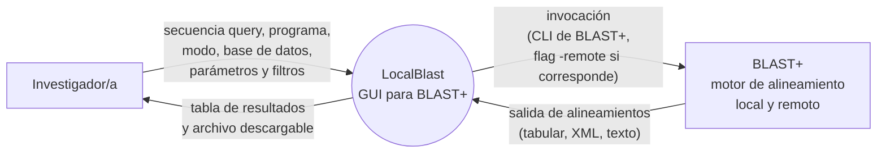
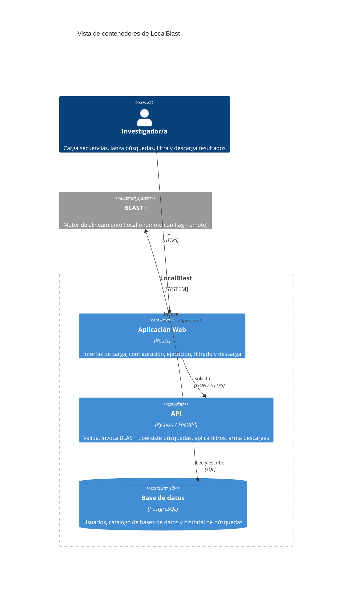
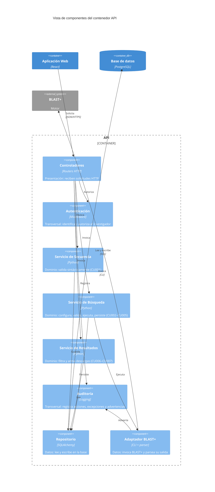

# Documento de Especificación de Arquitectura — LocalBlast

**Trabajo Práctico 3 · Ingeniería del Software 2026**

Este documento define la arquitectura de LocalBlast para los procesos profundizados en el TP1 (P1 · Ejecutar búsqueda BLAST y P2 · Filtrar y entregar resultados). Se apoya en los escenarios de calidad del TP2 para derivar las decisiones de estructura (estilo, patrón, tácticas y aspectos transversales), y las representa con las vistas de contenedores y componentes del modelo C4.

---

## Índice

1. [Introducción](#1-introducción)
2. [Restricciones](#2-restricciones)
3. [Contexto](#3-contexto)
4. [Drivers arquitectónicos](#4-drivers-arquitectónicos)
5. [Estrategia de solución](#5-estrategia-de-solución)
6. [Vista de contenedores](#6-vista-de-contenedores)
7. [Vista de componentes del API](#7-vista-de-componentes-del-api)
8. [Historias de usuario sobre las vistas](#8-historias-de-usuario-sobre-las-vistas)
9. [Decisiones de arquitectura](#9-decisiones-de-arquitectura)
10. [Trazabilidad](#10-trazabilidad)
11. [Glosario y bibliografía](#11-glosario-y-bibliografía)

---

## 1. Introducción

### 1.1 Propósito

Describir las decisiones estructurales de LocalBlast que atienden los escenarios de calidad críticos definidos en el TP2, y representarlas con las vistas de contenedores y componentes del modelo C4. El documento es la línea base arquitectónica para el desarrollo iterativo del sistema.

### 1.2 Alcance

La arquitectura se define para los dos procesos profundizados en el TP1:

- **P1 · Ejecutar búsqueda BLAST** (casos de uso CU001 a CU005).
- **P2 · Filtrar y entregar resultados** (casos de uso CU006 y CU007).

El proceso **P3 · Administrar bases de datos** queda fuera del alcance de este TP (ver [SRS §1.4](../requeriments/srs.md#14-fuera-del-alcance)); su actor Administrador/a y el flujo de administración del catálogo no se dibujan en las vistas.

**Fuera del alcance del TP3.** La vista de clases y de código, y los diagramas de despliegue, no se trabajan en este TP (quedan para el TP4).

### 1.3 Audiencia

- **Equipo de desarrollo** de LocalBlast: usa el documento como guía de construcción.
- **Cátedra de Ingeniería del Software**: lo evalúa como entregable del TP3.
- **Integrantes futuros** del proyecto: lo consultan al incorporarse para entender rápidamente la estructura del sistema.

### 1.4 Siglas

Las siglas se definen la primera vez que se usan en el cuerpo del documento. El glosario completo está en la [sección 11](#11-glosario-y-bibliografía).

---

## 2. Restricciones

Las restricciones que condicionan las decisiones de este documento son:

| Tipo | Restricción | Implicancia arquitectónica |
|---|---|---|
| **Equipo** | 3 integrantes, un cuatrimestre de dedicación parcial | Se descartan estilos que exijan alta complejidad operativa (microservicios, SOA con bus). |
| **Tecnología externa obligatoria** | **BLAST+** (motor de alineamiento) debe invocarse para toda búsqueda, en modo local o remoto | Toda la arquitectura se organiza alrededor de la invocación a BLAST+ como subproceso del lado servidor. |
| **Modelo de ciclo de vida** | Incremental con prácticas ágiles (ver [README §3](../../README.md#3-modelo-de-ciclo-de-vida-específico)) | La arquitectura debe permitir sumar capacidades sin reescribir las existentes. |
| **Entorno de despliegue** | Servidor del laboratorio, con BLAST+ instalado por el administrador de sistemas | No hay dependencia de infraestructura cloud; no se exige alta disponibilidad 24/7. |
| **Usuarios** | Menos de diez investigadores concurrentes | No es necesario diseñar para escala masiva; sí para hasta cinco búsquedas concurrentes (EC-01). |
| **Dependencia externa de red** | NCBI se contacta solo en modo remoto, y lo hace BLAST+, no nuestro sistema | Nuestro código no implementa cliente HTTP contra NCBI; la robustez remota se delega al reporte de errores de BLAST+. |
| **Experiencia del equipo** | Python y JavaScript/React | El estilo base debe ser realizable con esas tecnologías sin exigir aprender un ecosistema distinto. |

---

## 3. Contexto

El diagrama de contexto de LocalBlast se tomó del TP1 y se reproduce acá como encuadre. Los actores humanos y el único sistema externo (BLAST+) son los mismos; cambia solo que, para este TP, el actor Administrador/a queda fuera del alcance (su proceso P3 no se profundiza).

**Aclaración clave para la arquitectura.** La diferencia entre modo local y modo remoto queda enteramente del lado de BLAST+: en modo local lee índices del servidor del laboratorio; en modo remoto recibe la flag `-remote` y él mismo dialoga con NCBI. **Nuestro sistema no implementa cliente HTTP hacia NCBI.** Para LocalBlast, los dos modos son la misma operación — invocar BLAST+ con argumentos distintos — y las decisiones de arquitectura de este documento tratan ambos uniformemente.

El diagrama de contexto completo del sistema (incluyendo el actor Administrador/a y el proceso P3, documentados pero fuera del alcance del TP) está en [`contexto-inicial.md`](contexto-inicial.md).

---

## 4. Drivers arquitectónicos

### 4.1 Elección del atributo de calidad como driver

De los cinco atributos de calidad priorizados en el TP2 (ver [`escenarios-calidad.md`](../requeriments/quality-scenarios/escenarios-calidad.md)), elegimos un único atributo como **driver arquitectónico**: **Interoperabilidad** (Compatibilidad / Interoperabilidad en ISO/IEC 25010:2023).

**Por qué este y no otro:**

- **Es condición de existencia del producto.** LocalBlast *es*, por definición, una interfaz gráfica para BLAST+. Toda ejecución —local o remota— termina siendo una invocación al binario externo y un parseo de su salida. Sin interoperabilidad con BLAST+ el sistema no existe; con los otros atributos, LocalBlast puede ser menos ágil, menos robusto o menos modular, pero sigue siendo un sistema.
- **Fue el atributo más crítico en la matriz comparativa del TP2**, con 9 victorias sobre 9 posibles (ver TP2 §3.1). Ningún otro atributo lo venció en ningún par.
- **Es el atributo que más condiciona la estructura.** La elección de cómo invocar a BLAST+, dónde alojar al adaptador, cómo aislar las versiones del binario del resto del código, y cómo manejar la concurrencia de subprocesos son decisiones estructurales que viven en la arquitectura. Los otros atributos se materializan sobre todo *dentro* de las piezas que la interoperabilidad obliga a crear:
  - *Operabilidad* se juega en la Aplicación Web (parte del cliente del estilo que vamos a elegir).
  - *Confidencialidad* se resuelve con TLS en el canal cliente-servidor y con autorización en el servidor (son aspectos transversales que acompañan al estilo, no estilos propios).
  - *Tolerancia a fallos* se trata, en nuestro caso, delegando a BLAST+ el reporte de errores remotos y propagándolos sin reinterpretarlos (lo que, de nuevo, es una decisión del adaptador que la interoperabilidad exige crear).
  - *Modularidad* se obtiene en gran medida como consecuencia del patrón que la interoperabilidad justifica (ver [§5.3](#53-patrón-arquitectónico-capas-en-el-contenedor-api)): aislar BLAST+ en una capa dedicada deja el resto del sistema modular por diseño.

**Qué hacen los otros atributos en esta arquitectura.** No se descartan: se cubren mediante aspectos transversales y restricciones de implementación dentro de los contenedores y componentes que la interoperabilidad justifica (ver [§5.4](#54-aspectos-transversales)). La elección de un único driver es una **decisión de énfasis**, no una renuncia a los otros atributos.

### 4.2 Escenarios del TP2 seleccionados como drivers

De los dos escenarios de interoperabilidad del TP2, ambos son drivers arquitectónicos: cada uno condiciona la estructura del sistema de un modo distinto.

#### EC-01 · Sobrecarga por concurrencia de invocaciones

| Campo | Contenido |
|---|---|
| **Estímulo** | Hasta cinco investigadores lanzan búsquedas concurrentes contra el sistema, mezclando modo local y remoto. |
| **Respuesta esperada** | Cada búsqueda corre como subproceso independiente de BLAST+; los resultados se entregan a la sesión que los originó, sin cruce con otras. |
| **Medida** | **Cero** cruces de resultados con hasta cinco búsquedas concurrentes. |
| **Por qué condiciona la estructura** | Exige un contenedor servidor capaz de alojar subprocesos independientes de BLAST+ (uno por búsqueda), con un componente dedicado a mantener la correspondencia entre subproceso y sesión del investigador. No se puede resolver dentro de un único componente, ni solo en la interfaz. |

#### EC-02 · Degradado por cambio menor de versión de BLAST+

| Campo | Contenido |
|---|---|
| **Estímulo** | El administrador de sistemas actualiza BLAST+ a una versión posterior que suma columnas o campos a la salida, sin coordinarlo con el equipo de desarrollo. |
| **Respuesta esperada** | El parser reconoce los campos conocidos, ignora los nuevos sin corromper los conocidos, no aborta y registra una advertencia en el log. |
| **Medida** | **100%** de las búsquedas con salida "casi conocida" presentan intactos los campos obligatorios; **100%** quedan registradas con advertencia. |
| **Por qué condiciona la estructura** | Exige un componente adaptador aislado entre el núcleo del sistema y BLAST+. Los demás componentes **no deben saber** cómo es la salida real del binario, para que un cambio en esa salida no se propague por todo el código. Es una decisión de dependencia estructural, no de implementación interna. |

### 4.3 Restricciones del proyecto que acompañan a los drivers

Las dos restricciones de la [sección 2](#2-restricciones) que más influyen en cómo se traducen estos drivers son:

- **Equipo de 3 personas y un cuatrimestre.** Toda alternativa de arquitectura que atienda los drivers debe ser realizable con ese presupuesto. Esto descarta soluciones de alta complejidad operativa aunque sean técnicamente superiores (ver [DA-01](#da-01--estilo-base-cliente-servidor) y [DA-02](#da-02--patrón-capas-en-el-contenedor-api)).
- **Tecnologías ya dominadas (Python, React).** El estilo elegido debe realizarse con esas tecnologías sin introducir pilas que el equipo no domina.

---

## 5. Estrategia de solución

Esta sección recorre los cinco pasos del Paso 1 al Paso 5 de la guía del TP3: tácticas → estilo → patrón → aspectos transversales → cobertura. Al final queda una tabla que verifica, driver por driver, cómo lo atiende la arquitectura y qué sacrifica.

### 5.1 Tácticas elegidas y descartadas

El atributo Interoperabilidad del libro se corresponde con la subcaracterística **Interoperabilidad** de ISO/IEC 25010:2023 (ver TP3 Tabla 1). Para los dos drivers del punto anterior, las tácticas seleccionadas y descartadas son:

| Táctica (Tabla 2g del TP3) | Decisión | Por qué |
|---|---|---|
| **Adaptar la interfaz** | ✅ Seleccionada | Es la táctica central para EC-02. Un componente dedicado traduce entre la salida real de BLAST+ (texto tabular, XML, código de salida) y la estructura interna del sistema. Si BLAST+ cambia, cambia solo ese componente. |
| **Respetar estándares de comunicación** | ✅ Seleccionada | Entre el navegador y el servidor usamos HTTPS con JSON (web estándar); con BLAST+ usamos la interfaz de línea de comandos estándar documentada en el manual oficial del motor. Nada propietario entre contenedores. |
| **Descubrir servicios** | ❌ Descartada | BLAST+ corre en el mismo servidor que el API, con ruta configurada. No hay universo de servicios por descubrir en tiempo de ejecución. |
| **Orquestar** | ❌ Descartada | No hay varios servicios que orquestar: hay un único sistema externo (BLAST+) invocado por una sola operación por búsqueda. |

**Tácticas de otros atributos adoptadas en apoyo a los drivers de interoperabilidad.** La guía del TP3 permite esto cuando se justifica. Dos tácticas de otros atributos sostienen el cumplimiento de los drivers:

| Táctica | Atributo origen | Por qué la adoptamos para interoperabilidad |
|---|---|---|
| **Introducir concurrencia** | Desempeño (Tabla 2b) | Es la táctica que atiende el "cero cruces con cinco concurrentes" de EC-01. Lanzar cada búsqueda como subproceso independiente del binario BLAST+, con su propio contexto, es lo que garantiza el aislamiento. |
| **Encapsular** | Modificabilidad (Tabla 2d) | Convierte al adaptador en el único punto de contacto con BLAST+. Es el mecanismo del patrón Capas (ver [§5.3](#53-patrón-arquitectónico-capas-en-el-contenedor-api)) que materializa la táctica "adaptar la interfaz" dentro del contenedor API. |

### 5.2 Estilo arquitectónico base: Cliente-Servidor

**Decisión.** Adoptamos **Cliente-Servidor** como estilo arquitectónico base para todo el sistema (ver [DA-01](#da-01--estilo-base-cliente-servidor) para el registro detallado).

**Por qué este estilo:**

- **Es el estilo candidato de la Tabla 1 del TP3 para interoperabilidad** más natural para una interfaz gráfica web que usa un motor externo del lado servidor: el cliente (navegador) presenta y recibe entradas; el servidor hace todo el trabajo con BLAST+. La relación entre contenedores se expone como una interfaz REST con JSON sobre HTTPS, que es el estándar web (táctica "respetar estándares de comunicación").
- **Encaja con el equipo y el plazo** (restricción de la [sección 2](#2-restricciones)): es la estructura que mejor soportan los frameworks que el equipo ya domina (React en el cliente, Python + FastAPI/Flask en el servidor). No introduce un ecosistema nuevo.
- **Separa responsabilidades con pocas piezas que operar**: cliente, servidor, base de datos. Hay un único proceso del lado servidor que invoca a BLAST+. Es lo mínimo para cumplir los drivers.
- **Permite evolucionar.** Si en una iteración futura un escenario exige async pesado (por ejemplo, batch de 100 búsquedas), se puede sumar una cola entre API y un motor dedicado sin rehacer el resto (es la evolución que la guía describe en el Anexo C del TP3, pero para los drivers de este TP no la necesitamos).

**Restricciones del estilo que la arquitectura respeta** (Tabla 4 del TP3):

| Restricción del estilo | Cómo se respeta en LocalBlast |
|---|---|
| Los clientes no se comunican entre sí | Solo hay un cliente (Aplicación Web); no hay comunicación cliente-cliente. |
| El cliente no accede directamente a la base de datos | La Aplicación Web nunca habla SQL. Todo acceso a datos pasa por el API. |
| El servidor no inicia la comunicación con el cliente | El API responde a las solicitudes del cliente; no empuja mensajes al navegador por iniciativa propia (el progreso de la búsqueda se consulta desde el cliente). |
| El cliente inicia siempre la comunicación | Todas las flechas entre contenedores salen del cliente o del API hacia abajo (BD, BLAST+); ninguna sale de la BD o de BLAST+ hacia el cliente. |

Esto se verifica directamente en la vista de contenedores de la [sección 6](#6-vista-de-contenedores).

**Alternativas consideradas y descartadas.**

| Alternativa | Por qué se descartó |
|---|---|
| **Microservicios** | El libro los lista como candidato para interoperabilidad, pero exigen complejidad operativa (varios despliegues, red interna, consistencia entre bases) que un equipo de tres personas en un cuatrimestre no sostiene. No hay en LocalBlast partes con ritmos de cambio o de escala tan distintos como para justificar el costo. |
| **Orientada a eventos** | Resuelve picos y tareas lentas con desacople asincrónico. Con cinco búsquedas concurrentes y usuarios de un laboratorio chico, el acople síncrono alcanza. Sumar una cola (broker) es un contenedor más que operar sin beneficio para los drivers actuales. Queda como opción para una iteración futura si los escenarios cambian. |
| **SOA con bus** | Pensada para integrar sistemas existentes. En LocalBlast hay un único sistema externo (BLAST+) sin ningún bus de por medio y sin otros sistemas con los que integrarse. |

### 5.3 Patrón arquitectónico: Capas (en el contenedor API)

**Decisión.** Dentro del contenedor API aplicamos el **patrón de Capas** (ver [DA-02](#da-02--patrón-capas-en-el-contenedor-api) para el registro detallado). El patrón no se aplica al sistema entero (que ya está organizado por el estilo cliente-servidor), sino **dentro del API**, que es donde conviven varias responsabilidades que conviene separar.

**Por qué este patrón:**

- **Materializa la táctica "adaptar la interfaz" de forma mínima y suficiente.** Pone al adaptador de BLAST+ en la capa de datos, aislado detrás de una interfaz interna estable. Las capas superiores (dominio, presentación) no saben cómo es la salida real del binario; invocan al adaptador por sus métodos. Un cambio en la salida de BLAST+ se absorbe en el adaptador y no se propaga.
- **Cumple con las restricciones del equipo.** El patrón Capas es más chico que Hexagonal (puertos y adaptadores) y es el que un equipo de tres personas puede sostener en un cuatrimestre sin sobreingeniería. Hexagonal también funcionaría —y queda como opción si el proyecto crece— pero introduce más piezas (puertos explícitos, inversión de dependencias) que no son necesarias para los drivers de este TP.
- **Satisface tácticas de modificabilidad por diseño.** Separar en capas con dependencias hacia abajo mejora modularidad y capacidad de prueba (es exactamente lo que la Tabla 5 del TP3 señala para este patrón).

**Las cuatro capas:**

| Capa | Responsabilidad | Componentes del API que la implementan |
|---|---|---|
| **Presentación** | Exponer la interfaz HTTP del API: rutas, códigos de estado, validación sintáctica de entradas, serialización de respuestas. | Controladores |
| **Dominio / Servicios** | Lógica del dominio: coordinar carga de secuencia, configuración, validación semántica, ejecución, filtrado y preparación de descarga. | Servicio de Secuencia, Servicio de Búsqueda, Servicio de Resultados |
| **Datos** | Acceso a lo que vive por fuera del proceso del API: la base de datos y el binario BLAST+. | Repositorio, Adaptador BLAST+ |
| **Aspectos transversales** | Funcionalidades que atraviesan todas las capas y se dibujan como componentes propios usados por los demás. | Autenticación y autorización, Registro de auditoría y excepciones |

**Restricciones del patrón que la arquitectura respeta** (Tabla 6 del TP3):

| Restricción del patrón | Cómo se respeta en el contenedor API |
|---|---|
| Una capa no depende de las superiores | Ningún servicio de dominio llama a los Controladores; ningún componente de datos llama a los servicios de dominio ni a los Controladores. |
| Cada capa usa solo a la inmediatamente inferior (los transversales son la excepción documentada) | Los Controladores invocan servicios de dominio; los servicios de dominio usan Repositorio o Adaptador BLAST+; nunca al revés. |
| Cada capa tiene una responsabilidad clara | Ver la tabla de arriba. Ninguna capa mezcla responsabilidades que correspondan a otra. |

Esto se verifica directamente en la vista de componentes de la [sección 7](#7-vista-de-componentes-del-api): todas las flechas entre capas van en la misma dirección.

**Alternativas consideradas y descartadas.**

| Alternativa | Por qué se descartó |
|---|---|
| **Hexagonal (puertos y adaptadores)** | Aísla más estrictamente el núcleo del dominio con puertos explícitos. Es excelente para interoperabilidad e inversión de dependencias, pero introduce más interfaces y adaptadores de los que un equipo de tres personas puede sostener para un único sistema externo (BLAST+). Capas cubre nuestras necesidades con menos piezas. |
| **MVC** | Está pensado para separar presentación, lógica de interacción y modelo en una interfaz. En el API no hay vista: la "vista" es el cliente web, que es otro contenedor. MVC es más apropiado para el contenedor del cliente, no para el API. |
| **Broker** | Resuelve desacoplar emisores y receptores con un intermediario de mensajes. Útil cuando el consumidor y el productor viven en procesos distintos. En LocalBlast, el API y el adaptador de BLAST+ viven en el mismo proceso: una cola de mensajes sería un contenedor más que operar sin beneficio. |

### 5.4 Aspectos transversales

Además del patrón de Capas, el API adopta los siguientes aspectos transversales. Se dibujan como componentes propios en la vista de componentes y los usan los demás (sección 7).

| Aspecto | Qué resuelve | Dónde vive | Driver / escenario que lo motiva |
|---|---|---|---|
| **Autenticación y autorización** | Verifica quién es el investigador y a qué recursos puede acceder (su propio historial, sus propias búsquedas). | Componente del API. | Soporta los escenarios de confidencialidad del TP2 (TP2 §5.3). Aunque confidencialidad no es el driver elegido, no se puede ignorar: la implementación mínima es un aspecto transversal del API. |
| **Registro de auditoría y gestión de excepciones** | Captura errores de BLAST+ (incluidos los de EC-02: "advertencia en el log por campo no mapeado") y los propaga con información útil al cliente sin filtrar detalles internos. | Componente del API usado por Controladores, Servicios y Adaptador. | Requerido explícitamente por EC-02 ("registra una advertencia en el log"). |
| **Interoperabilidad** | La interoperabilidad con BLAST+ es, para esta arquitectura, el aspecto transversal que concentra el adaptador. No se dibuja como componente aparte: *es* el componente Adaptador BLAST+ de la capa de datos. | Componente Adaptador BLAST+ (ver sección 7). | EC-01 y EC-02. |

**Aspectos transversales considerados y descartados.**

| Aspecto | Por qué se descartó |
|---|---|
| **Notificaciones (correo electrónico, webhooks)** | Ninguno de nuestros drivers lo exige. El investigador ve el resultado en la interfaz, no por correo. Si en el futuro el batch asíncrono entra al alcance, se sumará. |
| **Monitoreo / instrumentación** | Para un laboratorio chico con pocos usuarios, el log del aspecto transversal "auditoría y excepciones" alcanza. No justifica agregar infraestructura de métricas. |

### 5.5 Tabla de cobertura

Cómo la arquitectura cubre cada driver y qué sacrifica a cambio.

| Driver (escenario TP2) | Táctica(s) | Dónde se materializa en la arquitectura | Qué se sacrifica |
|---|---|---|---|
| **EC-01** · Hasta cinco invocaciones concurrentes a BLAST+ sin cruce de resultados | Introducir concurrencia + encapsular | Componente **Adaptador BLAST+** del API: cada invocación corre como subproceso independiente, con identificador propio y referencia a la sesión que la lanzó (ver [DA-04](#da-04--ejecutar-cada-búsqueda-como-subproceso-independiente-de-blast)). | Mayor consumo de CPU y memoria durante los picos de concurrencia (un proceso de BLAST+ por búsqueda). Aceptable en un laboratorio chico. |
| **EC-02** · Cambios menores de versión de BLAST+ sin romper el parseo de la salida | Adaptar la interfaz + encapsular | Componente **Adaptador BLAST+** del API: su parser reconoce los campos conocidos por nombre, ignora los no mapeados y registra una advertencia a través del aspecto transversal de auditoría. El resto del sistema no cambia (ver [DA-03](#da-03--adaptador-blast-como-componente-dedicado-en-la-capa-de-datos)). | Una advertencia en el log por cada búsqueda con formato "casi conocido": el equipo debe revisar los logs periódicamente para enterarse de que BLAST+ cambió. Es un costo operativo bajo. |

**Conflictos entre tácticas: verificación.** Ninguna de las tácticas que adoptamos entra en conflicto con las demás. Encapsular el acceso a BLAST+ mejora modularidad y, al mismo tiempo, es lo que permite el aislamiento de concurrencia (cada subproceso lo lanza el mismo componente, con su propia correspondencia a la sesión). Respetar estándares de comunicación con el cliente (REST + JSON) no interfiere con el canal CLI hacia BLAST+ (son dos interfaces distintas, una por cada relación entre contenedores).

---

## 6. Vista de contenedores

### 6.1 Diagrama

### 6.2 Catálogo de contenedores

| Contenedor | Responsabilidad |
|---|---|
| **Aplicación Web** | Única interfaz humana del sistema. Formulario de carga, configuración y validación de búsquedas; vista de progreso y cancelación; tabla de resultados con filtros interactivos; disparo de descargas. No contiene lógica de dominio: todo cálculo no trivial lo hace el API. |
| **API** | Núcleo del sistema. Recibe solicitudes HTTP de la Aplicación Web, verifica autenticación y autorización, orquesta los servicios de dominio (carga, búsqueda, filtrado, descarga), persiste en la base de datos y es el único contenedor que invoca a BLAST+. |
| **Base de datos** | Almacén único del sistema. Guarda los usuarios habilitados, el catálogo de bases de datos BLAST disponibles (D1 del DFD) y el historial de búsquedas con sus parámetros, timestamps y resultados crudos (D2 del DFD). |
| **BLAST+** *(sistema externo)* | Motor de alineamiento. En modo local lee índices del servidor del laboratorio; en modo remoto recibe la flag `-remote` y él mismo dialoga con NCBI. LocalBlast lo trata uniformemente en ambos modos: le pasa argumentos por CLI, recibe su salida por stdout y su código de retorno. |

### 6.3 Catálogo de relaciones

| Origen → Destino | Qué se comunica |
|---|---|
| Investigador/a → Aplicación Web | Interacciones de la UI: carga de archivo, formulario, botones. |
| Aplicación Web → API | Solicitudes REST: carga de secuencia, configuración, validación, ejecución, consulta de progreso, filtrado y descarga. |
| API → Base de datos | Lectura y escritura: usuarios para autenticación, catálogo para listar bases disponibles, historial para persistir cada búsqueda ejecutada. |
| API → BLAST+ | Invocación como subproceso con los argumentos de la búsqueda (programa, modo, base de datos, parámetros, ruta a secuencia query). Lee la salida por stdout. |

### 6.4 Comprobación del estilo cliente-servidor

Verificando sobre el diagrama las reglas de la Tabla 4 del TP3:

- ✅ No hay flechas entre clientes (solo hay un cliente).
- ✅ No hay flechas de la base de datos hacia la Aplicación Web (toda escritura y lectura pasa por el API).
- ✅ No hay flechas del API hacia la Aplicación Web (el servidor no inicia la comunicación).
- ✅ El cliente inicia siempre la comunicación: la cadena Investigador/a → Web → API → BD y Web → API → BLAST+ fluye hacia abajo.

---

## 7. Vista de componentes del API

La vista de componentes se hace **solo para el contenedor API**, porque es el único de los contenedores internos que implementa lógica de dominio de los procesos profundizados. La Aplicación Web es el cliente y no se profundiza en componentes (su estructura interna responde a decisiones de usabilidad del TP2 y a los frameworks de UI, no a los drivers de este TP). La Base de datos no se profundiza porque es un almacén sin lógica propia.

### 7.1 Diagrama

> **Nota sobre la disposición.** La sintaxis C4 de Mermaid tiene limitaciones de layout conocidas que impiden ordenar perfectamente las flechas en diagramas con muchas relaciones; por eso las etiquetas sobre las flechas se mantuvieron **cortas** (un verbo cada una) y el detalle completo —qué comunica cada relación— vive en el catálogo de la [sección 7.3](#73-catálogo-de-relaciones).

### 7.2 Catálogo de componentes

| Componente | Capa | Responsabilidad |
|---|---|---|
| **Controladores** | Presentación | Exponen la interfaz HTTP del API: rutas, validación sintáctica de entradas, serialización de respuestas, códigos de estado. No contienen lógica del dominio: delegan en los servicios. |
| **Autenticación y autorización** | Transversal | Identifica al investigador que origina cada solicitud y verifica que tenga permiso para acceder al recurso solicitado (su propio historial, su propia búsqueda). Rechaza con 401/403 cuando corresponde. |
| **Auditoría y excepciones** | Transversal | Registra las acciones que ejecuta el sistema y las advertencias y errores que surgen (incluidas las de EC-02: campos no mapeados en la salida de BLAST+). Convierte las excepciones no controladas en respuestas HTTP coherentes. |
| **Servicio de Secuencia** | Dominio | Valida sintácticamente la secuencia query cargada por el investigador (RF-01, RF-02; implementa CU001). Infiere el alfabeto (ADN / ARN / proteína) y la deja disponible para el resto del flujo. |
| **Servicio de Búsqueda** | Dominio | Coordina la configuración (RF-03 a RF-06), la validación semántica (RF-07), la ejecución asíncrona con cancelación (RF-08), la presentación de resultados (RF-09) y la persistencia en el historial (RF-10). Implementa los casos de uso CU002 a CU005. Nunca llama directamente a BLAST+: lo hace a través del Adaptador. |
| **Servicio de Resultados** | Dominio | Aplica los filtros post-búsqueda sobre los resultados crudos ya devueltos por BLAST+ (RF-11) y arma los archivos descargables en los formatos soportados (RF-12). Implementa CU006 y CU007. |
| **Repositorio** | Datos | Único punto de acceso del API a la base de datos. Hace la traducción entre entidades del dominio y filas de SQL; agrupa las operaciones en transacciones cuando corresponde. |
| **Adaptador BLAST+** | Datos | **Componente clave de los drivers de interoperabilidad.** Único punto de contacto con BLAST+. Lanza cada invocación como subproceso independiente, mantiene la correspondencia entre subproceso y sesión que lo originó (EC-01), parsea la salida reconociendo los campos conocidos y descartando los no mapeados sin corromper los conocidos (EC-02), reporta advertencias a Auditoría. |

### 7.3 Catálogo de relaciones

| Origen → Destino | Verbo en el diagrama | Qué comunica realmente |
|---|---|---|
| **Dentro del contenedor API** (llamadas internas, sin protocolo) | | |
| Controladores → Autenticación | Autoriza | Pide verificación de identidad y de permisos al inicio de cada solicitud. |
| Controladores → Auditoría | Registra | Registra que una solicitud entró y salió, y propaga errores no controlados. |
| Controladores → Servicio de Secuencia | Invoca | Delega la carga y validación sintáctica de la secuencia query. |
| Controladores → Servicio de Búsqueda | Invoca | Delega la configuración, validación semántica, ejecución y persistencia. |
| Controladores → Servicio de Resultados | Invoca | Delega el filtrado post-búsqueda y la generación del archivo de descarga. |
| Servicio de Secuencia → Repositorio | Guarda | Guarda la secuencia cargada para esta sesión. |
| Servicio de Búsqueda → Repositorio | Persiste | Lee el catálogo de bases de datos disponibles y persiste cada búsqueda ejecutada en el historial. |
| Servicio de Búsqueda → Adaptador BLAST+ | Ejecuta | Pide la ejecución de una búsqueda validada, pasando la configuración completa. |
| Servicio de Resultados → Repositorio | Lee | Lee los resultados crudos de una búsqueda del historial para filtrarlos o prepararlos para descarga. |
| Adaptador BLAST+ → Auditoría | Advierte | Reporta advertencias cuando detecta campos no mapeados en la salida de BLAST+ (EC-02). |
| **Hacia contenedores vecinos** (con protocolo) | | |
| Aplicación Web → Controladores | Solicita | Solicitud REST (JSON / HTTPS). |
| Repositorio → Base de datos | Lee y escribe | Consultas y transacciones (SQL). |
| Adaptador BLAST+ → BLAST+ | Invoca | Invocación por línea de comandos; captura de stdout / stderr y código de salida (CLI / subproceso). |

### 7.4 Comprobación del patrón de capas

Verificando sobre el diagrama las reglas de la Tabla 6 del TP3:

- ✅ **Ninguna capa depende de las superiores.** Los componentes de datos (Repositorio, Adaptador BLAST+) no llaman a Servicios ni a Controladores. Los Servicios no llaman a Controladores. Todas las flechas de dominio bajan hacia la capa de datos; todas las flechas de presentación bajan hacia la capa de dominio.
- ✅ **No se saltean capas.** Los Controladores no llaman al Repositorio ni al Adaptador BLAST+ directamente: delegan en los Servicios. Esto es verificable mirando las flechas: no hay ninguna `ctrl → repo` ni `ctrl → adap`.
- ✅ **Cada capa tiene su responsabilidad propia** (ver [§5.3](#53-patrón-arquitectónico-capas-en-el-contenedor-api)).
- ✅ **Los aspectos transversales se dibujan como componentes propios** usados por otras capas: Autenticación y Auditoría. Las flechas desde Controladores y desde Adaptador BLAST+ hacia Auditoría no son violaciones del patrón: son uso explícito de un aspecto transversal, documentado como tal.

---

## 8. Historias de usuario sobre las vistas

Esta sección recorre, sobre las dos vistas, el *Given-When-Then* de tres historias de usuario representativas (una del flujo principal, una de ejecución con BLAST+, una de la segunda mitad del flujo). El objetivo es verificar que cada paso del criterio de aceptación tiene un lugar donde ocurre en la arquitectura.

| HU | Criterio recorrido | Contenedores que atraviesa | Componentes del API involucrados |
|---|---|---|---|
| **HU01_CU001_B** · Carga de la secuencia FASTA | **Given** un archivo FASTA bien formado · **When** el investigador lo sube · **Then** el sistema lo deja disponible con alfabeto inferido | Aplicación Web → API → Base de datos | Controladores → Autenticación → Servicio de Secuencia → Repositorio |
| **HU08_CU004_B** · Ejecución asíncrona de la búsqueda | **Given** una búsqueda ya configurada y validada · **When** el investigador presiona "Ejecutar" · **Then** la interfaz muestra progreso y permanece navegable; al terminar se dispara CU005 (presentación + persistencia) | Aplicación Web → API → BLAST+ (ejecución) · API → Base de datos (persistencia) | Controladores → Autenticación → Servicio de Búsqueda → Adaptador BLAST+ (invoca BLAST+ como subproceso independiente, EC-01) → Servicio de Búsqueda → Repositorio (guarda en historial) |
| **HU12_CU006_B** · Filtrado post-búsqueda | **Given** resultados crudos ya devueltos por BLAST+ · **When** el investigador modifica los umbrales de filtro · **Then** la tabla se refresca sobre el crudo original, en menos de 1 segundo | Aplicación Web → API → Base de datos (lee crudo) | Controladores → Autenticación → Servicio de Resultados → Repositorio |

**Lectura del escenario de EC-02 sobre las vistas.** Cuando BLAST+ devuelve una salida con un campo adicional no mapeado, la respuesta del sistema queda contenida enteramente dentro del **Adaptador BLAST+**: reconoce los campos conocidos, descarta el nuevo sin romper los conocidos, reporta una advertencia a **Auditoría y excepciones**, y devuelve los resultados al Servicio de Búsqueda como si el formato fuera el esperado. Ni los Controladores, ni los otros Servicios de dominio, ni la Aplicación Web se enteran del cambio. Esta es la propiedad arquitectónica concreta que el patrón de Capas, con el Adaptador BLAST+ en su capa de datos, aporta.

**Lectura del escenario de EC-01 sobre las vistas.** Cinco investigadores lanzan búsquedas concurrentes: cada una entra como una solicitud HTTP distinta a los Controladores, pasa por Autenticación (que la asocia a la sesión del investigador que la originó), llega al Servicio de Búsqueda, que a su vez le pide al Adaptador BLAST+ ejecutar la búsqueda. El Adaptador lanza un subproceso independiente de BLAST+ por cada una, con su propio identificador y una referencia a la sesión; cuando cada subproceso termina, el Adaptador entrega el resultado al Servicio de Búsqueda, que lo guarda en el historial de ese investigador y lo devuelve a los Controladores que respondieron esa solicitud. No hay un punto en el que los resultados de dos búsquedas puedan cruzarse porque no comparten ni estado interno ni canal.

---

## 9. Decisiones de arquitectura

### DA-01 · Estilo base cliente-servidor

- **Escenario que la motiva:** EC-01 y EC-02 (ambos de interoperabilidad). El sistema entero necesita un estilo que permita alojar un servidor con BLAST+ invocado del lado del servidor, mientras el investigador usa una interfaz web del lado del cliente.
- **Contexto:** LocalBlast es una interfaz gráfica para BLAST+. El equipo tiene 3 integrantes, un cuatrimestre y domina Python y React. Hasta diez investigadores concurrentes.
- **Decisión:**
  - **Tácticas:** Respetar estándares de comunicación (JSON sobre HTTPS entre cliente y servidor); encapsular el acceso a BLAST+ del lado del servidor.
  - **Estilo:** Cliente-Servidor como estilo base, aplicado a todo el sistema.
  - **Patrón:** se decide en DA-02 (local al contenedor API).
- **Alternativas consideradas:**
  - **Microservicios** — descartado: alta complejidad operativa para un equipo de 3 personas; sin partes con ritmos de cambio distintos que lo justifiquen.
  - **Orientada a eventos** — descartado: con cinco búsquedas concurrentes el acople síncrono alcanza; una cola sería un contenedor más que operar sin beneficio para los drivers actuales.
  - **SOA** — descartado: no hay varios sistemas que integrar.
- **Consecuencias:**
  - **A favor:** modelo simple y familiar para el equipo; comunicación entre cliente y servidor estándar y bien soportada por los frameworks; pocas piezas que desplegar.
  - **En contra:** el servidor es punto único de falla; si el servidor cae, el sistema deja de responder. Aceptable para un laboratorio pequeño sin exigencia de 24/7.
- **Elementos afectados:** contenedores "Aplicación Web", "API" y "Base de datos".

### DA-02 · Patrón Capas en el contenedor API

- **Escenario que la motiva:** EC-02 principalmente, y secundariamente EC-01. El API necesita aislar el acceso a BLAST+ (que puede cambiar) del resto del código.
- **Contexto:** Se eligió cliente-servidor como estilo base (DA-01). El API aloja carga, configuración, validación, ejecución, filtrado y descarga: varias responsabilidades que conviene separar.
- **Decisión:**
  - **Tácticas:** Encapsular (del atributo modificabilidad) y adaptar la interfaz (de interoperabilidad).
  - **Patrón:** Capas, con cuatro capas: Presentación (Controladores), Dominio (Servicios), Datos (Repositorio y Adaptador BLAST+) y una familia de componentes transversales (Autenticación, Auditoría).
- **Alternativas consideradas:**
  - **Hexagonal** — descartado: aisla más estrictamente, pero con un único sistema externo (BLAST+) las piezas extra (puertos explícitos, inversión de dependencias) son sobreingeniería para un equipo de 3 personas.
  - **MVC** — descartado: pensado para separar presentación de modelo; en el API no hay vista. Es más apropiado para la Aplicación Web.
  - **Broker** — descartado: resuelve desacoplar emisores y receptores en procesos distintos; API y Adaptador BLAST+ viven en el mismo proceso.
- **Consecuencias:**
  - **A favor:** modificabilidad (un cambio en BLAST+ no se propaga más allá del Adaptador); capacidad de prueba (cada capa se prueba por separado); claridad del código (cada módulo tiene una responsabilidad por capa).
  - **En contra:** cierta indirección (una solicitud HTTP atraviesa tres capas antes de llegar a BLAST+); algo de rendimiento (despreciable en el régimen de uso de LocalBlast).
- **Elementos afectados:** todos los componentes del contenedor API (sección 7).

### DA-03 · Adaptador BLAST+ como componente dedicado en la capa de datos

- **Escenario que la motiva:** EC-02 (cambio menor de versión de BLAST+ sin romper el parseo).
- **Contexto:** BLAST+ es externo, lo mantiene el administrador de sistemas del laboratorio con sus propios criterios, y su salida puede evolucionar (campos nuevos en formato tabular, atributos nuevos en XML).
- **Decisión:**
  - **Tácticas:** Adaptar la interfaz; encapsular.
  - **Estilo:** respeta el cliente-servidor base (vive dentro del servidor).
  - **Patrón:** aplicado dentro del patrón Capas (DA-02), en la capa de datos del API.
- **Alternativas consideradas:**
  - **Parsear BLAST+ directamente en los Servicios** — descartado: cada cambio de BLAST+ obligaría a tocar varios servicios; viola la táctica de encapsular.
  - **Un microservicio aparte "Executor"** — descartado por los mismos motivos que microservicios en DA-01.
- **Consecuencias:**
  - **A favor:** cambios de versión de BLAST+ se absorben en un único componente; el resto del API no sabe cómo es la salida real del binario y es inmune a sus cambios menores; EC-02 se cumple como propiedad arquitectónica.
  - **En contra:** una capa de indirección entre el Servicio de Búsqueda y BLAST+; obligación de mantener el mapeo "campo de BLAST+ → entidad del dominio" al día en el Adaptador.
- **Elementos afectados:** componente "Adaptador BLAST+" del API; componente "Auditoría y excepciones" (destino del log de advertencias).

### DA-04 · Ejecutar cada búsqueda como subproceso independiente de BLAST+

- **Escenario que la motiva:** EC-01 (cinco búsquedas concurrentes sin cruce de resultados).
- **Contexto:** BLAST+ es un binario de línea de comandos. Cada invocación es un proceso del sistema operativo con su propia memoria y su propio stdout/stderr. Lanzar varias en paralelo requiere decidir dónde se guarda la correspondencia entre proceso y sesión del investigador.
- **Decisión:**
  - **Tácticas:** Introducir concurrencia (del atributo desempeño, aplicada acá al escenario de interoperabilidad).
  - **Estilo:** respeta el cliente-servidor base.
  - **Patrón:** la correspondencia proceso↔sesión vive dentro del Adaptador BLAST+ (DA-03), no en los Controladores ni en los Servicios de dominio.
- **Alternativas consideradas:**
  - **Un único proceso BLAST+ en el que se encolan las búsquedas** — descartado: serializa las invocaciones y el escenario pedía cinco concurrentes; además, BLAST+ no está pensado para recibir "jobs" por una API persistente.
  - **Una cola de mensajes externa y un pool de workers** — descartado: suma un contenedor (broker) que no es necesario para la escala actual (ver DA-01).
- **Consecuencias:**
  - **A favor:** aislamiento natural entre búsquedas (cada subproceso tiene su propia memoria); si BLAST+ falla en una invocación, las otras no se ven afectadas; cumple EC-01 por diseño.
  - **En contra:** consumo de CPU y memoria crece linealmente con la concurrencia; cada subproceso implica el overhead de cargar BLAST+ en memoria. Aceptable para el régimen de uso previsto.
- **Elementos afectados:** componente "Adaptador BLAST+" (en el API).

---

## 10. Trazabilidad

### 10.1 Escenario → táctica → estilo o patrón → decisión → elemento C4

| Escenario (TP2) | Atributo (Tabla 1) | Tácticas | Estilo / Patrón | Decisión | Elemento C4 |
|---|---|---|---|---|---|
| **EC-01** · Concurrencia de invocaciones | Interoperabilidad | Introducir concurrencia; Encapsular | Estilo cliente-servidor (DA-01) + Patrón capas (DA-02) | DA-04 | Componente **Adaptador BLAST+** del contenedor API |
| **EC-02** · Cambio menor de versión de BLAST+ | Interoperabilidad | Adaptar la interfaz; Encapsular | Patrón capas (DA-02) + aspecto transversal de interoperabilidad | DA-03 | Componente **Adaptador BLAST+** del contenedor API + componente **Auditoría y excepciones** (destino del log) |

### 10.2 Historia de usuario → elementos C4

| Historia de usuario | Contenedores | Componentes del API |
|---|---|---|
| HU01_CU001_B · Cargar secuencia | Aplicación Web → API → Base de datos | Controladores → Autenticación → Servicio de Secuencia → Repositorio |
| HU02_CU001_E1 · Rechazo de secuencia inválida | Aplicación Web → API | Controladores → Autenticación → Servicio de Secuencia → Auditoría y excepciones (log del rechazo) |
| HU03_CU002_B · Configurar la búsqueda | Aplicación Web → API → Base de datos | Controladores → Autenticación → Servicio de Búsqueda → Repositorio (lee catálogo) |
| HU05_CU003_B · Validar la búsqueda | Aplicación Web → API | Controladores → Autenticación → Servicio de Búsqueda (validación semántica en memoria) |
| HU08_CU004_B · Ejecutar búsqueda | Aplicación Web → API → BLAST+ · API → Base de datos | Controladores → Autenticación → Servicio de Búsqueda → **Adaptador BLAST+** → Servicio de Búsqueda → Repositorio |
| HU09_CU004_A1 · Cancelación | Aplicación Web → API → BLAST+ | Controladores → Autenticación → Servicio de Búsqueda → **Adaptador BLAST+** (termina el subproceso) |
| HU10_CU004_E1 · Fallo del modo remoto | Aplicación Web → API | Controladores → Autenticación → Servicio de Búsqueda → **Adaptador BLAST+** → Auditoría y excepciones → Controladores (propagan el error literal al cliente) |
| HU11_CU005_B · Presentar y persistir | Aplicación Web → API → Base de datos | Controladores → Servicio de Búsqueda → Repositorio |
| HU12_CU006_B · Filtrado | Aplicación Web → API → Base de datos | Controladores → Autenticación → Servicio de Resultados → Repositorio |
| HU13_CU007_B · Descarga | Aplicación Web → API → Base de datos | Controladores → Autenticación → Servicio de Resultados → Repositorio |

Todo driver llega a al menos un contenedor y un componente. Todo componente de la vista corresponde a una responsabilidad del TP1 o a una decisión de arquitectura de este documento.

---

## 11. Glosario y bibliografía

### 11.1 Siglas usadas en este documento

| Sigla | Significado |
|---|---|
| AMQP | Protocolo estándar de mensajería para colas (mencionado solo para descartarlo) |
| API | Interfaz de programación de aplicaciones; en este TP, además, el nombre del contenedor servidor |
| C4 | Modelo de documentación de arquitectura en cuatro niveles: contexto, contenedores, componentes y código |
| CLI | Interfaz de línea de comandos (*command-line interface*) |
| CU | Caso de uso (del TP1) |
| CSV | Formato de texto con valores separados por comas |
| DA | Decisión de arquitectura |
| DFD | Diagrama de flujo de datos |
| EC | Escenario de calidad (del TP2) |
| HTTP / HTTPS | Protocolo de la web / HTTP sobre una conexión cifrada |
| HU | Historia de usuario (del TP1) |
| ISO/IEC 25010:2023 | Norma del modelo de calidad del producto de software |
| JSON | Formato de texto para intercambiar datos estructurados |
| MVC | Modelo-Vista-Controlador (mencionado solo para descartarlo en el contenedor API) |
| NCBI | *National Center for Biotechnology Information*, proveedor del BLAST remoto |
| REST | Estilo de diseño de APIs sobre HTTP |
| RF | Requerimiento funcional (del TP1) |
| SOA | Arquitectura orientada a servicios (mencionada solo para descartarla) |
| SQL | Lenguaje para consultar y modificar bases de datos relacionales |
| TLS | *Transport Layer Security*: la "S" de HTTPS |
| TP | Trabajo práctico |
| XML | Formato de datos estructurados con etiquetas, usado por BLAST+ como una de sus salidas |

### 11.2 Términos del dominio

Los términos del dominio (BLAST, BLAST+, query, base de datos BLAST, FASTA, E-value, etc.) están definidos en el [Glosario del SRS](../requeriments/srs.md#10-glosario). Se usan en este documento con el mismo significado, para preservar la coherencia entre el modelo del dominio del TP1 y la arquitectura del TP3.

### 11.3 Bibliografía

- Bass, L., Clements, P. y Kazman, R. *Software Architecture in Practice*. Addison-Wesley. Referencia para el catálogo de tácticas y la correspondencia con los atributos de calidad.
- ISO/IEC 25010:2023. *Systems and software Quality Requirements and Evaluation (SQuaRE) — Product quality model*.
- Brown, S. *The C4 model for visualising software architecture*.
- Material de cátedra del TP3 (guía, tablas 1 a 6, Anexos A, B y C).
- Documentación oficial de BLAST+ (NCBI), para la interfaz de línea de comandos del binario externo.

---

## Documentos relacionados

- [TP1 — SRS, DFD, casos de uso, historias de usuario](../requeriments/srs.md)
- [TP1 — Diagrama de contexto](contexto-inicial.md) *(incluye el actor Administrador/a y el proceso P3, fuera del alcance de este TP)*
- [TP2 — Escenarios de calidad](../requeriments/quality-scenarios/escenarios-calidad.md)
- [Bitácora de uso de IA](../uso-ia.md) *(incluye las entradas correspondientes al TP3)*
