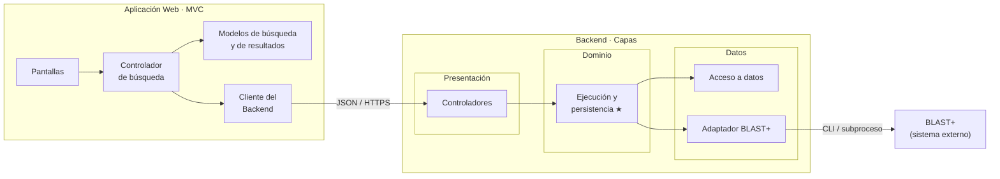
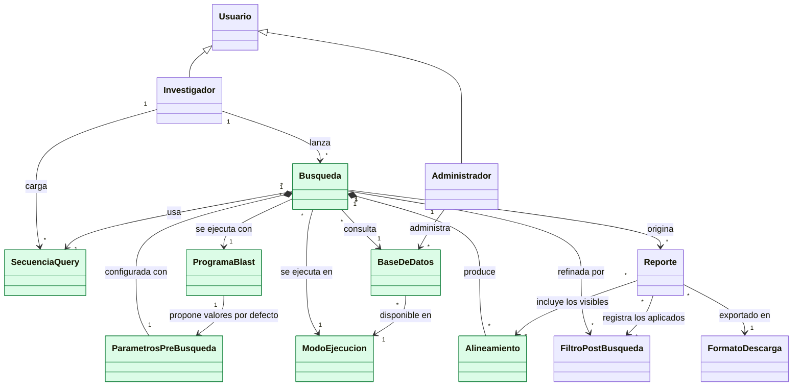
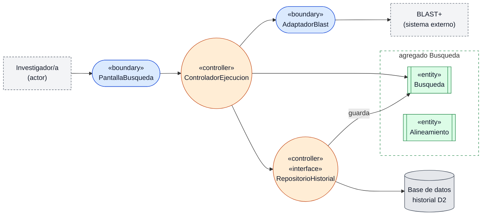
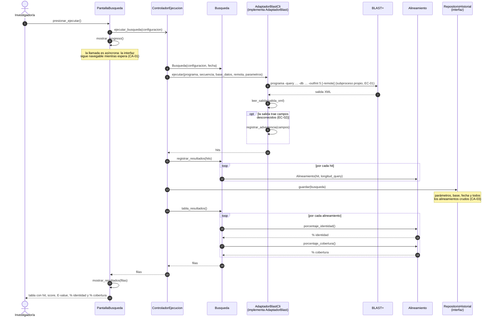
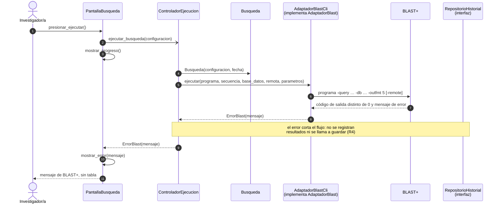
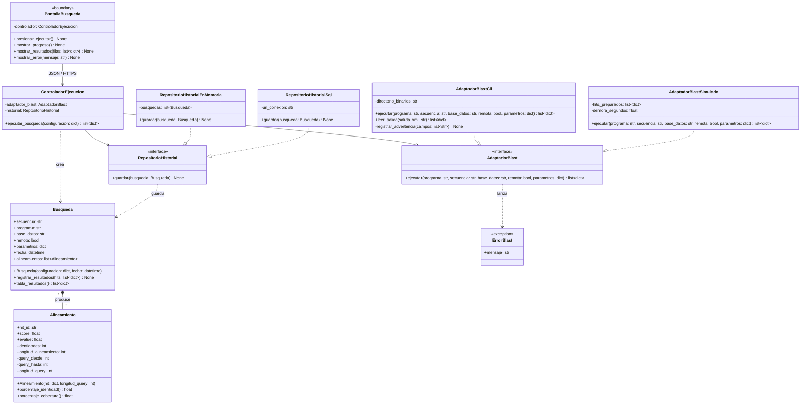

# Diseño detallado — LocalBlast

**HU08_CU004_B · Ejecutar la búsqueda validada y ver sus resultados**

Este documento baja la arquitectura de LocalBlast ([`architecture.md`](../architecture/architecture.md)) al nivel de clases para una historia de usuario. Parte de la HU y de sus criterios de aceptación, la analiza en sus tres dimensiones (funcionalidad, estructura y calidad) y deriva, en ese orden, el diagrama de robustez, los diagramas de secuencia y el modelo de clases. Cada diagrama sale del anterior: lo que no figura en la robustez no se invoca en las secuencias, y lo que no figura en las secuencias no aparece en el modelo de clases.

---

## Índice

1. [Introducción](#1-introducción)
2. [Relación con la arquitectura](#2-relación-con-la-arquitectura)
3. [Diseño de la HU](#3-diseño-de-la-hu)
4. [Modelo de clases](#4-modelo-de-clases)
5. [Justificación del diseño](#5-justificación-del-diseño)
6. [Implementación](#6-implementación)
7. [Pruebas](#7-pruebas)
8. [Trazabilidad](#8-trazabilidad)
9. [Glosario y bibliografía](#9-glosario-y-bibliografía)

---

## 1. Introducción

### 1.1 Propósito

Definir qué clases, operaciones y colaboraciones implementan la ejecución de una búsqueda BLAST en LocalBlast, desde que el investigador presiona **Ejecutar búsqueda** hasta que ve la tabla de alineamientos y la búsqueda queda guardada en el historial. El documento es la guía para implementar y probar esa funcionalidad.

### 1.2 Historia de usuario elegida

**`HU08_CU004_B` · Ejecutar la búsqueda validada y ver sus resultados**: el camino feliz (pasos 1 a 4) del caso de uso `CU004`. Realiza RF-08, RF-09 y RF-10.

**Qué queda afuera de este diseño:**

- La **cancelación** (`HU09_CU004_A1`) y el **fallo del modo remoto** con su mensaje diferenciado (`HU10_CU004_E1`), que tienen sus propias historias.
- La **identificación del investigador** (autenticación y sesión). No tiene historia de usuario propia y no forma parte de lo que esta HU pide.
- La **validación** de la búsqueda. Es la precondición de la HU (la deja hecha `HU05_CU003_B`), así que aquí la búsqueda llega ya validada.

### 1.3 Motivo de la elección

La HU cumple las tres condiciones para sostener un diseño en tres dimensiones:

| Condición | Evidencia en la arquitectura |
|---|---|
| Está asociada a un escenario de calidad | `EC-01` (concurrencia de invocaciones) y `EC-02` (cambio menor de versión de BLAST+) llegan al componente **Adaptador BLAST+**, que la HU atraviesa (tabla 11.1 de la arquitectura) |
| Atraviesa la estructura | Su recorrido (tabla 11.2) pasa por la Aplicación Web, por las tres capas del Backend y por el sistema externo BLAST+ |
| Hay decisiones de arquitectura que la afectan | `DA-03` (Adaptador BLAST+ dedicado) y `DA-04` (un subproceso por búsqueda) citan al Adaptador; `DA-02` (capas) rige todo el recorrido por el Backend |

Más allá de esas condiciones, es **la historia que justifica la existencia del producto**. LocalBlast es una interfaz para BLAST+, y esta es la única HU en la que BLAST+ se invoca de verdad. Las historias anteriores preparan la búsqueda y las posteriores trabajan sobre resultados que ya existen. Es también la que verifica el driver de la arquitectura (interoperabilidad) y la que tiene más riesgo técnico: ejecutar sin bloquear la interfaz, atender varias búsquedas a la vez sin mezclar resultados e interpretar una salida que no controlamos.

### 1.4 Siglas

| Sigla | Significado |
|---|---|
| C4 | Modelo de documentación de arquitectura en cuatro niveles: contexto, contenedores, componentes y código |
| CA | Criterio de aceptación de una historia de usuario |
| CLI | Interfaz de línea de comandos (*command-line interface*) |
| CU | Caso de uso |
| D2 | Almacén del DFD con las búsquedas ejecutadas y sus resultados crudos (historial) |
| DA | Decisión de arquitectura |
| DFD | Diagrama de flujo de datos |
| EC | Escenario de calidad |
| GRASP | Patrones generales para asignar responsabilidades (*General Responsibility Assignment Software Patterns*) |
| HTTP / HTTPS | Protocolo de la web / HTTP sobre una conexión cifrada |
| HU | Historia de usuario |
| MVC | Modelo-Vista-Controlador |
| NCBI | *National Center for Biotechnology Information*, proveedor del BLAST remoto |
| RF | Requerimiento funcional |
| SQL | Lenguaje para consultar y modificar bases de datos relacionales |
| XML | Formato de datos con etiquetas; es la salida de BLAST+ que usa este diseño (`-outfmt 5`) |

---

## 2. Relación con la arquitectura

### 2.1 Tabla de coherencia

| Dimensión | Contenido |
|---|---|
| **Funcionalidad** | `HU08_CU004_B`, slice básico `CU004_B` del caso de uso `CU004 · Ejecutar la búsqueda y ver sus resultados` (pasos 1 a 4). Caminos: el principal (ejecutar, guardar en el historial y mostrar la tabla) y uno de error (BLAST+ no termina bien: no se muestra tabla ni se guarda nada, como exige la garantía mínima de `CU004`). |
| **Estructura** | Contenedor **Aplicación Web** (patrón MVC, `DA-07`): Pantallas, Controlador de búsqueda, Modelo de búsqueda, Modelo de resultados y Cliente del Backend. Contenedor **Backend** (patrón Capas, `DA-02`): **Controladores** (presentación), **Ejecución y persistencia** (dominio), **Acceso a datos** y **Adaptador BLAST+** (datos). Sistema externo **BLAST+**. Estilo base cliente-servidor (`DA-01`). **Componente principal: Ejecución y persistencia.** |
| **Calidad** | `EC-01` · hasta cinco búsquedas concurrentes sin cruce de resultados. Tácticas: *introducir concurrencia* y *encapsular*. Decisión: `DA-04` (un subproceso de BLAST+ por búsqueda). `EC-02` · cambio menor de versión de BLAST+ sin romper la lectura de la salida. Tácticas: *adaptar la interfaz* y *encapsular*. Decisión: `DA-03` (Adaptador BLAST+ dedicado en la capa de datos). |
| **Dominio** | Entidades del modelo de dominio que intervienen: `Busqueda` y `Alineamiento` como clases; `SecuenciaQuery`, `ProgramaBlast`, `ParametrosPreBusqueda`, `ModoEjecucion` y `BaseDeDatos` como datos de la búsqueda. No intervienen `Usuario`, `Investigador`, `Administrador`, `FiltroPostBusqueda`, `Reporte` ni `FormatoDescarga` (ver [3.2](#32-entidades-del-modelo-de-dominio-que-intervienen)). |
| **Verificación** | `EC-01`: se verificará con una prueba de cinco búsquedas lanzadas a la vez sobre un adaptador simulado con demoras distintas; cada una recibe exactamente sus propios alineamientos (cero cruces). `EC-02`: se verificará con una prueba de la lectura de una salida XML con campos desconocidos; los campos obligatorios llegan intactos y queda registrada una advertencia. Las pruebas concretas se diseñan en la etapa de pruebas, una vez aprobado este diseño. |

### 2.2 Recorrido de la HU sobre los componentes



★ componente principal de la HU.

La verificación completa de coherencia con la arquitectura está en la [sección 8.2](#82-verificación-de-coherencia), porque necesita los diagramas de las secciones 3 y 4.

---

## 3. Diseño de la HU

### 3.1 Enunciado y criterios de aceptación

> **Como** investigador/a,
> **quiero** que el sistema invoque a BLAST+ en segundo plano sobre mi búsqueda validada, con indicador de progreso y opción de cancelar, y que al terminar me muestre los alineamientos en una tabla y guarde automáticamente la búsqueda en el historial,
> **para** poder seguir trabajando en la aplicación mientras la búsqueda corre, ver los resultados apenas estén listos y no perder la búsqueda aunque no llegue a refinarla ni descargarla en esta sesión.

- **CA-01. Ejecución asíncrona con indicador de progreso.** **Given** una búsqueda ya configurada y validada (postcondición de `CU003`), **When** el investigador presiona "Ejecutar búsqueda" y el sistema invoca a BLAST+ en segundo plano, **Then** la interfaz muestra un indicador de progreso visible y permanece navegable: el investigador puede desplazarse dentro de la aplicación sin que la ejecución se interrumpa.
- **CA-02. Presentación de la tabla al finalizar.** **Given** una búsqueda en ejecución que BLAST+ termina exitosamente, **When** el sistema recibe el conjunto crudo de alineamientos, **Then** presenta los resultados en una tabla con al menos las columnas: identificador del hit, score, E-value observado, porcentaje de identidad y porcentaje de cobertura.
- **CA-03. Persistencia automática en el historial.** **Given** una búsqueda que BLAST+ terminó exitosamente, **When** el sistema recibe su conjunto crudo de alineamientos, **Then** registra en el historial (D2), antes de presentar la tabla, una entrada con los parámetros pre-búsqueda, la base de datos usada, el timestamp y el conjunto **completo** de resultados crudos que devolvió BLAST+ (antes de cualquier filtro post-búsqueda), sin que el investigador tenga que ejercer `CU005` ni `CU006` para que la persistencia ocurra.

> **Precisión de CA-03.** La redacción original registraba la búsqueda "cuando el sistema termina de mostrar" la tabla. Eso chocaba con la garantía mínima de `CU004` ("si la tabla se muestra, la entrada en D2 también queda escrita"): si se muestra primero y se guarda después, una falla entre los dos pasos deja una tabla visible sin entrada en el historial. Se invirtió el orden (primero se guarda, después se muestra) en [`historias-usuario.md`](../requeriments/historias-usuario.md) y en el flujo de `CU004` de [`casos-de-uso.md`](../requeriments/casos-de-uso.md).

**La búsqueda no se guarda antes de ejecutarse.** La secuencia y la configuración validadas las conserva la Aplicación Web (en su Modelo de búsqueda) y viajan completas en la solicitud de ejecución. La única escritura en la base es la del historial, cuando BLAST+ ya terminó (RF-10).

### 3.2 Entidades del modelo de dominio que intervienen

Se marcaron los sustantivos del enunciado y de los criterios ("búsqueda validada", "BLAST+", "alineamientos", "tabla", "historial", "parámetros pre-búsqueda", "base de datos usada", "timestamp", "resultados crudos", "identificador del hit", "score", "E-value", "porcentaje de identidad", "porcentaje de cobertura") y se buscaron en el [modelo de dominio](../requeriments/modelo-dominio.md). En verde, las entidades que intervienen:



| Entidad del modelo | ¿Interviene? | Qué usa la HU de ella | La HU la... |
|---|---|---|---|
| `Busqueda` | Sí, como clase | Su configuración, para invocar a BLAST+; los alineamientos que produce; el momento en que se ejecutó | Crea (a partir de la configuración validada) |
| `Alineamiento` | Sí, como clase | Identificador del hit, score, E-value, % identidad y % cobertura: las cinco columnas de la tabla | Crea |
| `SecuenciaQuery` | Sí, como dato de `Busqueda` | El texto FASTA que recibe BLAST+ y su longitud (para la cobertura) | Consulta |
| `ProgramaBlast` | Sí, como dato de `Busqueda` | Qué binario se invoca (`blastn`, `blastp`, …) | Consulta |
| `ParametrosPreBusqueda` | Sí, como dato de `Busqueda` | E-value máximo, tamaño de palabra, matriz y penalizaciones de gap | Consulta |
| `ModoEjecucion` | Sí, como dato de `Busqueda` | Si la invocación lleva la flag `-remote` | Consulta |
| `BaseDeDatos` | Sí, como dato de `Busqueda` | Su ubicación (ruta del índice local o nombre de la base de NCBI) | Consulta |
| `Usuario`, `Investigador` | No | La identificación del investigador queda afuera de esta HU (1.2) | — |
| `Administrador` | No | Fuera del alcance; el catálogo de bases ya está cargado | — |
| `FiltroPostBusqueda` | No | CA-03 exige guardar el conjunto **crudo**; filtrar es `HU11_CU005_B` | — |
| `Reporte`, `FormatoDescarga` | No | Descargar es `HU12_CU006_B` | — |

**Por qué cinco entidades intervienen solo como datos.** `SecuenciaQuery`, `ProgramaBlast`, `ParametrosPreBusqueda`, `ModoEjecucion` y `BaseDeDatos` tienen reglas propias (alfabeto, rangos, compatibilidad entre programa, query y base), pero esas reglas pertenecen a las HU de carga, configuración y validación (`HU01` a `HU07`). Esta HU solo lee sus valores para pasárselos a BLAST+ y guardarlos en el historial. Alcanza con que `Busqueda` los exponga como atributos; convertirlas en clases acá agregaría clases sin comportamiento.

**Cambios al modelo de dominio.** Al armar esta tabla se detectó que el modelo no tenía el concepto **ProgramaBlast** y que tenía multiplicidades que contradecían a `CU001` (una misma secuencia se usa en varias búsquedas). El modelo se corrigió; los cambios están en el *Registro de cambios* de [`modelo-dominio.md`](../requeriments/modelo-dominio.md#registro-de-cambios).

### 3.3 Análisis tridimensional

| Elemento | Funcionalidad (qué hace) | Estructura (con qué se hace) | Calidad (qué propiedad cumple) |
|---|---|---|---|
| **CA-01** | Lanzar la búsqueda sin bloquear la interfaz y mostrar un indicador de progreso hasta que llegue la respuesta | `PantallaBusqueda` (hace la llamada de forma asíncrona y muestra el progreso); `ControladorEjecucion` | La interfaz sigue navegable mientras BLAST+ corre, porque la pantalla no se queda esperando la respuesta |
| **CA-02** | Al terminar BLAST+, mostrar la tabla con hit, score, E-value, % identidad y % cobertura | `AdaptadorBlast` (invoca y lee la salida); `Busqueda` y `Alineamiento`, que calcula sus porcentajes; `PantallaBusqueda` | `EC-02`: si la salida trae campos nuevos, la tabla igual sale con los campos obligatorios intactos |
| **CA-03** | Guardar en el historial la búsqueda con parámetros, base, timestamp y todos los alineamientos crudos | `RepositorioHistorial` | Nunca se muestra una tabla sin su entrada en el historial: primero se guarda y después se devuelve la tabla |
| **`EC-01`** · Concurrencia | Hasta cinco investigadores ejecutan a la vez | Cada solicitud se atiende en su propio hilo del servidor; `AdaptadorBlast` lanza un subproceso propio por búsqueda | **Cero cruces de resultados**: los resultados vuelven por la misma llamada que los pidió, sin estado compartido entre búsquedas |
| **`EC-02`** · Cambio de versión de BLAST+ | BLAST+ devuelve campos que el sistema no conoce | `AdaptadorBlast`, que es el único que conoce el formato de la salida | El 100 % de las salidas "casi conocidas" conserva los campos obligatorios y deja una advertencia en el log |

Los escenarios de **tolerancia a fallos** (rate limit y timeout de NCBI) describen el error del modo remoto, que es `HU10_CU004_E1`. Los de **confidencialidad** dependen de la identificación del investigador, que queda afuera de esta HU. Los de **operabilidad** alcanzan a la configuración (`HU05`) y al filtrado (`HU11`).

### 3.4 Diagrama de robustez

Leyenda: borde punteado = actor o sistema externo; cilindro gris = almacén de datos; rectángulo redondeado azul = *boundary*; círculo naranja = *controller*; rectángulo con barras verde = *entity*.



**Cómo se clasificó cada elemento.**

- **Fronteras.** Hay dos, porque el sistema habla con dos cosas que no son él: el investigador, a través de `PantallaBusqueda`, y BLAST+, a través de `AdaptadorBlast`.
- **Controladores.** `ControladorEjecucion` coordina la HU y `RepositorioHistorial` guarda la búsqueda terminada.
- **Interfaz con la base de datos.** `RepositorioHistorial` es una **interfaz**: define qué se puede hacer con el historial (`guardar`) pero no cómo ni dónde. Detrás de ella hay implementaciones intercambiables (en memoria y en una base SQL; ver el modelo de clases). El controlador solo conoce la interfaz, así que cambiar de base de datos no lo afecta.
- **Base de datos.** Es el almacén donde queda el historial (D2 del DFD), en el contenedor *Base de datos* de la arquitectura. No es una de las tres categorías de la robustez: se dibuja para mostrar dónde terminan los datos, igual que BLAST+ se dibuja para mostrar con quién habla el Adaptador. Solo la toca `RepositorioHistorial`: ni el controlador ni las entidades saben que existe, y por eso se puede cambiar la base (memoria, SQLite, PostgreSQL) sin tocarlos.
- **Entidades.** `Busqueda` y `Alineamiento`, que salen de la tabla 3.2. Forman un agregado: un alineamiento no existe sin su búsqueda, y desde afuera se accede siempre a través de `Busqueda`. Por eso no hay flecha del controlador a `Alineamiento`.

**Reglas de conexión verificadas.** El actor solo toca la pantalla; la pantalla solo toca al controlador; ninguna frontera toca una entidad (`AdaptadorBlast` recibe datos simples y devuelve los hits como datos, no como `Alineamiento`); BLAST+ se alcanza solo a través de una frontera; el controlador coordina a los demás; la base de datos se alcanza solo a través del repositorio.

#### 3.4.1 Dónde vive cada regla del negocio

| # | Regla | Dónde vive | Por qué |
|---|---|---|---|
| R1 | % identidad = identidades ÷ longitud del alineamiento × 100; % cobertura = tramo de la query cubierto ÷ longitud de la query × 100 | Entidad `Alineamiento` | Experto: el alineamiento tiene todos los datos para calcularlos. La longitud de la query se la pasa `Busqueda` al crearlo |
| R2 | Al historial va el conjunto **completo** de alineamientos crudos, sin filtrar | Entidad `Busqueda` | Crea un `Alineamiento` por cada hit que devolvió BLAST+ y no descarta ninguno. Es el conjunto que después guarda el repositorio |
| R3 | La tabla se devuelve solo después de que la búsqueda quedó en el historial | `ControladorEjecucion` (orden de los pasos) | Es una regla de coordinación entre dos colaboradores (el repositorio y la pantalla), y por eso el orden lo fija el controlador |
| R4 | Si BLAST+ no termina bien, no se muestra tabla ni se guarda nada (garantía mínima de `CU004`) | `AdaptadorBlast` (avisa con `ErrorBlast`) y `ControladorEjecucion` (el error corta el flujo antes de registrar y de guardar) | El Adaptador es quien sabe que BLAST+ falló (código de salida); el controlador no necesita ningún `if`, porque el error interrumpe la secuencia |
| R5 | Los campos de la salida de BLAST+ que no se conocen se ignoran y se advierten, sin tocar los conocidos (`EC-02`) | `AdaptadorBlast` | Táctica *adaptar la interfaz*: el formato de BLAST+ se conoce en un solo lugar (`DA-03`) |

La pantalla no aplica ninguna de estas reglas: solo muestra el progreso, la tabla o el error que recibe.

#### 3.4.2 Elementos del diagrama y componentes de la arquitectura

| Elemento | Tipo | Contenedor | Componente | Capa / rol |
|---|---|---|---|---|
| `PantallaBusqueda` | boundary | Aplicación Web | Pantallas, con el Controlador de búsqueda, los Modelos y el Cliente del Backend (ver nota) | Cliente (MVC) |
| `ControladorEjecucion` | controller | Backend | **Ejecución y persistencia** | Dominio |
| `Busqueda`, `Alineamiento` | entity | Backend | Ejecución y persistencia | Dominio |
| `RepositorioHistorial` | controller | Backend | Acceso a datos | Datos |
| `AdaptadorBlast` | boundary | Backend | Adaptador BLAST+ | Datos |
| BLAST+ | sistema externo | — | — | — |
| Base de datos (historial D2) | almacén de datos | Base de datos (PostgreSQL) | — | — |

**Nota sobre la Aplicación Web.** En esta HU la Aplicación Web no aplica reglas del negocio: la validación (`DA-05`) es de `HU05` y el filtrado (`DA-06`) es de `HU11`. Por eso se la representa con una sola frontera, `PantallaBusqueda`. Dentro de ella, según MVC, las Pantallas muestran progreso y tabla, el Controlador de búsqueda envía la solicitud a través del Cliente del Backend, el Modelo de búsqueda conserva la configuración validada que viaja en la solicitud y el Modelo de resultados guarda la tabla recibida.

**Nota sobre el componente Controladores.** El mensaje de la pantalla al `ControladorEjecucion` llega por HTTP a una ruta del Backend (componente **Controladores**) que solo convierte la solicitud JSON en la llamada a `ejecutar_busqueda` y el resultado en la respuesta JSON. Es código del framework web sin lógica propia, y por eso no se modela como clase. Así el recorrido respeta la cadena del patrón Capas: Aplicación Web → Controladores → Ejecución y persistencia → Acceso a datos / Adaptador BLAST+.

### 3.5 Diagramas de secuencia

Hay dos diagramas: el camino principal y el camino de error. Ambos usan los participantes del diagrama de robustez. **Cada flecha sólida es una llamada a una operación de la clase que la recibe**: el texto de la flecha es el nombre de esa operación, que aparece tal cual en el modelo de clases. Las flechas punteadas son respuestas. La única excepción es la flecha hacia BLAST+, que no es una clase nuestra sino un programa externo: su texto es la línea de comandos con que se lo invoca. El participante del Adaptador es la implementación `AdaptadorBlastCli`, porque `leer_salida` y `registrar_advertencia` son operaciones de esa clase; el controlador la conoce solo a través de la interfaz `AdaptadorBlast`, que tiene la operación `ejecutar`.

#### Secuencia 1 · Camino principal



Las tácticas de calidad se ven como operaciones concretas:

- **Introducir concurrencia (`EC-01`).** Cada solicitud de ejecución se atiende en su propio hilo del servidor, y en ese hilo `ejecutar` lanza un **subproceso propio** de BLAST+ y espera su salida (`DA-04`). Los hits vuelven por la misma llamada al mismo `ControladorEjecucion.ejecutar_busqueda` que los pidió. No hay ningún lugar compartido donde los resultados de dos búsquedas puedan mezclarse.
- **Adaptar la interfaz y encapsular (`EC-02`).** El controlador y las entidades nunca ven el XML de BLAST+. `leer_salida` toma los campos que conoce por su nombre y, si hay otros, el fragmento `opt` muestra cómo se advierten sin romper nada (`DA-03`).

#### Secuencia 2 · Camino de error: BLAST+ no termina bien



Este camino cubre la garantía mínima de `CU004`: si la ejecución no termina bien, no se muestra ninguna tabla y no se escribe nada en el historial. `RepositorioHistorial` figura en el diagrama justamente para mostrar que no recibe ninguna llamada. El tratamiento específico del error remoto (distinguir un timeout de un rechazo de NCBI) es de `HU10_CU004_E1`.

#### 3.5.1 Asignación de responsabilidades

| Responsabilidad | Quién | Criterio GRASP |
|---|---|---|
| Recibir el pedido de ejecución que llega de la pantalla y coordinar los pasos: crear la búsqueda, invocar a BLAST+, registrar, guardar y devolver la tabla | `ControladorEjecucion` | Controlador: orquesta sin hacer el trabajo del dominio (no calcula porcentajes ni lee el XML) |
| Crear la `Busqueda` | `ControladorEjecucion` | Creador: es quien recibe la configuración con la que se inicializa |
| Crear los `Alineamiento` a partir de los hits | `Busqueda` | Creador: la búsqueda contiene a sus alineamientos y tiene el dato que les falta (la longitud de la query) |
| Calcular % identidad y % cobertura | `Alineamiento` | Experto en información |
| Armar las filas de la tabla | `Busqueda` | Experto: conoce todos sus alineamientos |
| Invocar a BLAST+ y leer su salida, advirtiendo los campos desconocidos | `AdaptadorBlast` | Bajo acoplamiento (es lo único que conoce a BLAST+) y alta cohesión |
| Guardar la búsqueda en el historial | `RepositorioHistorial` | Alta cohesión y bajo acoplamiento: el controlador no sabe dónde ni cómo se guarda |
| Mostrar progreso, tabla o error | `PantallaBusqueda` | Bajo acoplamiento: solo conoce a `ControladorEjecucion` y no decide nada |

---

## 4. Modelo de clases

Derivado de las dos secuencias: cada participante es una clase o una interfaz, cada flecha que recibe es una operación y la información que necesita para responder son sus atributos. BLAST+ y el historial se acceden a través de interfaces, con su implementación aparte.



**Correspondencia con las secuencias.**

| Clase | Operaciones | Dónde aparecen |
|---|---|---|
| `PantallaBusqueda` | `presionar_ejecutar`, `mostrar_progreso`, `mostrar_resultados`, `mostrar_error` | Secuencias 1 y 2 |
| `ControladorEjecucion` | `ejecutar_busqueda` | Secuencias 1 y 2 |
| `Busqueda` | constructor, `registrar_resultados`, `tabla_resultados` | Constructor en 1 y 2; el resto en 1 |
| `Alineamiento` | constructor, `porcentaje_identidad`, `porcentaje_cobertura` | Secuencia 1 |
| `AdaptadorBlast` / `AdaptadorBlastCli` | `ejecutar`, `leer_salida`, `registrar_advertencia` | `ejecutar` en 1 y 2; las otras dos en 1 |
| `RepositorioHistorial` | `guardar` | Secuencia 1 |
| `ErrorBlast` | — (lo devuelve `ejecutar`) | Secuencia 2 |
| `AdaptadorBlastSimulado`, `RepositorioHistorialEnMemoria`, `RepositorioHistorialSql` | Implementan las interfaces que participan en las secuencias | Secuencias 1 y 2, detrás de su interfaz |

No hay operaciones que no aparezcan como flecha en alguna secuencia.

---

## 5. Justificación del diseño

### 5.1 Responsabilidades de las clases principales

| Clase | Responsabilidad | Criterio GRASP |
|---|---|---|
| `ControladorEjecucion` | Orquesta la HU: crea la búsqueda, pide la ejecución, hace registrar los resultados, guarda y devuelve la tabla. No tiene ningún `if` sobre reglas del negocio | Controlador; bajo acoplamiento (depende de dos interfaces, no de sus implementaciones) |
| `Busqueda` | Raíz del agregado: guarda la configuración y el momento de ejecución, crea sus alineamientos con todos los hits y arma la tabla | Experto en información y Creador |
| `Alineamiento` | Calcula sus porcentajes | Experto en información |
| `AdaptadorBlast` | Único punto de contacto con BLAST+: lanza el subproceso, lee la salida y advierte los campos que no conoce | Bajo acoplamiento y alta cohesión |
| `RepositorioHistorial` | Interfaz con la base de datos: guarda la búsqueda terminada con todos sus alineamientos. Sus implementaciones deciden dónde | Alta cohesión y bajo acoplamiento; **Polimorfismo** y **Variaciones protegidas** (ver D9) |

Las dos entidades tienen comportamiento propio (crear alineamientos, armar la tabla, calcular porcentajes): no son anémicas.

### 5.2 Decisiones de diseño

**D1 · La búsqueda no se guarda antes de ejecutarse.** La configuración validada viaja completa en la solicitud de ejecución, el controlador crea la `Busqueda` en memoria y la única escritura es la del historial, al final. Guardarla antes obligaba a una lectura extra, a un identificador de búsqueda previo y a manejar estados intermedios, sin nada que lo pida en la HU.

**D2 · La pantalla hace la llamada de forma asíncrona y espera la respuesta.** `PantallaBusqueda` envía la solicitud sin bloquearse, muestra el indicador de progreso y dibuja la tabla cuando llega la respuesta. Es lo mínimo que cumple CA-01: la interfaz sigue navegable y el servidor nunca inicia la comunicación (`DA-01`). Se descartó que la pantalla consulte el estado periódicamente, porque obliga a guardar en el servidor las búsquedas en curso y a tener una segunda operación de consulta. **Costo asumido:** una búsqueda remota muy larga mantiene abierta la solicitud HTTP todo ese tiempo. Si aparecieran cortes por tiempo, se pasaría a la consulta periódica sin cambiar las clases de dominio.

**D3 · Concurrencia sin estado compartido.** El servidor web atiende cada solicitud en su propio hilo (hasta cinco a la vez, como pide `EC-01`), y cada hilo lanza y espera su propio subproceso de BLAST+. Los resultados vuelven por la misma llamada que los pidió. Al no existir un registro compartido de búsquedas en curso, no hay dónde puedan cruzarse.

**D4 · Primero guardar, después devolver la tabla.** El controlador llama a `guardar` antes de `tabla_resultados`. Si guardar falla, la llamada termina con error y la pantalla no recibe tabla. Así nunca se muestra una tabla sin su entrada en el historial (CA-03 y garantía mínima de `CU004`).

**D5 · El Adaptador recibe datos simples y devuelve los hits como datos.** `ejecutar` recibe el programa, la secuencia, la base, el modo y los parámetros, y devuelve una lista de hits (diccionarios con los campos conocidos). El Adaptador no conoce las entidades del dominio (una frontera no toca entidades) y el dominio no conoce flags de línea de comandos ni etiquetas XML (`DA-03`). Es `Busqueda` quien convierte cada hit en un `Alineamiento`.

**D6 · Interfaces solo donde hay más de una implementación.** `AdaptadorBlast` tiene la implementación real (`AdaptadorBlastCli`) y una simulada (`AdaptadorBlastSimulado`), que hace falta para probar `EC-01` con demoras controladas y para correr el sistema donde BLAST+ no está instalado. `RepositorioHistorial` tiene la implementación en memoria y la SQL (ver D9). Las demás clases no tienen interfaz porque tienen una sola implementación posible.

**D7 · Salida XML (`-outfmt 5`).** La salida tabular (`-outfmt 6`) tiene columnas por posición, y una columna nueva corre las demás. En XML cada campo tiene nombre. Por eso es el formato que permite cumplir `EC-02`: tomar los campos conocidos por su nombre e ignorar los nuevos.

**D8 · `ErrorBlast` en lugar de un valor de retorno especial.** Cuando BLAST+ termina con error, el Adaptador lanza `ErrorBlast` con el mensaje de BLAST+. El error corta la secuencia antes de registrar y de guardar, y la ruta HTTP lo convierte en una respuesta de error que la pantalla muestra. El controlador no necesita ramas para ese caso.

**D9 · Interfaz con la base de datos, resuelta por polimorfismo.** Si mañana el historial pasa de una base a otra, el programa no debe cambiar. Para eso `ControladorEjecucion` no guarda en ninguna base concreta: llama a `guardar(busqueda)` sobre la interfaz `RepositorioHistorial`, y es la implementación que recibió por constructor la que decide dónde termina la búsqueda. Hay dos:

- `RepositorioHistorialEnMemoria`: guarda en una lista de Python. Sirve para las pruebas y para correr el sistema sin instalar nada.
- `RepositorioHistorialSql`: guarda en una base relacional, con la búsqueda y sus alineamientos en una sola transacción. Usa SQLAlchemy (la tecnología del componente Acceso a datos), así que la misma clase funciona con SQLite (desarrollo y defensa) o con PostgreSQL (producción, según la arquitectura) cambiando solo `url_conexion`.

Elegir una u otra es una sola línea en el punto de arranque del programa. El controlador, las entidades, las secuencias y las pruebas del controlador no cambian. Son dos criterios GRASP que se suman a los cinco básicos: **Polimorfismo** (la variación "dónde se guarda" se resuelve con clases distintas que responden a la misma operación, en lugar de un `if` sobre el tipo de base) y **Variaciones protegidas** (la interfaz protege al resto del sistema del punto que puede cambiar). Agregar otra base en el futuro es agregar otra clase que implemente `RepositorioHistorial`, sin tocar las existentes.

### 5.3 Patrones de diseño usados

| Patrón | Problema que resuelve | Dónde está en el diagrama |
|---|---|---|
| **Repository** | Que el controlador guarde la búsqueda sin saber si el historial está en memoria, en SQLite o en PostgreSQL | `RepositorioHistorial` (interfaz) con `RepositorioHistorialEnMemoria` y `RepositorioHistorialSql` |
| **Adapter** (GoF) | BLAST+ habla por línea de comandos y XML; el dominio necesita "ejecutá esto y devolveme los hits". El Adaptador traduce una interfaz en la otra | `AdaptadorBlast` (interfaz) y `AdaptadorBlastCli` (adaptador) |

**Se consideraron y se descartaron:**

- **Observer** para que el Adaptador avise al controlador cuando BLAST+ termina: sería una llamada de la capa de datos hacia el dominio, prohibida por `DA-02`. Esperar el subproceso en el mismo hilo resuelve lo mismo.
- **Strategy** para el modo local y el remoto: la diferencia es la flag `-remote`, que resuelve BLAST+. Serían dos clases casi idénticas.

---

## 6. Implementación

*Se completa una vez aprobado el diseño.* Estructura prevista:

```text
src/
├── dominio/            # busqueda.py, alineamiento.py
├── aplicacion/         # controlador_ejecucion.py, adaptador_blast.py (interfaz y ErrorBlast),
│                       # repositorio_historial.py (interfaz)
├── infraestructura/    # adaptador_blast_cli.py, adaptador_blast_simulado.py,
│                       # repositorio_historial_en_memoria.py, repositorio_historial_sql.py
└── interfaz/           # pantalla de búsqueda y ruta HTTP de ejecución
tests/
```

Correspondencia con la arquitectura: `aplicacion/controlador_ejecucion.py` y `dominio/` son el componente **Ejecución y persistencia**; `infraestructura/repositorio_historial_*` es **Acceso a datos**; `infraestructura/adaptador_blast_*` es el **Adaptador BLAST+**; la ruta HTTP de `interfaz/` es **Controladores**.

Qué implementación del repositorio y del adaptador se usa se decide en un único lugar, el punto de arranque del programa, que las crea y se las pasa al `ControladorEjecucion` por su constructor.

---

## 7. Pruebas

*Se completa una vez aprobado el diseño.*

---

## 8. Trazabilidad

### 8.1 HU → componente C4 → clases → archivo

Extiende la tabla 11.2 de la arquitectura con las columnas de diseño. Los archivos son los previstos para la implementación; la columna de pruebas se agrega cuando se diseñen los casos de prueba.

| Criterio / escenario | Componente C4 | Clases | Archivo previsto |
|---|---|---|---|
| CA-01 · Ejecución sin bloquear, con progreso | Pantallas → Controladores → Ejecución y persistencia | `PantallaBusqueda`, `ControladorEjecucion` | `interfaz/`, `aplicacion/controlador_ejecucion.py` |
| CA-02 · Tabla al finalizar | Ejecución y persistencia → Adaptador BLAST+ | `ControladorEjecucion`, `AdaptadorBlast`, `Busqueda`, `Alineamiento` | `aplicacion/controlador_ejecucion.py`, `dominio/busqueda.py`, `dominio/alineamiento.py` |
| CA-03 · Persistencia en el historial | Ejecución y persistencia → Acceso a datos | `ControladorEjecucion`, `Busqueda`, `RepositorioHistorial` | `aplicacion/controlador_ejecucion.py`, `infraestructura/repositorio_historial_en_memoria.py`, `infraestructura/repositorio_historial_sql.py` |
| Camino de error (garantía mínima de `CU004`) | Ejecución y persistencia → Adaptador BLAST+ | `AdaptadorBlast`, `ErrorBlast`, `ControladorEjecucion` | `aplicacion/adaptador_blast.py`, `aplicacion/controlador_ejecucion.py` |
| `EC-01` · Cero cruces con cinco concurrentes | Ejecución y persistencia → Adaptador BLAST+ | `ControladorEjecucion`, `AdaptadorBlast` | `aplicacion/controlador_ejecucion.py` |
| `EC-02` · Campos nuevos en la salida | Adaptador BLAST+ | `AdaptadorBlastCli` | `infraestructura/adaptador_blast_cli.py` |

### 8.2 Verificación de coherencia

| Verificación | ¿Se cumple? | Evidencia |
|---|---|---|
| Cada participante de las secuencias pertenece a un componente de la ficha | Sí | Tabla 3.4.2: los seis participantes tienen contenedor, componente y capa |
| Cada mensaje entre componentes está en el catálogo de relaciones de la arquitectura | Sí | `PantallaBusqueda → ControladorEjecucion` = Aplicación Web → Controladores (*Solicita*) → Ejecución y persistencia (*Invoca*), a través de la ruta HTTP (3.4.2). `ControladorEjecucion → AdaptadorBlast` = Ejecución y persistencia → Adaptador BLAST+ (*Ejecuta*). `AdaptadorBlast → BLAST+` = Adaptador BLAST+ → BLAST+ (*Invoca*). `ControladorEjecucion → RepositorioHistorial` = Ejecución y persistencia → Acceso a datos (*Persiste*). `RepositorioHistorial → Base de datos` = Acceso a datos → Base de datos (*Lee y escribe*, SQL) |
| El diseño respeta las restricciones del estilo y de los patrones del contenedor | Sí | Cliente-servidor: el cliente inicia la comunicación y espera la respuesta; el servidor nunca le envía nada por su cuenta. Capas: las llamadas van de presentación a dominio a datos, sin saltear capas y sin llamadas hacia arriba (por eso se descartó Observer). MVC: la Aplicación Web solo muestra lo que recibe |
| La táctica del escenario de calidad aparece como operación o mensaje | Sí | `EC-01`: la flecha a BLAST+ con un subproceso propio por ejecución, dentro de la llamada asíncrona a `ejecutar_busqueda` (secuencia 1). `EC-02`: `leer_salida` y el `opt` con `registrar_advertencia` (secuencia 1) |
| Cada entidad del diagrama de robustez está en el modelo de dominio (o se agregó) | Sí | `Busqueda` y `Alineamiento` están en el modelo de dominio |
| Cada entidad que interviene según el paso 1 aparece en el diseño, o se explica por qué no | Sí | `Busqueda` y `Alineamiento` son clases. Las otras cinco intervienen como atributos de `Busqueda`, por el motivo explicado en 3.2 |
| La medida del escenario tiene una prueba que la verifica | Pendiente (etapa de pruebas) | Las medidas a verificar quedan identificadas en la tabla de coherencia (2.1): cero cruces con cinco ejecuciones simultáneas (`EC-01`) y campos obligatorios intactos con advertencia registrada (`EC-02`). El diseño las hace verificables sin BLAST+ real gracias a `AdaptadorBlastSimulado` y a que `leer_salida` es una operación pública |
| Todo criterio de aceptación llega al menos a una prueba | Pendiente (etapa de pruebas) | Cada criterio ya llega a clases y archivos (tabla 8.1); la columna de pruebas se completa al diseñar los casos de prueba |
| Toda clase del diagrama aparece en alguna secuencia | Sí | Tabla de correspondencia de la sección 4 |

### 8.3 Actualizaciones a documentos anteriores

| Documento | Cambio | Motivo |
|---|---|---|
| [`modelo-dominio.md`](../requeriments/modelo-dominio.md) | Corrección de multiplicidades, nueva entidad `ProgramaBlast`, composiciones, relaciones del `Reporte` y ciclo de vida de la búsqueda (ver su *Registro de cambios*) | El modelo era previo a la partición de los casos de uso y a la arquitectura |
| [`historias-usuario.md`](../requeriments/historias-usuario.md) | CA-03 de `HU08_CU004_B`: la búsqueda se registra en el historial **antes** de presentar la tabla | Conflicto con la garantía mínima de `CU004` (3.1 y D4) |
| [`casos-de-uso.md`](../requeriments/casos-de-uso.md) | Flujo principal de `CU004`: el paso de persistencia pasa antes que el de presentación | Mismo motivo |
| [`architecture.md`](../architecture/architecture.md) | La secuencia y la configuración ya no se guardan antes de ejecutar: la relación *Preparación de búsqueda → Acceso a datos* pasa de *Guarda* a *Lee catálogo*, y se quitó esa mención de *Autenticación y sesión*. La ejecución deja de tener una "consulta de progreso" aparte: la Aplicación Web espera la respuesta de su solicitud mientras muestra el indicador (secciones 5.2, 6.3, 7.2.2 y 8.4). En *Ejecución y persistencia* se indica que persiste antes de entregar los resultados. Se agregó a `DA-04` cómo se evita el cruce de resultados sin un registro compartido | Decisiones D1, D2, D3 y D4 de este diseño |

---

## 9. Glosario y bibliografía

### 9.1 Términos

| Término | Significado en este documento |
|---|---|
| Agregado | Grupo de entidades que se tratan como una unidad y se acceden a través de una entidad raíz. Aquí, `Busqueda` con sus alineamientos |
| Hit | Cada secuencia de la base de datos que BLAST+ encontró parecida a la query. En la salida de BLAST+ llega como datos; en el dominio se convierte en un `Alineamiento` |
| Historial | Conjunto de búsquedas ejecutadas con sus resultados crudos (almacén D2) |
| Polimorfismo | Que objetos de clases distintas respondan a la misma operación, cada uno a su manera. Aquí, las implementaciones de `RepositorioHistorial` responden a `guardar` cada una en su almacén |
| Subproceso | Proceso del sistema operativo que lanza el Backend para ejecutar un programa de BLAST+ |

Los términos del dominio (BLAST, BLAST+, query, E-value, FASTA, etc.) están en el [glosario del SRS](../requeriments/srs.md#10-glosario).

### 9.2 Bibliografía

- Valotto, V. *Diseño tridimensional de software*. 2025.
- Rosenberg, D. y Stephens, K. *Use Case Driven Object Modeling with UML: Theory and Practice*. Apress, 2007.
- Larman, C. *Applying UML and Patterns: An Introduction to Object-Oriented Analysis and Design and Iterative Development*. Prentice Hall.
- Gamma, E., Helm, R., Johnson, R. y Vlissides, J. *Design Patterns: Elements of Reusable Object-Oriented Software*. Addison-Wesley.
- Camacho, C. et al. *BLAST+ Command Line Applications User Manual*. NCBI.
