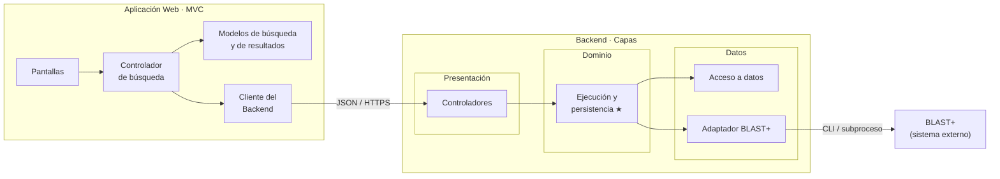
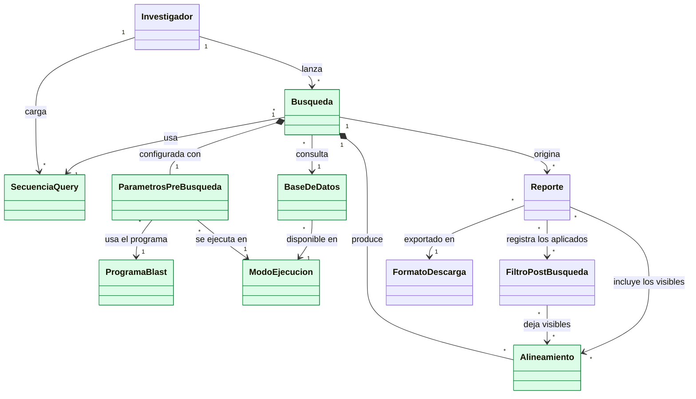
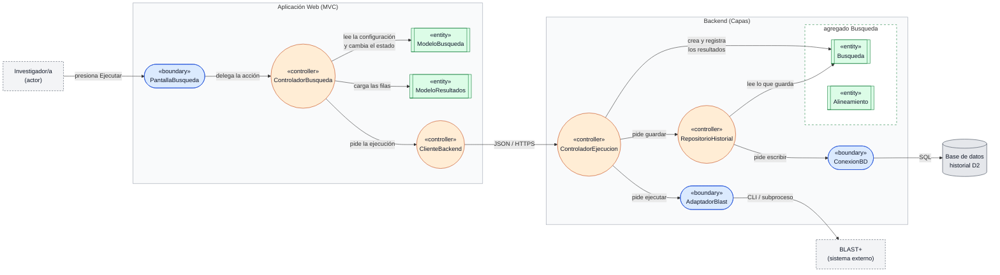
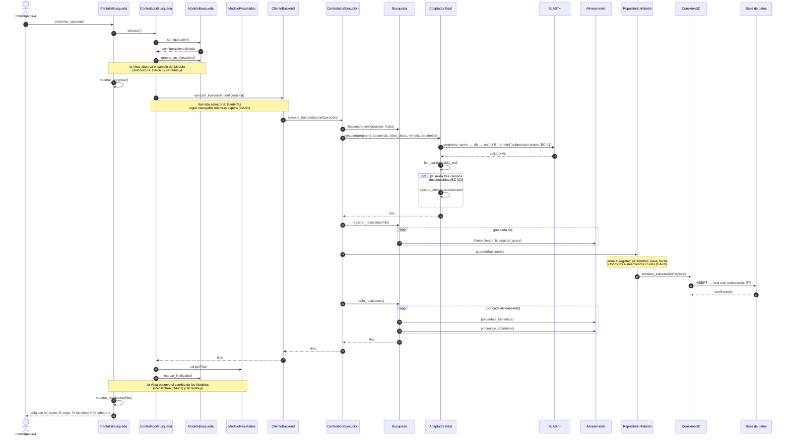
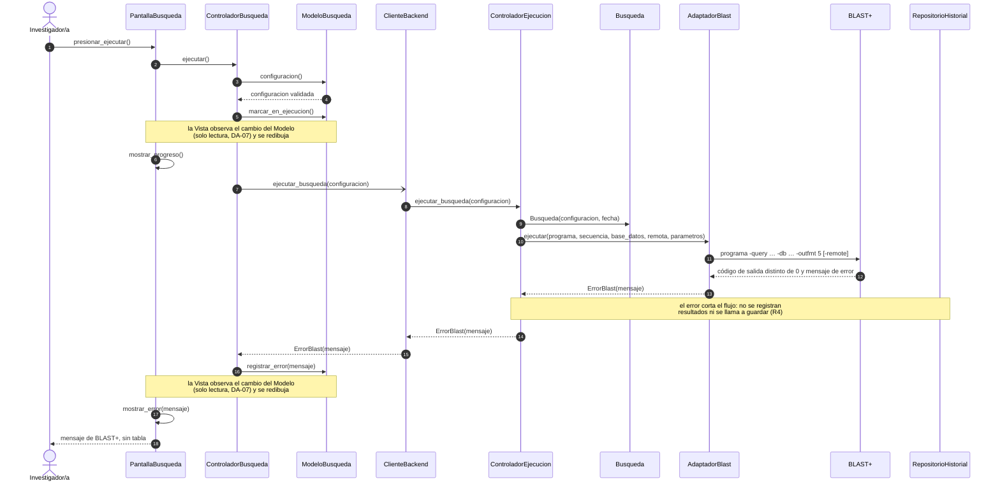

# Diseño detallado — LocalBlast

**HU08_CU004_B · Ejecutar la búsqueda validada y ver sus resultados**

Este documento baja la arquitectura de LocalBlast ([`architecture.md`](../architecture/architecture.md)) al nivel de clases para una historia de usuario. Parte de la HU y de sus criterios de aceptación, la analiza en sus tres dimensiones (funcionalidad, estructura y calidad) y deriva, en ese orden, el diagrama de robustez y los diagramas de secuencia. Cada diagrama sale del anterior: lo que no figura en la robustez no se invoca en las secuencias, y lo que no figura en las secuencias no se programa.

Las secciones 4 a 8 (modelo de clases, justificación del diseño, implementación, pruebas y trazabilidad) se agregan una vez implementada la HU, porque el modelo de clases se obtiene del código y se valida contra estos diagramas.

---

## Índice

1. [Introducción](#1-introducción)
2. [Relación con la arquitectura](#2-relación-con-la-arquitectura)
3. [Diseño de la HU](#3-diseño-de-la-hu)
   - 3.1 [Enunciado y criterios de aceptación](#31-enunciado-y-criterios-de-aceptación)
   - 3.2 [Entidades del modelo de dominio que intervienen](#32-entidades-del-modelo-de-dominio-que-intervienen)
   - 3.3 [Análisis tridimensional](#33-análisis-tridimensional)
   - 3.4 [Diagrama de robustez](#34-diagrama-de-robustez)
   - 3.5 [Diagramas de secuencia](#35-diagramas-de-secuencia)
   - 3.6 [Verificación de coherencia con la arquitectura](#36-verificación-de-coherencia-con-la-arquitectura)
   - 3.7 [Cambios en los documentos anteriores](#37-cambios-en-los-documentos-anteriores)
9. [Glosario y bibliografía](#9-glosario-y-bibliografía)

---

## 1. Introducción

### 1.1 Propósito

Definir qué clases, operaciones y colaboraciones implementan la ejecución de una búsqueda BLAST en LocalBlast, desde que el investigador presiona **Ejecutar búsqueda** hasta que ve la tabla de alineamientos y la búsqueda queda guardada en el historial. El documento es la guía para implementar y probar esa funcionalidad.

### 1.2 Historia de usuario elegida

**`HU08_CU004_B` · Ejecutar la búsqueda validada y ver sus resultados**: el camino feliz (pasos 1 a 4) del caso de uso `CU004`. Realiza RF-08, RF-09 y RF-10.

**Qué queda afuera de este diseño:**

- La **cancelación** (`HU09_CU004_A1`) y el **fallo del modo remoto** con su mensaje diferenciado (`HU10_CU004_E1`), que tienen sus propias historias.
- La **identificación del investigador** (autenticación y sesión). No tiene historia de usuario propia y no forma parte de lo que esta HU pide.
- La **validación** de la búsqueda. Es la precondición de la HU (la deja hecha `HU05_CU003_B`), así que aquí la búsqueda llega ya validada.

### 1.3 Motivo de la elección

La HU cumple las tres condiciones para sostener un diseño en tres dimensiones:

| Condición | Evidencia en la arquitectura |
|---|---|
| Está asociada a un escenario de calidad | `EC-01` (concurrencia de invocaciones) y `EC-02` (cambio menor de versión de BLAST+) llegan al componente **Adaptador BLAST+**, que la HU atraviesa (tabla 11.1 de la arquitectura) |
| Atraviesa la estructura | Su recorrido (tabla 11.2) pasa por la Aplicación Web, por las tres capas del Backend y por el sistema externo BLAST+ |
| Hay decisiones de arquitectura que la afectan | `DA-03` (Adaptador BLAST+ dedicado) y `DA-04` (un subproceso por búsqueda) citan al Adaptador; `DA-02` (capas) rige todo el recorrido por el Backend |

Más allá de esas condiciones, es **la historia que justifica la existencia del producto**. LocalBlast es una interfaz para BLAST+, y esta es la única HU en la que BLAST+ se invoca de verdad. Las historias anteriores preparan la búsqueda y las posteriores trabajan sobre resultados que ya existen. Es también la que verifica el driver de la arquitectura (interoperabilidad) y la que tiene más riesgo técnico: ejecutar sin bloquear la interfaz, atender varias búsquedas a la vez sin mezclar resultados e interpretar una salida que no controlamos.

### 1.4 Siglas

| Sigla | Significado |
|---|---|
| BD | Base de datos relacional donde se guarda el historial (no confundir con la entidad `BaseDeDatos`, que es una base de datos BLAST) |
| C4 | Modelo de documentación de arquitectura en cuatro niveles: contexto, contenedores, componentes y código |
| CA | Criterio de aceptación de una historia de usuario |
| CLI | Interfaz de línea de comandos (*command-line interface*) |
| CU | Caso de uso |
| D2 | Almacén del DFD con las búsquedas ejecutadas y sus resultados crudos (historial) |
| DA | Decisión de arquitectura |
| DFD | Diagrama de flujo de datos |
| EC | Escenario de calidad |
| GRASP | Patrones generales para asignar responsabilidades (*General Responsibility Assignment Software Patterns*) |
| HTTP / HTTPS | Protocolo de la web / HTTP sobre una conexión cifrada |
| HU | Historia de usuario |
| JSON | Formato de texto para intercambiar datos estructurados; es el formato de las solicitudes entre la Aplicación Web y el Backend |
| MVC | Modelo-Vista-Controlador |
| NCBI | *National Center for Biotechnology Information*, proveedor del BLAST remoto |
| REST | Estilo de interfaz web basado en recursos y operaciones HTTP; es la interfaz que el Backend ofrece a la Aplicación Web |
| RF | Requerimiento funcional |
| SQL | Lenguaje para consultar y modificar bases de datos relacionales |
| XML | Formato de datos con etiquetas; es la salida de BLAST+ que usa este diseño (`-outfmt 5`) |

---

## 2. Relación con la arquitectura

### 2.1 Tabla de coherencia

| Dimensión | Contenido |
|---|---|
| **Funcionalidad** | `HU08_CU004_B`, slice básico `CU004_B` del caso de uso `CU004 · Ejecutar la búsqueda y ver sus resultados` (pasos 1 a 4). Caminos: el principal (ejecutar, guardar en el historial y mostrar la tabla) y uno de error (BLAST+ no termina bien: no se muestra tabla ni se guarda nada, como exige la garantía mínima de `CU004`). |
| **Estructura** | Contenedor **Aplicación Web** (patrón MVC, `DA-07`): Pantallas, Controlador de búsqueda, Modelo de búsqueda, Modelo de resultados y Cliente del Backend. Contenedor **Backend** (patrón Capas, `DA-02`): **Controladores** (presentación), **Ejecución y persistencia** (dominio), **Acceso a datos** y **Adaptador BLAST+** (datos). Sistema externo **BLAST+**. Estilo base cliente-servidor (`DA-01`). **Componente principal: Ejecución y persistencia.** |
| **Calidad** | `EC-01` · hasta cinco búsquedas concurrentes sin cruce de resultados. Tácticas: *introducir concurrencia* y *encapsular*. Decisión: `DA-04` (un subproceso de BLAST+ por búsqueda). `EC-02` · cambio menor de versión de BLAST+ sin romper la lectura de la salida. Tácticas: *adaptar la interfaz* y *encapsular*. Decisión: `DA-03` (Adaptador BLAST+ dedicado en la capa de datos). |
| **Dominio** | Entidades del modelo de dominio que intervienen: `Busqueda` y `Alineamiento` como clases; `SecuenciaQuery`, `ParametrosPreBusqueda` (con su `ProgramaBlast` y su `ModoEjecucion`) y `BaseDeDatos` como datos de la búsqueda. No intervienen `Investigador`, `FiltroPostBusqueda`, `Reporte` ni `FormatoDescarga` (ver [3.2](#32-entidades-del-modelo-de-dominio-que-intervienen)). |
| **Verificación** | `EC-01`: se verificará con una prueba de cinco búsquedas lanzadas a la vez sobre un adaptador simulado con demoras distintas; cada una recibe exactamente sus propios alineamientos (cero cruces). `EC-02`: se verificará con una prueba de la lectura de una salida XML con campos desconocidos; los campos obligatorios llegan intactos y queda registrada una advertencia. Las pruebas concretas se diseñan en la etapa de pruebas, una vez aprobado este diseño. |

### 2.2 Recorrido de la HU sobre los componentes

★ componente principal de la HU.

La verificación completa de coherencia con la arquitectura está en la [sección 3.6](#36-verificación-de-coherencia-con-la-arquitectura), porque necesita los diagramas de robustez y de secuencia.

---

## 3. Diseño de la HU

### 3.1 Enunciado y criterios de aceptación

> **Como** investigador/a,
> **quiero** que el sistema invoque a BLAST+ en segundo plano sobre mi búsqueda validada, con indicador de progreso y opción de cancelar, y que al terminar me muestre los alineamientos en una tabla y guarde automáticamente la búsqueda en el historial,
> **para** poder seguir trabajando en la aplicación mientras la búsqueda corre, ver los resultados apenas estén listos y no perder la búsqueda aunque no llegue a refinarla ni descargarla en esta sesión.

- **CA-01. Ejecución asíncrona con indicador de progreso.** **Given** una búsqueda ya configurada y validada (postcondición de `CU003`), **When** el investigador presiona "Ejecutar búsqueda" y el sistema invoca a BLAST+ en segundo plano, **Then** la interfaz muestra un indicador de progreso visible y permanece navegable: el investigador puede desplazarse dentro de la aplicación sin que la ejecución se interrumpa.
- **CA-02. Presentación de la tabla al finalizar.** **Given** una búsqueda en ejecución que BLAST+ termina exitosamente, **When** el sistema recibe el conjunto crudo de alineamientos, **Then** presenta los resultados en una tabla con al menos las columnas: identificador del hit, score, E-value observado, porcentaje de identidad y porcentaje de cobertura.
- **CA-03. Persistencia automática en el historial.** **Given** una búsqueda que BLAST+ terminó exitosamente, **When** el sistema recibe su conjunto crudo de alineamientos, **Then** registra en el historial (D2), antes de presentar la tabla, una entrada con los parámetros pre-búsqueda, la base de datos usada, el timestamp y el conjunto **completo** de resultados crudos que devolvió BLAST+ (antes de cualquier filtro post-búsqueda), sin que el investigador tenga que ejercer `CU005` ni `CU006` para que la persistencia ocurra.

> **Precisión de CA-03.** La redacción original registraba la búsqueda "cuando el sistema termina de mostrar" la tabla. Eso chocaba con la garantía mínima de `CU004` ("si la tabla se muestra, la entrada en D2 también queda escrita"): si se muestra primero y se guarda después, una falla entre los dos pasos deja una tabla visible sin entrada en el historial. Se invirtió el orden (primero se guarda, después se muestra) en [`historias-usuario.md`](../requeriments/historias-usuario.md) y en el flujo de `CU004` de [`casos-de-uso.md`](../requeriments/casos-de-uso.md).

**La búsqueda no se guarda antes de ejecutarse.** La secuencia y la configuración validadas las conserva la Aplicación Web (en su Modelo de búsqueda) y viajan completas en la solicitud de ejecución. La única escritura en la base es la del historial, cuando BLAST+ ya terminó (RF-10).

### 3.2 Entidades del modelo de dominio que intervienen

Se marcaron los sustantivos del enunciado y de los criterios ("búsqueda validada", "BLAST+", "alineamientos", "tabla", "historial", "parámetros pre-búsqueda", "base de datos usada", "timestamp", "resultados crudos", "identificador del hit", "score", "E-value", "porcentaje de identidad", "porcentaje de cobertura") y se buscaron en el [modelo de dominio](../requeriments/modelo-dominio.md). En verde, las entidades que intervienen. El diagrama muestra la parte del modelo que está dentro del alcance de implementación: se omiten `Usuario` y `Administrador`, porque la administración del catálogo de bases no se implementa (ver la [nota sobre el alcance](../requeriments/modelo-dominio.md#nota-sobre-el-alcance) del modelo).

| Entidad del modelo | ¿Interviene? | Qué usa la HU de ella | La HU la... |
|---|---|---|---|
| `Busqueda` | Sí, como clase | Su configuración, para invocar a BLAST+; los alineamientos que produce; el momento en que se ejecutó | Crea (a partir de la configuración validada) |
| `Alineamiento` | Sí, como clase | Identificador del hit, score, E-value, % identidad y % cobertura: las cinco columnas de la tabla | Crea |
| `SecuenciaQuery` | Sí, como dato de `Busqueda` | El texto FASTA que recibe BLAST+ y su longitud (para la cobertura) | Consulta |
| `ParametrosPreBusqueda` | Sí, como dato de `Busqueda` | E-value máximo, tamaño de palabra, matriz y penalizaciones de gap, y el programa y el modo elegidos | Consulta |
| `ProgramaBlast` | Sí, como dato de `ParametrosPreBusqueda` | Qué binario se invoca (`blastn`, `blastp`, …) | Consulta |
| `ModoEjecucion` | Sí, como dato de `ParametrosPreBusqueda` | Si la invocación lleva la flag `-remote` | Consulta |
| `BaseDeDatos` | Sí, como dato de `Busqueda` | Su ubicación (ruta del índice local o nombre de la base de NCBI) | Consulta |
| `Investigador` | No | La identificación del investigador queda afuera de esta HU (1.2) | — |
| `FiltroPostBusqueda` | No | CA-03 exige guardar el conjunto **crudo**; filtrar es `HU11_CU005_B` | — |
| `Reporte`, `FormatoDescarga` | No | Descargar es `HU12_CU006_B` | — |

**Por qué cinco entidades intervienen solo como datos.** `SecuenciaQuery`, `ParametrosPreBusqueda`, `ProgramaBlast`, `ModoEjecucion` y `BaseDeDatos` tienen reglas propias (alfabeto, rangos, compatibilidad entre programa, query y base), pero esas reglas pertenecen a las HU de carga, configuración y validación (`HU01` a `HU07`). Esta HU solo lee sus valores para pasárselos a BLAST+ y guardarlos en el historial. Alcanza con que `Busqueda` los exponga como atributos (la configuración que recibe); convertirlas en clases acá agregaría clases sin comportamiento.

**Cambios al modelo de dominio.** Al armar esta tabla se detectó que el modelo no tenía el concepto **ProgramaBlast** y que tenía multiplicidades que contradecían a `CU001` (una misma secuencia se usa en varias búsquedas). En una segunda revisión se reorganizaron las relaciones para que no pasen todas por `Busqueda`: el programa y el modo cuelgan ahora de `ParametrosPreBusqueda` (se eligen en la misma configuración previa), y `FiltroPostBusqueda` se conecta con `Alineamiento` y con `Reporte`, que es lo que realmente toca, en lugar de con `Busqueda`. Los cambios están en el *Registro de cambios* de [`modelo-dominio.md`](../requeriments/modelo-dominio.md#registro-de-cambios) (cambios 1 a 10).

### 3.3 Análisis tridimensional

| Elemento | Funcionalidad (qué hace) | Estructura (con qué se hace) | Calidad (qué propiedad cumple) |
|---|---|---|---|
| **CA-01** | Lanzar la búsqueda sin bloquear la interfaz y mostrar un indicador de progreso hasta que llegue la respuesta | `PantallaBusqueda` (delega y muestra el estado de los Modelos); `ControladorBusqueda` (marca la búsqueda en ejecución en `ModeloBusqueda` y pide la ejecución a `ClienteBackend` de forma asíncrona); `ControladorEjecucion` | La interfaz sigue navegable mientras BLAST+ corre, porque nadie en el cliente se queda bloqueado esperando la respuesta |
| **CA-02** | Al terminar BLAST+, mostrar la tabla con hit, score, E-value, % identidad y % cobertura | `AdaptadorBlast` (invoca y lee la salida); `Busqueda` y `Alineamiento`, que calcula sus porcentajes; en el cliente, `ControladorBusqueda` carga las filas en `ModeloResultados` y `PantallaBusqueda` las dibuja al observar el cambio | `EC-02`: si la salida trae campos nuevos, la tabla igual sale con los campos obligatorios intactos |
| **CA-03** | Guardar en el historial la búsqueda con parámetros, base, timestamp y todos los alineamientos crudos | `RepositorioHistorial` (arma el registro a partir de `Busqueda`) y `ConexionBD` (lo escribe en la base en una transacción) | Nunca se muestra una tabla sin su entrada en el historial: primero se guarda y después se devuelve la tabla |
| **`EC-01`** · Concurrencia | Hasta cinco investigadores ejecutan a la vez | Cada solicitud se atiende en su propio hilo del servidor; `AdaptadorBlast` lanza un subproceso propio por búsqueda | **Cero cruces de resultados**: los resultados vuelven por la misma llamada que los pidió, sin estado compartido entre búsquedas |
| **`EC-02`** · Cambio de versión de BLAST+ | BLAST+ devuelve campos que el sistema no conoce | `AdaptadorBlast`, que es el único que conoce el formato de la salida | El 100 % de las salidas "casi conocidas" conserva los campos obligatorios y deja una advertencia en el log |

Los escenarios de **tolerancia a fallos** (rate limit y timeout de NCBI) describen el error del modo remoto, que es `HU10_CU004_E1`. Los de **confidencialidad** dependen de la identificación del investigador, que queda afuera de esta HU. Los de **operabilidad** alcanzan a la configuración (`HU05`) y al filtrado (`HU11`).

### 3.4 Diagrama de robustez

Leyenda: borde punteado = actor o sistema externo; cilindro gris = almacén de datos; rectángulo redondeado azul = *boundary*; círculo naranja = *controller*; rectángulo con barras verde = *entity*. Los recuadros grises agrupan los elementos de cada contenedor y el recuadro verde punteado, el agregado `Busqueda`. Cada flecha dice qué le pide un elemento a otro.

**Cómo se clasificó cada elemento.**

- **Fronteras.** Hay tres, una por cada cosa con la que el sistema habla y que no es código nuestro: el investigador, a través de `PantallaBusqueda`; BLAST+, a través de `AdaptadorBlast`; y el motor de base de datos, a través de `ConexionBD`. La base de datos es un contenedor de LocalBlast, pero no tiene lógica nuestra: es un producto de terceros (PostgreSQL) al que se llega por una conexión y un protocolo (SQL). Para el código del Backend es tan externa como BLAST+, y por eso se accede a ella por una frontera y no directamente desde un controlador.
- **Controladores de la Aplicación Web.** `ControladorBusqueda` interpreta la acción del investigador y actualiza los Modelos (rol Controlador del MVC). `ClienteBackend` es el único que sabe hablar con el Backend por HTTP. La comunicación entre la Aplicación Web y el Backend **no** es una frontera: los dos contenedores tienen lógica nuestra y en los dos extremos hay controladores, así que es una coordinación entre controladores.
- **Controladores del Backend.** `ControladorEjecucion` coordina la ejecución. `RepositorioHistorial` sabe **qué** se guarda del historial (arma el registro a partir de la `Busqueda`), y `ConexionBD` sabe **cómo** se habla con el motor (conexión, sentencias SQL y transacción). El repositorio es un controlador técnico: no tiene reglas del negocio, solo coordina el guardado.
- **Entidades del Backend.** `Busqueda` y `Alineamiento`, que salen de la tabla 3.2. Forman un agregado: un alineamiento no existe sin su búsqueda, y desde afuera se accede siempre a través de `Busqueda`. Por eso `Alineamiento` no tiene flechas propias: solo lo crea y lo consulta su `Busqueda`.
- **Entidades de la Aplicación Web.** `ModeloBusqueda` y `ModeloResultados` son el rol Modelo del MVC: la representación, en el cliente, de la `Busqueda` que se va a ejecutar (su configuración validada y su estado) y de sus `Alineamiento` ya calculados (las filas de la tabla). No son entidades nuevas del dominio, sino la copia en el cliente de dos que ya están en el modelo.
- **Base de datos.** Es el almacén donde queda el historial (D2), en el contenedor *Base de datos*. No es una de las tres categorías de la robustez: se dibuja para mostrar dónde terminan los datos, igual que BLAST+. Solo la toca `ConexionBD`.

**Reglas de conexión verificadas.**

| Tipo de conexión | Flechas del diagrama | ¿Permitida? |
|---|---|---|
| Actor → boundary | Investigador → `PantallaBusqueda` | Sí |
| Boundary → controller | `PantallaBusqueda` → `ControladorBusqueda` | Sí |
| Controller → boundary | `ControladorEjecucion` → `AdaptadorBlast`; `RepositorioHistorial` → `ConexionBD` | Sí: el controlador se apoya en fronteras para llegar a un sistema externo |
| Controller → controller | `ControladorBusqueda` → `ClienteBackend` → `ControladorEjecucion` → `RepositorioHistorial` | Sí |
| Controller → entity | `ControladorBusqueda` → `ModeloBusqueda`, `ModeloResultados`; `ControladorEjecucion` → `Busqueda`; `RepositorioHistorial` → `Busqueda` | Sí |
| Boundary → sistema externo o almacén | `AdaptadorBlast` → BLAST+; `ConexionBD` → Base de datos | Sí: es la razón de ser de esas fronteras |
| Boundary → entity | — | No hay ninguna |
| Actor → controller o entity | — | No hay ninguna |

- **La pantalla no se conecta con ninguna entidad en el diagrama.** En la arquitectura, la Vista observa a los Modelos para leer su estado y redibujarse cuando cambia (`DA-07`, relación *Muestra* del catálogo de la Aplicación Web), pero nunca los modifica ni decide con ellos. Esa observación de solo lectura **no se dibuja en la robustez**, porque el diagrama no admite conexiones de una frontera a una entidad. Lo que el diagrama sí muestra es la regla de fondo: toda acción de la pantalla pasa por `ControladorBusqueda`, que es el único que modifica los Modelos. En los diagramas de secuencia la observación aparece como una nota, no como un mensaje.
- **La Vista nunca se conecta con el Backend:** el único camino hacia el servidor es `ControladorBusqueda → ClienteBackend → ControladorEjecucion`.
- `AdaptadorBlast` recibe datos simples y devuelve los hits como datos, no como `Alineamiento`.
- BLAST+ se alcanza solo a través de su frontera, y la base de datos solo a través de `RepositorioHistorial` y `ConexionBD`.

#### 3.4.1 Dónde vive cada regla del negocio

| # | Regla | Dónde vive | Por qué |
|---|---|---|---|
| R1 | % identidad = identidades ÷ longitud del alineamiento × 100; % cobertura = tramo de la query cubierto ÷ longitud de la query × 100 | Entidad `Alineamiento` | Experto: el alineamiento tiene todos los datos para calcularlos. La longitud de la query se la pasa `Busqueda` al crearlo |
| R2 | Al historial va el conjunto **completo** de alineamientos crudos, sin filtrar | Entidad `Busqueda` | Crea un `Alineamiento` por cada hit que devolvió BLAST+ y no descarta ninguno. Es el conjunto que después guarda el repositorio |
| R3 | La tabla se devuelve solo después de que la búsqueda quedó en el historial | `ControladorEjecucion` (orden de los pasos) | Es una regla de coordinación entre dos colaboradores (el repositorio y quien pidió la ejecución), y por eso el orden lo fija el controlador |
| R4 | Si BLAST+ no termina bien, no se muestra tabla ni se guarda nada (garantía mínima de `CU004`) | `AdaptadorBlast` (avisa con `ErrorBlast`) y `ControladorEjecucion` (el error corta el flujo antes de registrar y de guardar) | El Adaptador es quien sabe que BLAST+ falló (código de salida); el controlador no necesita ningún `if`, porque el error interrumpe la secuencia |
| R5 | Los campos de la salida de BLAST+ que no se conocen se ignoran y se advierten, sin tocar los conocidos (`EC-02`) | `AdaptadorBlast` | Táctica *adaptar la interfaz*: el formato de BLAST+ se conoce en un solo lugar (`DA-03`) |
| R6 | La ejecución pasa por los estados *en ejecución*, *finalizada* o *con error*, y la pantalla muestra progreso, tabla o mensaje según el estado | `ModeloBusqueda` (guarda el estado) y `ControladorBusqueda` (lo cambia) | Es estado de la interacción en el cliente, no del dominio. La Vista solo lo lee, al observar el Modelo, para saber qué dibujar |
| R7 | El registro del historial se escribe completo o no se escribe (la búsqueda y todos sus alineamientos en una sola transacción) | `ConexionBD` | Si la escritura falla a la mitad, no puede quedar una búsqueda con parte de sus alineamientos. La transacción es un detalle del motor de base de datos, y solo la frontera hacia la base lo conoce |

Las reglas del dominio (R1 a R5) viven en el Backend. La pantalla no aplica ninguna: solo muestra lo que tienen los Modelos.

#### 3.4.2 Elementos del diagrama y componentes de la arquitectura

| Elemento | Tipo | Contenedor | Componente | Capa / rol |
|---|---|---|---|---|
| `PantallaBusqueda` | boundary | Aplicación Web | Pantallas | Vista (MVC) |
| `ControladorBusqueda` | controller | Aplicación Web | Controlador de búsqueda | Controlador (MVC) |
| `ModeloBusqueda` | entity | Aplicación Web | Modelo de búsqueda | Modelo (MVC) |
| `ModeloResultados` | entity | Aplicación Web | Modelo de resultados | Modelo (MVC) |
| `ClienteBackend` | controller | Aplicación Web | Cliente del Backend | Apoyo (fuera de la tríada MVC) |
| `ControladorEjecucion` | controller | Backend | **Ejecución y persistencia** | Dominio |
| `Busqueda`, `Alineamiento` | entity | Backend | Ejecución y persistencia | Dominio |
| `RepositorioHistorial` | controller | Backend | Acceso a datos | Datos |
| `ConexionBD` | boundary | Backend | Acceso a datos | Datos |
| `AdaptadorBlast` | boundary | Backend | Adaptador BLAST+ | Datos |
| BLAST+ | sistema externo | — | — | — |
| Base de datos (historial D2) | almacén de datos | Base de datos (PostgreSQL) | — | — |

**Nota sobre el componente Controladores del Backend.** El mensaje de `ClienteBackend` a `ControladorEjecucion` llega por HTTP a una ruta del Backend (componente **Controladores**) que solo convierte la solicitud JSON en la llamada a `ejecutar_busqueda` y el resultado en la respuesta JSON. Es código del framework web sin lógica propia, y por eso no se modela como clase. Así el recorrido respeta la cadena del patrón Capas: Controladores → Ejecución y persistencia → Acceso a datos / Adaptador BLAST+.

**Nota sobre la persistencia intercambiable.** Que el historial se pueda guardar en memoria o en una base real sin tocar `ControladorEjecucion` es una decisión de clases (el controlador conocerá al repositorio solo por su interfaz). Se mostrará en el modelo de clases que se obtenga del código; la robustez no la representa con estereotipos.

### 3.5 Diagramas de secuencia

Hay dos diagramas: el camino principal y el camino de error. Ambos usan solo los participantes del diagrama de robustez. **Cada flecha sólida es una llamada a una operación de la clase que la recibe**: el texto de la flecha es el nombre de esa operación, que al implementar pasa al código con ese mismo nombre. Las flechas punteadas son respuestas. Las únicas excepciones son las flechas hacia BLAST+ y hacia la base de datos, que no son clases nuestras: su texto es la línea de comandos o la sentencia con que se las usa.

**Cómo se redibuja la Vista.** Cuando `ControladorBusqueda` cambia un Modelo, la Vista se entera por suscripción (en React, el cambio de estado provoca que el componente se vuelva a dibujar) y lee el estado del Modelo, como fija `DA-07`. Como en la robustez no hay conexión de la pantalla con los Modelos, en las secuencias esa lectura se muestra como una nota seguida de lo que dibuja la pantalla (`mostrar_progreso`, `mostrar_resultados` o `mostrar_error`), y no como un mensaje. El Modelo nunca llama a la Vista: no la conoce.

#### Secuencia 1 · Camino principal

Las tácticas de calidad se ven como operaciones concretas:

- **Introducir concurrencia (`EC-01`).** Cada solicitud de ejecución se atiende en su propio hilo del servidor, y en ese hilo `ejecutar` lanza un **subproceso propio** de BLAST+ y espera su salida (`DA-04`). Los hits vuelven por la misma llamada al mismo `ejecutar_busqueda` que los pidió. No hay ningún lugar compartido donde los resultados de dos búsquedas puedan mezclarse.
- **Adaptar la interfaz y encapsular (`EC-02`).** El controlador y las entidades nunca ven el XML de BLAST+. `leer_salida` toma los campos que conoce por su nombre y, si hay otros, el fragmento `opt` muestra cómo se advierten sin romper nada (`DA-03`).

#### Secuencia 2 · Camino de error: BLAST+ no termina bien

Este camino cubre la garantía mínima de `CU004`: si la ejecución no termina bien, no se muestra ninguna tabla y no se escribe nada en el historial. `RepositorioHistorial` figura en el diagrama justamente para mostrar que no recibe ninguna llamada; `ModeloResultados`, `ConexionBD` y la base de datos no aparecen porque no se usan. El tratamiento específico del error remoto (distinguir un timeout de un rechazo de NCBI) es de `HU10_CU004_E1`.

#### 3.5.1 Asignación de responsabilidades

| Responsabilidad | Quién | Criterio GRASP |
|---|---|---|
| Recibir el clic y mostrar el progreso, la tabla o el error según lo que tengan los Modelos | `PantallaBusqueda` | Bajo acoplamiento: para actuar solo conoce a `ControladorBusqueda`; a los Modelos solo los observa para leer, y no decide nada |
| Interpretar la acción "ejecutar" en el cliente: tomar la configuración, cambiar el estado, pedir la ejecución, cargar el resultado o el error | `ControladorBusqueda` | Controlador (del lado cliente) |
| Conservar la configuración validada y el estado de la ejecución | `ModeloBusqueda` | Experto en información |
| Conservar las filas recibidas para la tabla (y luego filtrarlas, en `HU11`) | `ModeloResultados` | Experto en información |
| Hablar con el Backend por HTTP | `ClienteBackend` | Bajo acoplamiento y alta cohesión: es lo único del cliente que conoce la forma de la interfaz REST |
| Coordinar la ejecución en el servidor: crear la búsqueda, invocar a BLAST+, registrar, guardar y devolver la tabla | `ControladorEjecucion` | Controlador: orquesta sin hacer el trabajo del dominio |
| Crear la `Busqueda` | `ControladorEjecucion` | Creador: es quien recibe la configuración con la que se inicializa |
| Crear los `Alineamiento` a partir de los hits | `Busqueda` | Creador: la búsqueda contiene a sus alineamientos y tiene el dato que les falta (la longitud de la query) |
| Calcular % identidad y % cobertura | `Alineamiento` | Experto en información |
| Armar las filas de la tabla | `Busqueda` | Experto: conoce todos sus alineamientos |
| Invocar a BLAST+ y leer su salida, advirtiendo los campos desconocidos | `AdaptadorBlast` | Bajo acoplamiento (es lo único que conoce a BLAST+) y alta cohesión |
| Armar el registro del historial a partir de la búsqueda y pedir que se escriba | `RepositorioHistorial` | Alta cohesión y bajo acoplamiento: el controlador pide "guardar" sin saber cómo ni dónde se guarda |
| Escribir el registro en la base de datos en una sola transacción | `ConexionBD` | Bajo acoplamiento y alta cohesión: es lo único que conoce el motor de base de datos y SQL |

### 3.6 Verificación de coherencia con la arquitectura

**Cada mensaje entre componentes distintos existe en el catálogo de relaciones.** Los mensajes entre elementos del mismo componente (por ejemplo, `ControladorEjecucion → Busqueda` o `RepositorioHistorial → ConexionBD`) no necesitan una relación en el catálogo.

| Mensaje de la secuencia | Componente origen → destino | Relación del catálogo |
|---|---|---|
| `PantallaBusqueda → ControladorBusqueda`: `ejecutar()` | Pantallas → Controlador de búsqueda | *Delega* ([7.2.2](../architecture/architecture.md#722-catálogo-de-relaciones-de-la-aplicación-web)) |
| Observación de `PantallaBusqueda` sobre `ModeloBusqueda` y `ModeloResultados` (notas de las secuencias) | Pantallas → Modelo de búsqueda y Modelo de resultados | *Muestra*, solo lectura (7.2.2). No se dibuja en la robustez porque el diagrama no admite frontera → entidad |
| `ControladorBusqueda → ModeloBusqueda`: `configuracion()`, `marcar_en_ejecucion()`, `marcar_finalizada()`, `registrar_error()` | Controlador de búsqueda → Modelo de búsqueda | *Actualiza* (7.2.2) |
| `ControladorBusqueda → ModeloResultados`: `cargar()` | Controlador de búsqueda → Modelo de resultados | *Carga resultados* (7.2.2) |
| `ControladorBusqueda → ClienteBackend`: `ejecutar_busqueda()` | Controlador de búsqueda → Cliente del Backend | *Envía* (7.2.2) |
| `ClienteBackend → ControladorEjecucion`: `ejecutar_busqueda()` | Cliente del Backend → Controladores → Ejecución y persistencia | *Solicita* (7.2.2 y 7.1.2) e *Invoca* ([7.1.2](../architecture/architecture.md#712-catálogo-de-relaciones-del-backend)) |
| `ControladorEjecucion → AdaptadorBlast`: `ejecutar()` | Ejecución y persistencia → Adaptador BLAST+ | *Ejecuta* (7.1.2) |
| `AdaptadorBlast → BLAST+` | Adaptador BLAST+ → BLAST+ | *Invoca*, CLI / subproceso (7.1.2) |
| `ControladorEjecucion → RepositorioHistorial`: `guardar()` | Ejecución y persistencia → Acceso a datos | *Persiste* (7.1.2) |
| `ConexionBD → Base de datos` | Acceso a datos → Base de datos | *Lee y escribe*, SQL (7.1.2) |

**Patrones y estilo del TP de arquitectura.**

- **Capas en el Backend (`DA-02`).** El recorrido baja siempre: Controladores → Ejecución y persistencia → Acceso a datos y Adaptador BLAST+. Ningún elemento de la capa de datos llama a uno de dominio; `RepositorioHistorial` recibe la `Busqueda` como parámetro y la traduce a un registro, que es la responsabilidad que el catálogo le da a Acceso a datos. No se saltea ninguna capa.
- **MVC en la Aplicación Web (`DA-07`).** La Vista delega toda acción en el Controlador y a los Modelos solo los observa para leer; solo el Controlador modifica los Modelos; los Modelos no conocen a nadie; el Cliente del Backend solo lo usa el Controlador.
- **Cliente-servidor (`DA-01`).** El único canal entre la Aplicación Web y el Backend es la solicitud JSON / HTTPS de `ClienteBackend`.
- **Tácticas de calidad.** `EC-01` se ve en el subproceso propio que lanza `ejecutar` (`DA-04`); `EC-02`, en `leer_salida` y `registrar_advertencia` del Adaptador (`DA-03`).

### 3.7 Cambios en los documentos anteriores

Al bajar al diseño aparecieron diferencias con documentos anteriores. Se documentan y se actualizaron esos documentos:

| Documento | Cambio | Motivo |
|---|---|---|
| [`modelo-dominio.md`](../requeriments/modelo-dominio.md#registro-de-cambios) | `ProgramaBlast` y `ModoEjecucion` cuelgan de `ParametrosPreBusqueda`; `FiltroPostBusqueda` se conecta con `Alineamiento` y `Reporte` en vez de con `Busqueda` (cambios 8 y 9) | Casi todas las relaciones pasaban por `Busqueda`, aunque varias entidades se relacionan entre sí sin pasar por ella |
| [`historias-usuario.md`](../requeriments/historias-usuario.md) y [`casos-de-uso.md`](../requeriments/casos-de-uso.md) | Orden de CA-03 de `HU08` y del flujo de `CU004`: primero se guarda en el historial y después se muestra la tabla | Ver la precisión de CA-03 en [3.1](#31-enunciado-y-criterios-de-aceptación) |

---

## 9. Glosario y bibliografía

### 9.1 Términos

| Término | Significado en este documento |
|---|---|
| Agregado | Grupo de entidades que se tratan como una unidad: se crean, se guardan y se acceden desde una entidad raíz (`Busqueda` con sus `Alineamiento`) |
| *Boundary* (frontera) | Elemento de la robustez que conecta al sistema con un actor o con algo que no es código nuestro (pantalla, BLAST+, motor de base de datos) |
| *Controller* (controlador) | Elemento de la robustez que coordina la funcionalidad: decide qué se hace y en qué orden. Los repositorios son controladores técnicos |
| *Entity* (entidad) | Elemento de la robustez que representa un concepto del dominio, con sus datos y sus reglas |
| Hit | Cada coincidencia que BLAST+ informa entre la query y una secuencia de la base; en el dominio es un `Alineamiento` |
| Historial | Conjunto de búsquedas finalizadas de un investigador, con sus resultados crudos (almacén D2) |
| Resultados crudos | Todos los alineamientos que devolvió BLAST+, antes de cualquier filtro post-búsqueda |
| Subproceso | Programa que el Backend lanza aparte (una invocación de BLAST+ por búsqueda) y del que espera su salida |
| Transacción | Grupo de escrituras en la base que se confirman todas juntas o ninguna |

Los términos del dominio (BLAST, BLAST+, query, FASTA, E-value, etc.) están definidos en el [Glosario del SRS](../requeriments/srs.md#10-glosario).

### 9.2 Bibliografía

- Valotto, V. *Diseño tridimensional de software*. 2025.
- Rosenberg, D. y Stephens, K. *Use Case Driven Object Modeling with UML: Theory and Practice*. Apress, 2007. Diagrama de robustez y sus reglas de conexión.
- Larman, C. *Applying UML and Patterns: An Introduction to Object-Oriented Analysis and Design and Iterative Development*. Prentice Hall. Criterios GRASP.
- Krasner, G. y Pope, S. "A Cookbook for Using the Model-View-Controller User Interface Paradigm in Smalltalk-80". *Journal of Object-Oriented Programming*, 1(3), 1988. Patrón MVC.
- Camacho, C. et al. "BLAST+: architecture and applications". *BMC Bioinformatics*, 10:421, 2009. Formato de invocación y salida de BLAST+.
