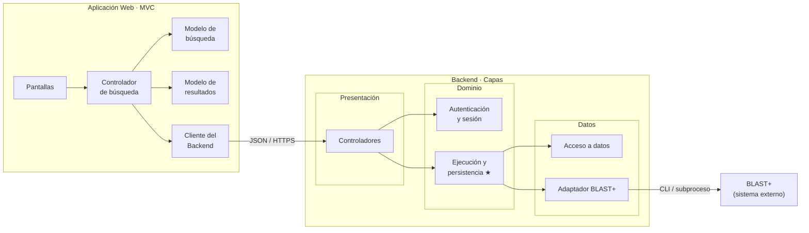
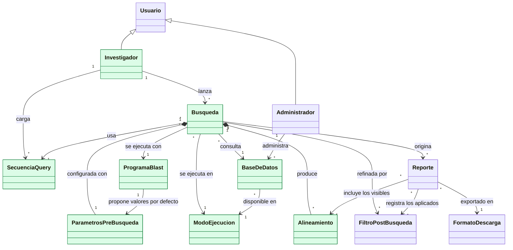
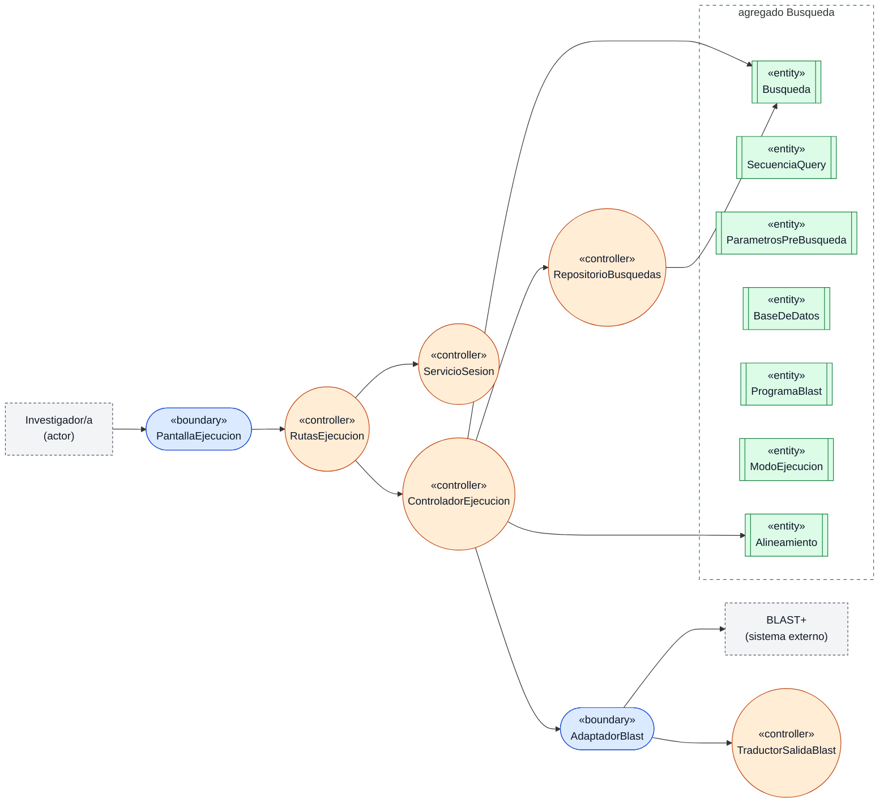
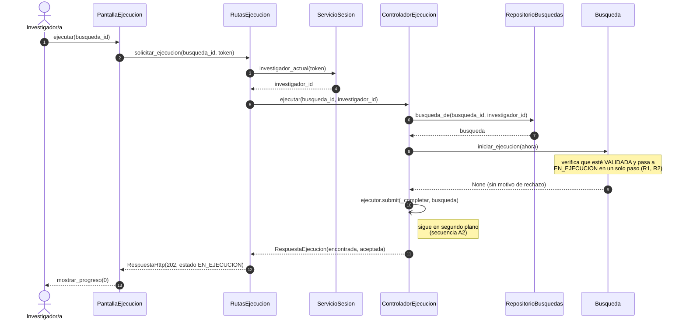
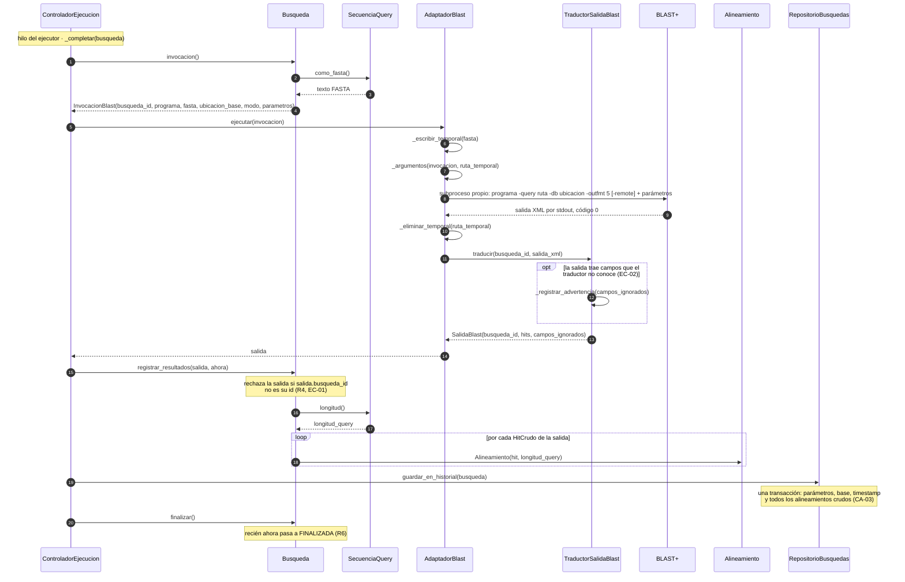
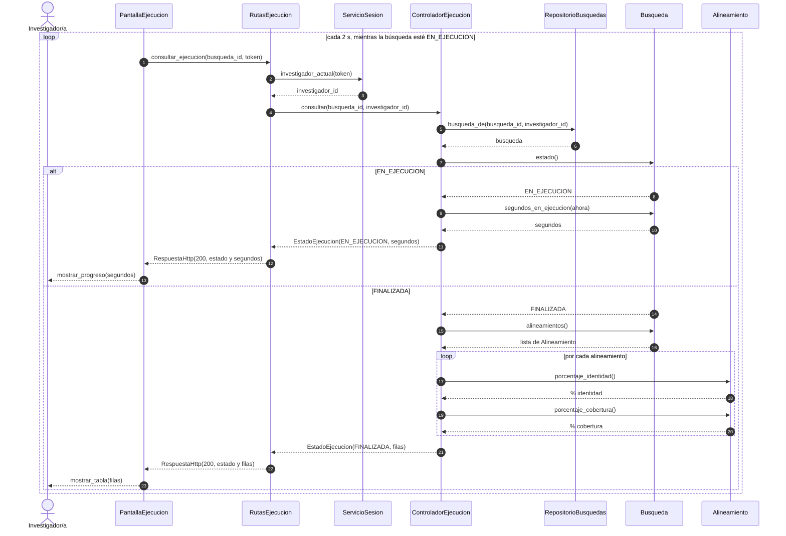
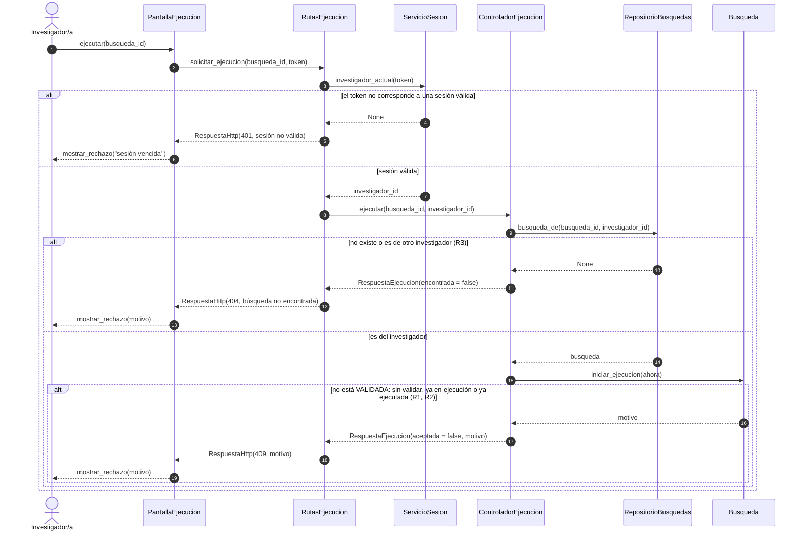
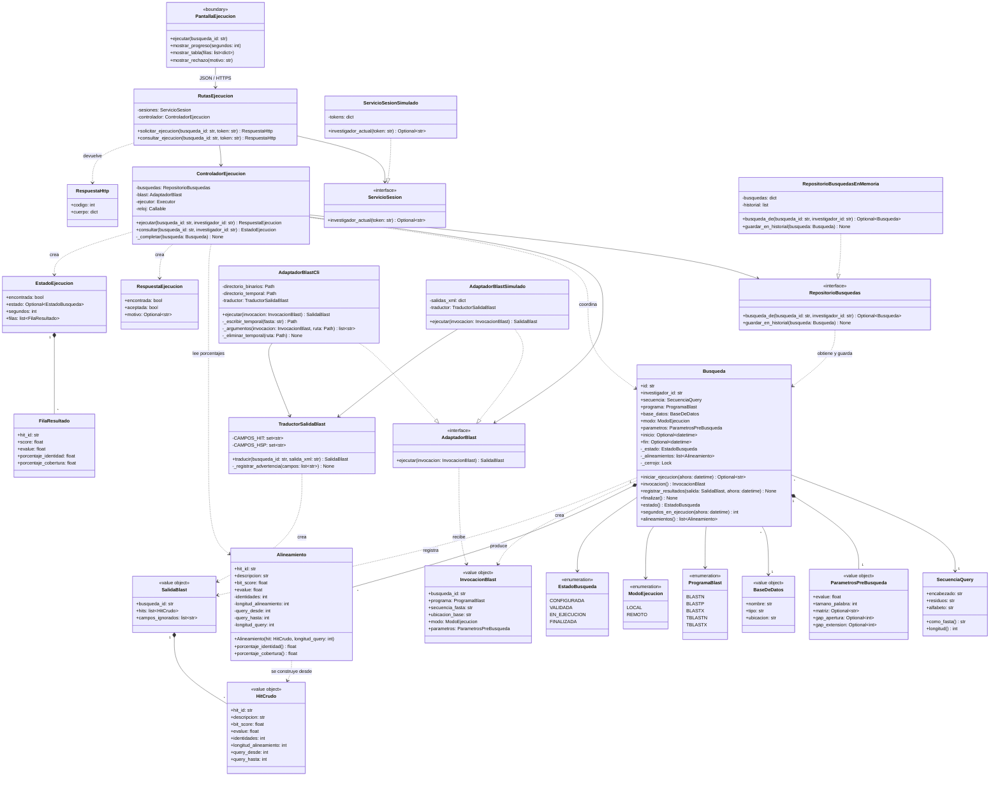

# Diseño detallado — LocalBlast

**HU08_CU004_B · Ejecutar la búsqueda validada y ver sus resultados**

Este documento baja la arquitectura de LocalBlast ([`architecture.md`](../architecture/architecture.md)) al nivel de clases para una historia de usuario. Parte de la HU y de sus criterios de aceptación, la analiza en sus tres dimensiones (funcionalidad, estructura y calidad) y deriva, en ese orden, el diagrama de robustez, los diagramas de secuencia y el modelo de clases. Cada diagrama se obtiene del anterior: lo que no figura en la robustez no se invoca en las secuencias, y lo que no figura en las secuencias no aparece en el modelo de clases.

---

## Índice

1. [Introducción](#1-introducción)
2. [Relación con la arquitectura](#2-relación-con-la-arquitectura)
3. [Diseño de la HU](#3-diseño-de-la-hu)
4. [Modelo de clases](#4-modelo-de-clases)
5. [Justificación del diseño](#5-justificación-del-diseño)
6. [Implementación](#6-implementación)
7. [Pruebas](#7-pruebas)
8. [Trazabilidad](#8-trazabilidad)
9. [Glosario y bibliografía](#9-glosario-y-bibliografía)

---

## 1. Introducción

### 1.1 Propósito

Definir qué clases, operaciones y colaboraciones implementan la ejecución de una búsqueda BLAST en LocalBlast, desde que el investigador presiona **Ejecutar búsqueda** hasta que ve la tabla de alineamientos y la búsqueda queda guardada en su historial. El documento es la guía para implementar y probar esa funcionalidad, y deja registradas las decisiones de diseño con su justificación.

### 1.2 Historia de usuario elegida

**`HU08_CU004_B` · Ejecutar la búsqueda validada y ver sus resultados**, slice básico (camino feliz, pasos 1 a 4) del caso de uso `CU004`. Realiza RF-08, RF-09 y RF-10.

Quedan fuera de este diseño los otros dos slices de `CU004`, que tienen su propia historia: la cancelación manual (`HU09_CU004_A1`) y el fallo del modo remoto (`HU10_CU004_E1`). El diseño deja preparado el lugar donde se van a enganchar (ver [5.3](#53-qué-queda-preparado-para-hu09-y-hu10)).

### 1.3 Motivo de la elección

La HU cumple las tres condiciones para sostener un diseño en tres dimensiones:

| Condición | Evidencia en la arquitectura |
|---|---|
| Está asociada a un escenario de calidad | `EC-01` (concurrencia de invocaciones) y `EC-02` (cambio menor de versión de BLAST+) llegan al componente **Adaptador BLAST+**, que la HU atraviesa (tabla 11.1 de la arquitectura) |
| Atraviesa la estructura | Su recorrido (tabla 11.2) pasa por los dos contenedores con lógica (Aplicación Web y Backend), por las tres capas del Backend y por el sistema externo BLAST+ |
| Hay decisiones de arquitectura que la afectan | `DA-03` (Adaptador BLAST+ dedicado) y `DA-04` (un subproceso por búsqueda) citan al Adaptador; `DA-02` (capas) y `DA-08` (único servidor) rigen todo el recorrido |

Más allá de esas condiciones, es **la historia que justifica la existencia del producto**. LocalBlast es una interfaz para BLAST+, y esta es la única HU en la que BLAST+ se invoca de verdad. Las HU anteriores (`HU01` a `HU07`) preparan la búsqueda y las posteriores (`HU11` a `HU13`) trabajan sobre resultados que ya existen. Si esta HU no está bien diseñada, el driver arquitectónico (interoperabilidad) queda sin verificar. Es además la HU con más riesgo técnico: ejecución asíncrona, concurrencia entre investigadores, parseo de una salida que no controlamos y la garantía de que lo que se muestra coincide con lo que se guarda.

### 1.4 Siglas

| Sigla | Significado |
|---|---|
| BD | Base de datos |
| C4 | Modelo de documentación de arquitectura en cuatro niveles: contexto, contenedores, componentes y código |
| CA | Criterio de aceptación de una historia de usuario |
| CLI | Interfaz de línea de comandos (*command-line interface*) |
| CP | Caso de prueba |
| CU | Caso de uso |
| D2 | Almacén del DFD con las búsquedas finalizadas y sus resultados crudos (historial) |
| DA | Decisión de arquitectura |
| DFD | Diagrama de flujo de datos |
| EC | Escenario de calidad |
| GRASP | Patrones generales para asignar responsabilidades (*General Responsibility Assignment Software Patterns*) |
| HTTP / HTTPS | Protocolo de la web / HTTP sobre una conexión cifrada |
| HU | Historia de usuario |
| JSON | Formato de texto para intercambiar datos estructurados |
| MVC | Modelo-Vista-Controlador |
| NCBI | *National Center for Biotechnology Information*, proveedor del BLAST remoto |
| RF | Requerimiento funcional |
| REST | Estilo de diseño de interfaces sobre HTTP |
| XML | Formato de datos estructurados con etiquetas; es el formato de salida de BLAST+ que usa este diseño (`-outfmt 5`) |

---

## 2. Relación con la arquitectura

### 2.1 Tabla de coherencia

| Dimensión | Contenido |
|---|---|
| **Funcionalidad** | `HU08_CU004_B`, slice básico `CU004_B` del caso de uso `CU004 · Ejecutar la búsqueda y ver sus resultados` (pasos 1 a 4). Caminos: el principal (que por ser asíncrono se dibuja en tres momentos: lanzar, completar en segundo plano y consultar hasta ver la tabla) y los rechazos al lanzar (sin sesión, búsqueda inexistente o ajena, búsqueda no ejecutable). |
| **Estructura** | Contenedor **Aplicación Web** (patrón MVC, `DA-07`): Pantallas, Controlador de búsqueda, Modelo de búsqueda, Modelo de resultados, Cliente del Backend. Contenedor **Backend** (patrón Capas, `DA-02`): **Controladores** (presentación), **Autenticación y sesión** y **Ejecución y persistencia** (dominio), **Acceso a datos** y **Adaptador BLAST+** (datos). Sistema externo **BLAST+**. Estilo base cliente-servidor (`DA-01`). **Componente principal: Ejecución y persistencia**, que coordina la HU; el **Adaptador BLAST+** es el componente donde se juegan los escenarios de calidad. |
| **Calidad** | `EC-01` · hasta cinco búsquedas concurrentes sin cruce de resultados. Tácticas: *introducir concurrencia* y *encapsular*. Decisiones: `DA-04` (un subproceso de BLAST+ por búsqueda) y `DA-08`. `EC-02` · cambio menor de versión de BLAST+ sin romper el parseo. Tácticas: *adaptar la interfaz* y *encapsular*. Decisión: `DA-03` (Adaptador BLAST+ dedicado en la capa de datos). Además alcanzan a la HU los dos escenarios de **confidencialidad** (archivos temporales con la secuencia y aislamiento del historial entre investigadores). |
| **Dominio** | Entidades del modelo de dominio que intervienen: `Busqueda`, `SecuenciaQuery`, `ProgramaBlast`, `ParametrosPreBusqueda`, `ModoEjecucion`, `BaseDeDatos`, `Alineamiento` e `Investigador` (solo su identificador). No intervienen `Administrador`, `FiltroPostBusqueda`, `Reporte` ni `FormatoDescarga` (ver [3.2](#32-entidades-del-modelo-de-dominio-que-intervienen)). |
| **Verificación** | `EC-01`: prueba con cinco búsquedas lanzadas a la vez sobre un adaptador simulado con demoras distintas; cada búsqueda termina con exactamente sus propios alineamientos (cero cruces). `EC-02`: prueba del traductor con una salida XML que trae campos que no conoce; los cinco campos obligatorios llegan intactos y queda registrada la advertencia. Ver [8.2](#82-casos-de-prueba-previstos). |

### 2.2 Recorrido de la HU sobre los componentes



★ componente principal de la HU.

### 2.3 Verificación de coherencia con la arquitectura

La verificación completa, con la evidencia de cada punto, está al final del diseño, en la [sección 8.3](#83-verificación-de-coherencia), porque necesita los diagramas de las secciones 3 y 4.

---

## 3. Diseño de la HU

### 3.1 Enunciado y criterios de aceptación

> **Como** investigador/a,
> **quiero** que el sistema invoque a BLAST+ en segundo plano sobre mi búsqueda validada, con indicador de progreso y opción de cancelar, y que al terminar me muestre los alineamientos en una tabla y guarde automáticamente la búsqueda en el historial,
> **para** poder seguir trabajando en la aplicación mientras la búsqueda corre, ver los resultados apenas estén listos y no perder la búsqueda aunque no llegue a refinarla ni descargarla en esta sesión.

- **CA-01. Ejecución asíncrona con indicador de progreso.** **Given** una búsqueda ya configurada y validada (postcondición de `CU003`), **When** el investigador presiona "Ejecutar búsqueda" y el sistema invoca a BLAST+ en segundo plano, **Then** la interfaz muestra un indicador de progreso visible y permanece navegable: el investigador puede desplazarse dentro de la aplicación sin que la ejecución se interrumpa.
- **CA-02. Presentación de la tabla al finalizar.** **Given** una búsqueda en ejecución que BLAST+ termina exitosamente, **When** el sistema recibe el conjunto crudo de alineamientos, **Then** presenta los resultados en una tabla con al menos las columnas: identificador del hit, score, E-value observado, porcentaje de identidad y porcentaje de cobertura.
- **CA-03. Persistencia automática en el historial.** **Given** una búsqueda que BLAST+ terminó exitosamente, **When** el sistema recibe su conjunto crudo de alineamientos, **Then** registra en el historial (D2), antes de presentar la tabla, una entrada con los parámetros pre-búsqueda, la base de datos usada, el timestamp y el conjunto **completo** de resultados crudos que devolvió BLAST+ (antes de cualquier filtro post-búsqueda), sin que el investigador tenga que ejercer `CU005` ni `CU006` para que la persistencia ocurra.

> **Precisión de CA-03.** La redacción original decía que la búsqueda se registraba "cuando el sistema termina de mostrar" la tabla. Al diseñar la secuencia apareció un conflicto con la garantía mínima de `CU004` ("si la tabla se muestra, la entrada en D2 también queda escrita"): si se muestra primero y se guarda después, una falla entre los dos pasos deja una tabla visible sin entrada en el historial. El orden se invirtió (primero se guarda, después se muestra) y se actualizó el criterio en [`historias-usuario.md`](../requeriments/historias-usuario.md) y el flujo de `CU004` en [`casos-de-uso.md`](../requeriments/casos-de-uso.md). El valor para el investigador no cambia.

**Precondición del slice.** Existe una búsqueda en estado *Validada*, del investigador que la ejecuta. La dejó así `CU003` (`HU05_CU003_B`), cuyo diseño no forma parte de este documento.

### 3.2 Entidades del modelo de dominio que intervienen

Se marcaron los sustantivos del enunciado y de los criterios ("búsqueda validada", "BLAST+", "alineamientos", "tabla", "historial", "parámetros pre-búsqueda", "base de datos usada", "timestamp", "resultados crudos", "identificador del hit", "score", "E-value", "porcentaje de identidad", "porcentaje de cobertura") y se buscaron en el [modelo de dominio](../requeriments/modelo-dominio.md). En verde, las entidades que intervienen:



| Entidad del modelo | ¿Interviene? | Qué usa la HU de ella | La HU la... |
|---|---|---|---|
| `Busqueda` | Sí | Su estado (solo se ejecuta si está *Validada*), su configuración completa para armar la invocación a BLAST+, el investigador al que pertenece y los alineamientos que produce. Es la que pasa por *En ejecución* y *Finalizada* | Consulta y modifica |
| `SecuenciaQuery` | Sí | El texto FASTA que recibe BLAST+ y su longitud (para calcular la cobertura) | Consulta |
| `ProgramaBlast` | Sí | Qué binario se invoca (`blastn`, `blastp`, …) | Consulta |
| `ParametrosPreBusqueda` | Sí | E-value máximo, tamaño de palabra, matriz y penalizaciones de gap, que viajan a BLAST+ y se guardan en el historial | Consulta |
| `ModoEjecucion` | Sí | Si la invocación lleva la flag `-remote` | Consulta |
| `BaseDeDatos` | Sí | Su ubicación (ruta del índice local o nombre de la base de NCBI) y su nombre, que se guarda en el historial | Consulta |
| `Alineamiento` | Sí | Identificador del hit, score, E-value, % identidad y % cobertura: las cinco columnas de la tabla | Crea |
| `Investigador` | Sí, solo su identificador | Que la búsqueda le pertenezca: nadie ejecuta ni consulta búsquedas ajenas | Consulta (el identificador) |
| `Usuario` | No | La HU trabaja con el rol Investigador; la generalización no agrega nada | — |
| `Administrador` | No | Fuera del alcance; el catálogo de bases ya está cargado | — |
| `FiltroPostBusqueda` | No | CA-03 exige guardar el conjunto **crudo**, antes de cualquier filtro. Filtrar es `HU11_CU005_B` | — |
| `Reporte` | No | Descargar es `HU12_CU006_B` | — |
| `FormatoDescarga` | No | Descargar es `HU12_CU006_B` | — |

**Cambios al modelo de dominio.** Al armar esta tabla se detectó que el modelo no tenía el concepto **ProgramaBlast**, que tenía multiplicidades que contradecían a `CU001` (una secuencia usada por varias búsquedas) y que no explicitaba el **ciclo de vida de la búsqueda**, del que depende la regla "solo se ejecuta una búsqueda validada". El modelo se corrigió y los cambios quedaron registrados en la sección *Registro de cambios* de [`modelo-dominio.md`](../requeriments/modelo-dominio.md#registro-de-cambios).

### 3.3 Análisis tridimensional

| Elemento | Funcionalidad (qué hace) | Estructura (con qué se hace) | Calidad (qué propiedad cumple) |
|---|---|---|---|
| **CA-01** | Lanzar la búsqueda validada sin esperar a que BLAST+ termine y mostrar un indicador de progreso | Pantalla de ejecución; rutas HTTP del Backend; controlador de ejecución, que deja la ejecución corriendo en segundo plano; entidad `Busqueda`, que pasa de *Validada* a *En ejecución* | La interfaz no se bloquea: la solicitud vuelve de inmediato (respuesta `202`) y el progreso se consulta desde el cliente, porque el estilo cliente-servidor no deja que el servidor empuje mensajes (`DA-01`) |
| **CA-02** | Al terminar BLAST+, mostrar la tabla con hit, score, E-value, % identidad y % cobertura | Adaptador BLAST+ (invoca y traduce la salida); entidades `Busqueda` y `Alineamiento`, que calcula sus porcentajes; pantalla que dibuja la tabla | `EC-02`: si la salida trae campos nuevos, la tabla igual sale con los cinco campos obligatorios intactos |
| **CA-03** | Guardar en el historial la búsqueda con parámetros, base, timestamp y todos los alineamientos crudos | Repositorio de búsquedas (Acceso a datos), que guarda en una sola transacción; `Busqueda` pasa a *Finalizada* recién después de guardarse | Consistencia: nunca se muestra una tabla sin su entrada en el historial (garantía mínima de `CU004`) |
| **`EC-01`** · Concurrencia | Hasta cinco investigadores ejecutan a la vez | Ejecutor de hasta cinco hilos en el controlador de ejecución; un subproceso de BLAST+ y un archivo temporal propios por búsqueda en el Adaptador | **Cero cruces de resultados**: la salida viaja etiquetada con el identificador de su búsqueda y `Busqueda` rechaza una salida que no es suya |
| **`EC-02`** · Cambio de versión de BLAST+ | BLAST+ devuelve campos que el sistema no conoce | Traductor de la salida dentro del Adaptador BLAST+ | El 100 % de las salidas "casi conocidas" conserva los campos obligatorios y el 100 % deja una advertencia en el log |
| **Confidencialidad · escenario 1** (5.3) | La secuencia viaja a BLAST+ a través de un archivo temporal | Adaptador BLAST+ | El archivo se crea con permisos solo para el usuario del sistema y se borra al terminar la ejecución, salga bien o mal (medida: ningún archivo pasado 1 minuto) |
| **Confidencialidad · escenario 2** (5.3) | Un investigador intenta ejecutar o consultar la búsqueda de otro | Autenticación y sesión (identifica al investigador); repositorio, que solo devuelve búsquedas del investigador que pregunta | La respuesta es la misma para una búsqueda ajena que para una inexistente (`404`): no se revela si existe |

Los escenarios de **tolerancia a fallos** (rate limit y timeout de NCBI) no alcanzan a este slice: describen el camino de error del modo remoto, que es `HU10_CU004_E1`. Los de **operabilidad** alcanzan a la configuración (`HU05`) y al filtrado (`HU11`), no a la ejecución.

### 3.4 Diagrama de robustez

Leyenda: borde punteado = actor o sistema externo; rectángulo redondeado azul = *boundary*; círculo naranja = *controller*; rectángulo con barras verde = *entity*. El recuadro punteado agrupa las entidades del agregado `Busqueda`, a las que se accede a través de su raíz.



**Cómo se clasificó cada elemento.**

- **Fronteras.** Hay dos, porque el sistema habla con dos cosas que no son él: el investigador (a través de `PantallaEjecucion`) y BLAST+ (a través de `AdaptadorBlast`). La comunicación entre la Aplicación Web y el Backend **no** es una frontera: los dos contenedores son parte de LocalBlast, así que `RutasEjecucion` es un controlador que recibe el pedido de otro controlador, no un borde del sistema.
- **La Aplicación Web como una sola frontera.** En esta HU la Aplicación Web no aplica ninguna regla del negocio: la validación (`DA-05`) es de `HU05` y el filtrado (`DA-06`) es de `HU11`. Para esta HU solo muestra el progreso, consulta el estado periódicamente y dibuja la tabla. Por eso se la representa con una única frontera, `PantallaEjecucion`. Su reparto interno según MVC se detalla en la tabla 3.4.3.
- **Controladores.** Los verbos que necesitan lógica: recibir el pedido HTTP (`RutasEjecucion`), identificar al investigador (`ServicioSesion`), coordinar la ejecución (`ControladorEjecucion`), obtener y guardar búsquedas (`RepositorioBusquedas`) y traducir la salida de BLAST+ (`TraductorSalidaBlast`).
- **Entidades.** Exactamente las que la tabla 3.2 marca como intervinientes. `Investigador` no aparece como elemento porque la HU solo usa su identificador, que entrega `ServicioSesion` y que guarda la propia `Busqueda`.

**Reglas de conexión verificadas.** El actor solo toca la pantalla; la pantalla solo toca a un controlador; ninguna frontera toca una entidad (el Adaptador recibe y devuelve objetos de valor neutros, `InvocacionBlast` y `SalidaBlast`, no entidades); el único sistema externo se alcanza a través de una frontera; los controladores se coordinan entre sí y manipulan entidades. Dentro del agregado no se dibujan flechas: sus entidades se componen entre sí (relaciones del modelo de dominio) y desde afuera solo se accede a la raíz `Busqueda` y, para leer los porcentajes, a `Alineamiento`.

#### 3.4.1 Dónde vive cada regla del negocio

| # | Regla | Dónde vive | Por qué |
|---|---|---|---|
| R1 | Solo se ejecuta una búsqueda en estado *Validada* | Entidad `Busqueda` (`iniciar_ejecucion`) | Experto: la búsqueda conoce su estado. Es la precondición de `CU004`, y en la entidad nadie puede saltearla aunque llegue un pedido que no pasó por la pantalla. La pantalla solo habilita el botón cuando el Modelo de búsqueda la marca validada: **la pantalla ayuda, el dominio garantiza** |
| R2 | Una búsqueda no puede lanzarse dos veces a la vez | Entidad `Busqueda` (`iniciar_ejecucion`, verifica y cambia de estado en un solo paso) | Un doble clic o dos pestañas no deben lanzar dos subprocesos para la misma búsqueda. Si la verificación y el cambio de estado estuvieran separados, dos pedidos simultáneos podrían pasar los dos |
| R3 | Un investigador solo ejecuta y consulta sus propias búsquedas, y una búsqueda ajena no se distingue de una inexistente | `RepositorioBusquedas` (`busqueda_de`, consulta acotada al investigador) | Si la búsqueda ajena llegara al controlador para que la entidad diga "no es tuya", ya habría salido de la capa de datos y el controlador podría filtrar información por error. Acotar la consulta hace que la búsqueda ajena simplemente no exista para quien pregunta. Coincide con el catálogo de la arquitectura ("lectura filtrada al investigador actual") |
| R4 | Los resultados de una ejecución solo se registran en la búsqueda que la originó (`EC-01`) | Entidad `Busqueda` (`registrar_resultados`) | La búsqueda verifica su propia integridad: rechaza una salida etiquetada con otro identificador. Es la última barrera contra un cruce de resultados |
| R5 | % identidad = identidades ÷ longitud del alineamiento × 100; % cobertura = tramo de la query cubierto ÷ longitud de la query × 100 | Entidad `Alineamiento` | Experto: el alineamiento tiene todos los datos para calcularlos (el largo de la query lo recibe al crearse) |
| R6 | La búsqueda figura como *Finalizada* (y la tabla se muestra) solo si ya está en el historial, con todos sus alineamientos crudos | Orden de los pasos en `ControladorEjecucion._completar` y precondición en `Busqueda.finalizar` | Es una regla de **coordinación** entre dos colaboradores (la entidad y el repositorio), y por eso el orden lo fija el controlador. La entidad, por su parte, no acepta pasar a *Finalizada* sin resultados registrados |
| R7 | Los campos de la salida de BLAST+ que no se conocen se ignoran y se advierten, sin tocar los conocidos (`EC-02`) | `TraductorSalidaBlast` | Es la táctica *adaptar la interfaz*: el conocimiento del formato de BLAST+ vive en un solo lugar, dentro del Adaptador (`DA-03`) |
| R8 | La secuencia query no queda en disco una vez terminada la ejecución (confidencialidad) | `AdaptadorBlast` (implementación CLI) | Es quien crea el archivo temporal; borrarlo en el mismo lugar garantiza que se borra aunque BLAST+ falle |

#### 3.4.2 Elementos del diagrama y componentes de la arquitectura

| Elemento | Tipo | Contenedor | Componente | Capa / rol |
|---|---|---|---|---|
| `PantallaEjecucion` | boundary | Aplicación Web | Pantallas, Controlador de búsqueda, Modelo de búsqueda, Modelo de resultados, Cliente del Backend (ver 3.4.3) | Cliente (MVC) |
| `RutasEjecucion` | controller | Backend | Controladores | Presentación |
| `ServicioSesion` | controller | Backend | Autenticación y sesión | Dominio |
| `ControladorEjecucion` | controller | Backend | **Ejecución y persistencia** | Dominio |
| `Busqueda`, `SecuenciaQuery`, `ParametrosPreBusqueda`, `BaseDeDatos`, `ProgramaBlast`, `ModoEjecucion`, `Alineamiento` | entity | Backend | Ejecución y persistencia (las entidades del dominio son compartidas por los componentes de dominio; en esta HU las usa Ejecución y persistencia) | Dominio |
| `RepositorioBusquedas` | controller | Backend | Acceso a datos | Datos |
| `AdaptadorBlast` | boundary | Backend | Adaptador BLAST+ | Datos |
| `TraductorSalidaBlast` | controller | Backend | Adaptador BLAST+ | Datos |
| BLAST+ | sistema externo | — | — | — |

Todas las conexiones respetan las restricciones del patrón Capas del Backend: presentación → dominio → datos, sin saltear capas (`RutasEjecucion` nunca llama al repositorio ni al Adaptador) y sin flechas hacia arriba (ni el repositorio ni el Adaptador llaman a componentes de dominio).

#### 3.4.3 Reparto de `PantallaEjecucion` dentro de la Aplicación Web

| Responsabilidad de la frontera en esta HU | Componente MVC que la cumple |
|---|---|
| Recibir el clic en "Ejecutar búsqueda" y mostrar progreso, tabla o rechazo | **Pantallas** (Vista) |
| Pedir la ejecución y consultar el estado cada 2 segundos mientras esté *En ejecución* | **Controlador de búsqueda** (Controlador), a través del **Cliente del Backend** |
| Guardar el estado de ejecución y el tiempo transcurrido, que la Vista dibuja | **Modelo de búsqueda** (Modelo) |
| Guardar los resultados crudos recibidos para dibujar la tabla (y luego filtrarlos en `HU11`) | **Modelo de resultados** (Modelo) |

Ninguna de estas responsabilidades decide algo del negocio: si la búsqueda se puede ejecutar o si terminó lo decide el Backend, y la Aplicación Web muestra lo que recibe.

### 3.5 Diagramas de secuencia

El camino principal es **asíncrono**: tiene tres disparadores distintos (el clic del investigador, el fin del subproceso de BLAST+ y cada consulta periódica de la pantalla), que ocurren en hilos distintos y en momentos distintos. Dibujarlo en un único diagrama lo haría ilegible y mezclaría hilos. Por eso se dibuja en tres diagramas encadenados (A1, A2 y A3), más un diagrama B con los rechazos. Todos usan los participantes del diagrama de robustez.

| Diagrama | Camino | Criterios que cubre |
|---|---|---|
| **A1** | Lanzar la ejecución | CA-01 |
| **A2** | Completar la ejecución en segundo plano | CA-02 (obtención de los alineamientos), CA-03, `EC-01`, `EC-02`, confidencialidad 1 |
| **A3** | Consultar el progreso y ver la tabla | CA-01 (progreso), CA-02 (tabla) |
| **B** | Rechazos al lanzar | Precondición de CA-01, confidencialidad 2 |

#### Secuencia A1 · Lanzar la ejecución



El controlador **no espera** a BLAST+: deja la tarea en el ejecutor (mensaje asíncrono) y responde enseguida. Eso es lo que hace que la interfaz siga navegable (CA-01). El ejecutor tiene hasta cinco hilos, la concurrencia que pide `EC-01`.

#### Secuencia A2 · Completar la ejecución en segundo plano



Aquí se ven las tácticas de calidad como operaciones concretas:

- **Introducir concurrencia (`EC-01`).** Cada `_completar` corre en su propio hilo, y cada `ejecutar` del Adaptador lanza un **subproceso propio** de BLAST+ con su propio archivo temporal y su propia salida estándar (`DA-04`). La salida vuelve al mismo hilo que tiene la búsqueda, etiquetada con su `busqueda_id`, y `registrar_resultados` lo verifica.
- **Adaptar la interfaz y encapsular (`EC-02`).** El controlador y la entidad no ven el XML de BLAST+: reciben un `SalidaBlast` con los campos conocidos. El fragmento `opt` muestra la respuesta del escenario: el traductor ignora lo que no conoce y lo advierte (`DA-03`).
- **Confidencialidad, escenario 1.** `_eliminar_temporal` se ejecuta apenas termina el subproceso y antes de seguir. En el código va en un bloque `finally`, para que también ocurra si BLAST+ falla.

#### Secuencia A3 · Consultar el progreso y ver la tabla



El servidor no avisa al cliente cuando BLAST+ termina, porque en el estilo cliente-servidor el servidor no inicia la comunicación (`DA-01`). Por eso la pantalla consulta periódicamente. BLAST+ no informa un porcentaje de avance, así que el indicador muestra el estado y el tiempo transcurrido. El controlador arma una `FilaResultado` por alineamiento, con las cinco columnas de CA-02. Así la capa de presentación serializa datos y no toca entidades.

#### Secuencia B · Rechazos al lanzar la ejecución



En ninguno de los tres rechazos se invoca a BLAST+, se crea un hilo ni se escribe en el historial. La consulta del estado (A3) usa el mismo `busqueda_de`, así que una consulta sobre una búsqueda ajena también recibe `404`. La pantalla solo muestra el motivo que recibe; no decide nada.

#### 3.5.1 Asignación de responsabilidades

| Responsabilidad | Quién | Criterio GRASP |
|---|---|---|
| Recibir el evento "ejecutar" o "consultar" que llega del cliente y traducir la respuesta a HTTP (`202`, `200`, `401`, `404`, `409`) | `RutasEjecucion` | Controlador (fachada del Backend hacia el cliente) y alta cohesión: solo sabe de HTTP |
| Identificar al investigador a partir del token | `ServicioSesion` | Experto: conoce las sesiones vigentes |
| Coordinar la ejecución: obtener la búsqueda, iniciarla, dejarla en segundo plano, invocar al Adaptador, registrar, guardar y finalizar | `ControladorEjecucion` | Controlador: orquesta el caso de uso sin hacer el trabajo del dominio (no decide si la búsqueda es ejecutable ni calcula porcentajes) |
| Decidir si la búsqueda se puede ejecutar y pasar a *En ejecución* en un solo paso | `Busqueda` | Experto: conoce su estado |
| Armar la invocación a BLAST+ con su configuración | `Busqueda` | Experto: tiene la secuencia, el programa, la base, el modo y los parámetros |
| Dar el texto FASTA y la longitud de la secuencia | `SecuenciaQuery` | Experto |
| Verificar que la salida sea suya y crear sus alineamientos | `Busqueda` | Experto (conoce su id) y Creador: la búsqueda contiene a sus alineamientos y tiene el dato que les falta (la longitud de la query) |
| Calcular % identidad y % cobertura | `Alineamiento` | Experto: tiene todos los datos |
| Crear las `FilaResultado` de la tabla | `ControladorEjecucion` | Creador: es quien tiene los alineamientos y arma la respuesta; así la presentación no conoce entidades (bajo acoplamiento) |
| Obtener solo las búsquedas del investigador y guardar en el historial en una transacción | `RepositorioBusquedas` | Alta cohesión y bajo acoplamiento: el controlador no sabe cómo ni dónde se guarda |
| Lanzar un subproceso de BLAST+ por búsqueda, manejar el archivo temporal y traducir la invocación a argumentos de línea de comandos | `AdaptadorBlast` | Bajo acoplamiento (es lo único que conoce a BLAST+) y alta cohesión |
| Interpretar el XML de BLAST+, ignorar y advertir los campos desconocidos | `TraductorSalidaBlast` | Experto en el formato de salida; alta cohesión: separa "invocar" de "interpretar" |
| Mostrar progreso, tabla o rechazo | `PantallaEjecucion` | Bajo acoplamiento: solo conoce a `RutasEjecucion`; no decide |

---

## 4. Modelo de clases

Derivado de las cuatro secuencias: cada participante es una clase o una interfaz, cada mensaje que recibe es una operación y la información que necesita para responderlo son sus atributos. Los repositorios y la conexión con sistemas o servicios que se reemplazan (BLAST+, autenticación) son interfaces, con su implementación aparte.



**Correspondencia con las secuencias.**

| Clase | Dónde aparece |
|---|---|
| `PantallaEjecucion`, `RutasEjecucion`, `ServicioSesion`, `ControladorEjecucion`, `RepositorioBusquedas`, `Busqueda` | A1, A3 y B |
| `SecuenciaQuery`, `AdaptadorBlast`, `TraductorSalidaBlast` | A2 |
| `Alineamiento` | A2 (se crea) y A3 (porcentajes) |
| `RespuestaHttp`, `RespuestaEjecucion` | A1 y B (retornos) |
| `EstadoEjecucion`, `FilaResultado` | A3 (retornos) |
| `InvocacionBlast`, `ProgramaBlast`, `ModoEjecucion`, `ParametrosPreBusqueda`, `BaseDeDatos` (su `ubicacion`) | A2: son el contenido de `InvocacionBlast`, que devuelve `invocacion()` |
| `SalidaBlast`, `HitCrudo` | A2 (retorno de `traducir` y de `ejecutar`; iteración del `loop`) |
| `EstadoBusqueda` | A1, A3 y B (valores `VALIDADA`, `EN_EJECUCION`, `FINALIZADA`) |
| `RepositorioBusquedasEnMemoria`, `AdaptadorBlastCli`, `AdaptadorBlastSimulado`, `ServicioSesionSimulado` | Implementaciones de las interfaces que participan en las secuencias. Las operaciones privadas de `AdaptadorBlastCli` son las auto-llamadas de A2 |

No hay operaciones que no aparezcan como mensaje en alguna secuencia, salvo los constructores de los objetos de valor y los atributos de lectura que usa el repositorio para guardar la búsqueda (parámetros, base, inicio), que se nombran en la nota de `guardar_en_historial` en A2.

---

## 5. Justificación del diseño

### 5.1 Responsabilidades de las clases principales

| Clase | Responsabilidad | Criterio GRASP |
|---|---|---|
| `ControladorEjecucion` | Orquesta la HU de punta a punta: lanzar, completar en segundo plano y responder consultas. No tiene ningún `if` sobre reglas del negocio: pregunta a `Busqueda` si puede ejecutarse y actúa según la respuesta | Controlador; bajo acoplamiento (depende de dos interfaces, no de sus implementaciones) |
| `Busqueda` | Raíz del agregado. Custodia su ciclo de vida (R1, R2, R6), arma la invocación, verifica que la salida sea suya (R4) y crea sus alineamientos | Experto en información y Creador. Es la entidad con más comportamiento del diseño: no es anémica |
| `Alineamiento` | Calcula sus porcentajes y, al construirse, verifica que sus datos sean coherentes (longitudes positivas, tramo de la query válido) | Experto en información |
| `RepositorioBusquedas` | Obtiene solo las búsquedas del investigador que pregunta (R3) y guarda la búsqueda finalizada en el historial en una transacción | Alta cohesión; bajo acoplamiento |
| `AdaptadorBlast` | Único punto de contacto con BLAST+: un subproceso por invocación, archivo temporal propio y borrado garantizado | Bajo acoplamiento; alta cohesión |
| `TraductorSalidaBlast` | Convierte el XML de BLAST+ en `SalidaBlast`, reconociendo campos por nombre e ignorando y advirtiendo los desconocidos | Experto en el formato de salida; alta cohesión |
| `RutasEjecucion` | Traduce entre HTTP y el controlador de ejecución; consulta la sesión antes de delegar | Controlador (fachada de presentación); alta cohesión |

### 5.2 Decisiones de diseño

**D1 · La ejecución corre en un ejecutor de hilos inyectado.** `ControladorEjecucion` recibe por constructor un `Executor` (en producción, un `ThreadPoolExecutor` de cinco hilos) y le entrega `_completar`. Cada hilo espera a su propio subproceso de BLAST+. Se descartó una cola de mensajes con *workers*, por la misma razón que en `DA-01` y `DA-04`: sería un contenedor más que operar. También se descartó `async/await`, porque el trabajo pesado lo hace un subproceso externo y un hilo que lo espera alcanza. Inyectar el ejecutor permite probar el controlador de forma determinista, con un ejecutor que corre la tarea en el mismo hilo. El límite de cinco hilos es la concurrencia de `EC-01`: una sexta búsqueda queda *En ejecución* esperando un hilo libre y no se pierde.

**D2 · La correspondencia entre subproceso y búsqueda viaja con los datos.** `DA-04` ubica la correspondencia subproceso ↔ sesión en el Adaptador. En el diseño se concreta así: el Adaptador copia el `busqueda_id` de la `InvocacionBlast` en la `SalidaBlast` que produce ese mismo subproceso, y `Busqueda.registrar_resultados` rechaza una salida con otro identificador. No hace falta un registro compartido de procesos para esta HU, y no tener estado compartido es lo que elimina la posibilidad de cruces. El registro de procesos en curso aparece recién con la cancelación (`HU09`).

**D3 · Guardar primero y finalizar después.** `registrar_resultados` deja los alineamientos en la búsqueda, pero el estado sigue *En ejecución* hasta que `finalizar()` se llama, y el controlador lo llama **después** de `guardar_en_historial`. Como la pantalla solo dibuja la tabla cuando ve *Finalizada*, nunca se muestra una tabla sin su entrada en el historial (CA-03 y garantía mínima de `CU004`). La alternativa (un único `registrar_resultados` que también finalizara) dejaba una ventana en la que una consulta podía ver la tabla antes de que existiera la entrada en D2.

**D4 · Búsquedas ajenas: la consulta del repositorio está acotada al investigador.** `busqueda_de(busqueda_id, investigador_id)` devuelve `None` tanto si la búsqueda no existe como si es de otro investigador. Las rutas responden `404` en los dos casos, como pide el escenario 2 de confidencialidad (no revelar la existencia de recursos ajenos). Poner la regla en la entidad (`busqueda.pertenece_a(...)`) también funcionaba, pero obligaba a sacar de la capa de datos un objeto que el investigador no tiene derecho a ver.

**D5 · Objetos de valor neutros entre el dominio y el Adaptador.** `Busqueda` produce una `InvocacionBlast` (qué hay que ejecutar) y el Adaptador devuelve una `SalidaBlast` con `HitCrudo` (qué devolvió BLAST+). Ninguno de los dos contiene flags de línea de comandos ni etiquetas XML: esos detalles quedan dentro del Adaptador, como pide `DA-03`. A la vez, el Adaptador no crea entidades (una frontera no toca entidades), y es `Busqueda` quien convierte cada `HitCrudo` en `Alineamiento`. El costo es una clase (`HitCrudo`) con campos parecidos a los de `Alineamiento`; se acepta porque es justamente el amortiguador que absorbe los cambios de formato de BLAST+.

**D6 · Interfaces solo donde hay más de una implementación real.** `AdaptadorBlast` tiene dos: la que invoca el binario (`AdaptadorBlastCli`) y una simulada (`AdaptadorBlastSimulado`), que hace falta para probar `EC-01` con demoras controladas y para correr el sistema donde BLAST+ no está instalado. `RepositorioBusquedas` tiene la implementación en memoria y tendrá la de PostgreSQL. `ServicioSesion` tiene la simulada y tendrá la real con los usuarios de la base. `TraductorSalidaBlast` **no** tiene interfaz: tiene una sola implementación y no se reemplaza. Se lo separó del Adaptador para poder probar `EC-02` sin ejecutar BLAST+ y para que lo compartan las dos implementaciones del Adaptador.

**D7 · `FilaResultado` en lugar de exponer entidades a la presentación.** `RutasEjecucion` recibe filas ya armadas y solo las serializa. Así ningún mensaje sale de la capa de presentación hacia una entidad del dominio, y los mensajes entre componentes quedan dentro del catálogo de la arquitectura.

**D8 · Objetos de valor sin comportamiento propio en esta HU.** `ParametrosPreBusqueda` y `BaseDeDatos` aparecen solo con atributos porque esta HU únicamente los lee. Sus reglas (rangos válidos por programa, compatibilidad entre programa, query y base) son de `HU03`, `HU05`, `HU06` y `HU07`, y se van a agregar al diseñar esas historias. No por eso el dominio queda anémico: las reglas de esta HU viven en `Busqueda` y `Alineamiento`.

**D9 · El reloj se inyecta.** `ControladorEjecucion` recibe una función `reloj` que devuelve la fecha y hora actual. Es lo que permite probar el tiempo transcurrido y los timestamps del historial sin depender del reloj del sistema.

**D10 · Salida XML (`-outfmt 5`).** De los formatos de BLAST+, el tabular (`-outfmt 6`) tiene columnas posicionales: un campo nuevo corre las posiciones. El XML identifica cada campo por nombre. Por eso es el formato que permite cumplir `EC-02` reconociendo campos por nombre e ignorando los nuevos.

### 5.3 Qué queda preparado para HU09 y HU10

- **Cancelación (`HU09`).** Se agregará `AdaptadorBlast.cancelar(busqueda_id)`, con un registro de subprocesos en curso dentro de `AdaptadorBlastCli`, y la transición *En ejecución → Descartada* en `Busqueda`.
- **Fallo del modo remoto (`HU10`).** El Adaptador informará el código de salida y el mensaje de error literal de BLAST+, y `_completar` tendrá la rama que devuelve la búsqueda a *Validada* sin escribir en el historial.

Ninguna de las dos cambia lo diseñado acá: se suman operaciones y ramas. Estas extensiones no se dibujan en este documento para no agregar operaciones "por si acaso".

### 5.4 Patrones de diseño usados

| Patrón | Problema que resuelve | Dónde está en el diagrama |
|---|---|---|
| **Repository** | Que el controlador obtenga y guarde búsquedas sin saber si están en memoria o en PostgreSQL | `RepositorioBusquedas` y `RepositorioBusquedasEnMemoria` |
| **Adapter** (GoF) | BLAST+ habla por línea de comandos y XML, y el dominio necesita "ejecutá esta invocación y devolveme los hits". El Adaptador traduce una interfaz en la otra | `AdaptadorBlast` (interfaz objetivo), `AdaptadorBlastCli` (adaptador) y `TraductorSalidaBlast`, que es la mitad del adaptador que interpreta la salida |

**Se consideraron y se descartaron:**

- **Observer** o un *callback* del Adaptador hacia el controlador para avisar que BLAST+ terminó: el Adaptador (capa de datos) llamaría a un componente de dominio, que es una dependencia hacia arriba prohibida por `DA-02`. El hilo que espera al subproceso resuelve lo mismo con dependencias solo hacia abajo.
- **Strategy** para el modo local y el remoto: la diferencia entre los dos modos es un flag que BLAST+ resuelve (`-remote`), y nuestro código hace lo mismo en ambos casos. Una estrategia por modo serían dos clases idénticas.
- **Factory** para crear alineamientos: la construcción es directa y la hace quien contiene a los alineamientos (`Busqueda`).

---

## 6. Implementación

*Se completa una vez aprobado el diseño.* La estructura prevista es la siguiente:

```text
src/
├── dominio/            # Busqueda, SecuenciaQuery, ParametrosPreBusqueda, BaseDeDatos, Alineamiento,
│                       # enumeraciones, InvocacionBlast, SalidaBlast, HitCrudo
├── aplicacion/         # ControladorEjecucion, RespuestaEjecucion, EstadoEjecucion, FilaResultado
│                       # e interfaces RepositorioBusquedas, AdaptadorBlast, ServicioSesion
├── infraestructura/    # RepositorioBusquedasEnMemoria, AdaptadorBlastCli, AdaptadorBlastSimulado,
│                       # TraductorSalidaBlast, ServicioSesionSimulado
└── interfaz/           # RutasEjecucion (Backend) y la pantalla de ejecución
tests/
```

Correspondencia con la arquitectura: `aplicacion/controlador_ejecucion.py` es el componente **Ejecución y persistencia**; `infraestructura/repositorio_*` es **Acceso a datos**; `infraestructura/adaptador_blast_*` y `traductor_salida_blast.py` son el **Adaptador BLAST+**; `interfaz/rutas_ejecucion.py` es **Controladores**.

---

## 7. Pruebas

*Se completa una vez aprobado el diseño.* Los casos de prueba previstos, con su origen, están en la [sección 8.2](#82-casos-de-prueba-previstos).

---

## 8. Trazabilidad

### 8.1 HU → componente C4 → clases → archivo → pruebas

Extiende la tabla 11.2 de la arquitectura con las columnas de diseño. Los archivos y las pruebas son los previstos para la implementación.

| Criterio / escenario | Componente C4 | Clases | Archivo previsto | Pruebas |
|---|---|---|---|---|
| CA-01 · Ejecución asíncrona con progreso | Pantallas, Controlador de búsqueda, Cliente del Backend → Controladores → Autenticación y sesión → Ejecución y persistencia → Acceso a datos | `PantallaEjecucion`, `RutasEjecucion`, `ServicioSesion`, `ControladorEjecucion`, `RepositorioBusquedas`, `Busqueda` | `interfaz/rutas_ejecucion.py`, `aplicacion/controlador_ejecucion.py`, `dominio/busqueda.py` | `CP-01`, `CP-02` |
| CA-02 · Tabla al finalizar | Ejecución y persistencia → Adaptador BLAST+; Modelo de resultados → Pantallas | `ControladorEjecucion`, `AdaptadorBlast`, `TraductorSalidaBlast`, `Busqueda`, `Alineamiento`, `FilaResultado` | `aplicacion/controlador_ejecucion.py`, `dominio/alineamiento.py`, `infraestructura/traductor_salida_blast.py` | `CP-03`, `CP-04` |
| CA-03 · Persistencia en el historial | Ejecución y persistencia → Acceso a datos | `ControladorEjecucion`, `Busqueda`, `RepositorioBusquedas` | `aplicacion/controlador_ejecucion.py`, `infraestructura/repositorio_busquedas_en_memoria.py` | `CP-05`, `CP-06` |
| Rechazos al lanzar (precondición) | Controladores → Autenticación y sesión → Ejecución y persistencia → Acceso a datos | `RutasEjecucion`, `ServicioSesion`, `ControladorEjecucion`, `RepositorioBusquedas`, `Busqueda` | `interfaz/rutas_ejecucion.py`, `dominio/busqueda.py` | `CP-07`, `CP-08`, `CP-09`, `CP-10` |
| `EC-01` · Cero cruces con cinco concurrentes | Ejecución y persistencia → Adaptador BLAST+ | `ControladorEjecucion` (ejecutor), `AdaptadorBlast`, `Busqueda.registrar_resultados` | `aplicacion/controlador_ejecucion.py`, `dominio/busqueda.py` | `CP-11`, `CP-12` |
| `EC-02` · Campos nuevos en la salida | Adaptador BLAST+ | `TraductorSalidaBlast`, `SalidaBlast` | `infraestructura/traductor_salida_blast.py` | `CP-13` |
| Confidencialidad · temporal borrado | Adaptador BLAST+ | `AdaptadorBlastCli` | `infraestructura/adaptador_blast_cli.py` | `CP-14` |
| Confidencialidad · búsqueda ajena | Acceso a datos | `RepositorioBusquedas` | `infraestructura/repositorio_busquedas_en_memoria.py` | `CP-09` |

### 8.2 Casos de prueba previstos

| ID | Técnica | Origen | Dado (entrada y estado) | Resultado esperado |
|---|---|---|---|---|
| `CP-01` | Caja negra | CA-01 | Búsqueda *Validada* del investigador; ejecutor que todavía no corrió la tarea | `ejecutar` vuelve aceptada sin esperar al Adaptador; la búsqueda queda *En ejecución*; el Adaptador aún no fue invocado |
| `CP-02` | Caja negra | CA-01 | Búsqueda *En ejecución* iniciada a las 10:00:00; reloj en 10:00:12 | `consultar` devuelve *En ejecución* con 12 segundos y sin filas |
| `CP-03` | Caja negra | CA-02 | Adaptador simulado que devuelve dos hits; ejecución completada | `consultar` devuelve *Finalizada* y dos filas con hit, score, E-value, % identidad y % cobertura |
| `CP-04` | Caja negra, valores límite | CA-02, R5 | Alineamientos con identidades = longitud (100 %), con tramo de la query completo (cobertura 100 %) y con un solo residuo cubierto | Porcentajes exactos: 100, 100 y 100 ÷ longitud de la query |
| `CP-05` | Caja negra | CA-03 | Ejecución completada con tres hits | El historial tiene una entrada con parámetros, base, timestamp de inicio y los tres alineamientos, sin filtrar |
| `CP-06` | Caja blanca | CA-03, R6 (`_completar`) | Repositorio doble que anota el estado de la búsqueda en el momento de guardar | Al guardarse la búsqueda estaba *En ejecución*; después de guardar está *Finalizada* |
| `CP-07` | Caja negra | Rechazo, R1 | Búsqueda *Configurada* (sin validar) | Rechazada con motivo; el Adaptador no se invoca; el historial queda vacío |
| `CP-08` | Caja negra | Rechazo, R1 | Búsqueda *Finalizada* | Rechazada con motivo |
| `CP-09` | Caja negra | Rechazo, R3, confidencialidad 2 | Búsqueda de otro investigador; y, por separado, un identificador inexistente | En los dos casos, `encontrada = false` y la misma respuesta `404` |
| `CP-10` | Caja negra | Rechazo | Token sin sesión válida | `401`; el controlador de ejecución no se invoca |
| `CP-11` | Caja blanca | R2 (`iniciar_ejecucion`) | 20 hilos llaman a la vez a `iniciar_ejecucion` sobre la misma búsqueda *Validada* | Exactamente uno recibe `None`; los demás reciben motivo |
| `CP-12` | Caja negra | `EC-01` | Cinco búsquedas de cinco investigadores, lanzadas a la vez con un ejecutor de 5 hilos y un Adaptador simulado con demoras distintas y hits distintos por búsqueda | Cada búsqueda termina con exactamente sus hits: cero cruces |
| `CP-13` | Caja negra | `EC-02` | XML de BLAST+ con una etiqueta nueva en un *hit* y otra en un *HSP* | Los cinco campos obligatorios de cada hit son correctos; `campos_ignorados` nombra las dos etiquetas; queda una advertencia en el log |
| `CP-14` | Caja blanca | Confidencialidad 1, R8 | `AdaptadorBlastCli` con un binario de prueba que termina bien y otro que termina con error | En los dos casos el directorio temporal queda vacío al volver de `ejecutar` |
| `CP-15` | Caja blanca | R4 (`registrar_resultados`) | `SalidaBlast` con el identificador de otra búsqueda | Se rechaza y la búsqueda no incorpora alineamientos |

### 8.3 Verificación de coherencia

| Verificación | ¿Se cumple? | Evidencia |
|---|---|---|
| Cada participante de las secuencias pertenece a un componente de la ficha | Sí | Tabla 3.4.2: cada participante tiene contenedor, componente y capa; los diez pertenecen a componentes de la tabla de coherencia (2.1) |
| Cada mensaje entre componentes está en el catálogo de relaciones de la arquitectura | Sí, con una actualización | `PantallaEjecucion → RutasEjecucion` = Aplicación Web → Controladores (*Solicita*). `RutasEjecucion → ServicioSesion` = Controladores → Autenticación y sesión (*Autentica*). `RutasEjecucion → ControladorEjecucion` = Controladores → Ejecución y persistencia (*Invoca*). `ControladorEjecucion → AdaptadorBlast` = Ejecución y persistencia → Adaptador BLAST+ (*Ejecuta*). `AdaptadorBlast → BLAST+` = Adaptador BLAST+ → BLAST+ (*Invoca*). `ControladorEjecucion → RepositorioBusquedas`: el catálogo decía solo *Persiste*, y `busqueda_de` es una lectura; **se actualizó** a *Lee y persiste* (ver 8.4) |
| El diseño respeta las restricciones del estilo y de los patrones del contenedor | Sí | Cliente-servidor: el servidor nunca inicia la comunicación, el progreso se consulta desde el cliente (A3). Capas: todas las llamadas van de presentación a dominio a datos, sin saltear capas; el Adaptador no llama hacia arriba (por eso se descartó el *callback*, 5.4). MVC: la Aplicación Web solo muestra lo que recibe (3.4.3) |
| La táctica del escenario de calidad aparece como operación o mensaje | Sí | `EC-01`, *introducir concurrencia*: `ejecutor.submit(_completar, busqueda)` (A1) y el subproceso propio por invocación (A2); *encapsular*: la verificación de `busqueda_id` en `registrar_resultados` (A2). `EC-02`, *adaptar la interfaz*: `traducir(...)` y el `opt` con `_registrar_advertencia` (A2) |
| Cada entidad del diagrama de robustez está en el modelo de dominio (o se agregó) | Sí | Las siete entidades de la robustez están en el modelo de dominio; `ProgramaBlast` se agregó en esta revisión (tabla 3.2 y registro de cambios del modelo) |
| Cada entidad que interviene según el paso 1 aparece en el diseño, o se explica por qué no | Sí | Todas aparecen en la robustez y en el modelo de clases. `Investigador` aparece solo como identificador (`investigador_id`) porque la HU no usa ningún otro dato ni regla suya (3.4) |
| La medida del escenario tiene una prueba que la verifica | Sí (prevista) | `EC-01`: `CP-12` (cero cruces con cinco concurrentes) y `CP-15`. `EC-02`: `CP-13` (campos obligatorios intactos y advertencia registrada) |
| Todo criterio de aceptación llega al menos a una prueba | Sí (prevista) | CA-01 → `CP-01`, `CP-02`; CA-02 → `CP-03`, `CP-04`; CA-03 → `CP-05`, `CP-06` |
| Toda clase del diagrama aparece en alguna secuencia | Sí | Tabla de correspondencia de la sección 4 |

### 8.4 Actualizaciones a documentos anteriores

| Documento | Cambio | Motivo |
|---|---|---|
| [`modelo-dominio.md`](../requeriments/modelo-dominio.md) | Corrección de multiplicidades, nueva entidad `ProgramaBlast`, composiciones, relaciones del `Reporte` y ciclo de vida de la búsqueda (ver su *Registro de cambios*) | El modelo era previo a la partición de los casos de uso y a la arquitectura, y no sostenía las reglas de esta HU |
| [`historias-usuario.md`](../requeriments/historias-usuario.md) | CA-03 de `HU08_CU004_B`: la búsqueda se registra en el historial **antes** de presentar la tabla | Conflicto con la garantía mínima de `CU004` detectado al dibujar la secuencia (ver 3.1 y D3) |
| [`casos-de-uso.md`](../requeriments/casos-de-uso.md) | Flujo principal de `CU004`: el paso de persistencia pasa antes que el de presentación | Mismo motivo |
| [`architecture.md`](../architecture/architecture.md) | La relación *Ejecución y persistencia → Acceso a datos* pasa de *Persiste* a *Lee y persiste*, en el diagrama 7.1 y en el catálogo 7.1.2. La relación *Controladores → Ejecución y persistencia* incluye la consulta del estado de la ejecución. Se agregó a `DA-04` cómo se concreta la correspondencia entre subproceso y búsqueda | El controlador lee la búsqueda validada antes de ejecutarla, y la consulta del progreso es parte del recorrido; el catálogo solo mencionaba la escritura y la ejecución |

---

## 9. Glosario y bibliografía

### 9.1 Términos

| Término | Significado en este documento |
|---|---|
| Agregado | Grupo de entidades que se tratan como una unidad y se acceden a través de una entidad raíz. Aquí, `Busqueda` con su secuencia, su configuración y sus alineamientos |
| Objeto de valor | Objeto sin identidad propia que solo transporta datos inmutables (`InvocacionBlast`, `SalidaBlast`, `HitCrudo`, `ParametrosPreBusqueda`, `BaseDeDatos`) |
| Ejecutor | Componente de la biblioteca estándar de Python (`concurrent.futures.Executor`) que corre tareas en hilos separados |
| HSP | *High-scoring Segment Pair*: cada tramo alineado dentro de un hit de BLAST. Para la tabla se toma el HSP de mayor puntaje de cada hit |
| Historial | Conjunto de búsquedas finalizadas de un investigador (almacén D2) |
| Subproceso | Proceso del sistema operativo lanzado por el Backend para ejecutar un binario de BLAST+ |

Los términos del dominio (BLAST, BLAST+, query, E-value, FASTA, etc.) están en el [glosario del SRS](../requeriments/srs.md#10-glosario).

### 9.2 Bibliografía

- Valotto, V. *Diseño tridimensional de software*. 2025.
- Rosenberg, D. y Stephens, K. *Use Case Driven Object Modeling with UML: Theory and Practice*. Apress, 2007.
- Larman, C. *Applying UML and Patterns: An Introduction to Object-Oriented Analysis and Design and Iterative Development*. Prentice Hall.
- Gamma, E., Helm, R., Johnson, R. y Vlissides, J. *Design Patterns: Elements of Reusable Object-Oriented Software*. Addison-Wesley.
- Camacho, C. et al. *BLAST+ Command Line Applications User Manual*. NCBI.
