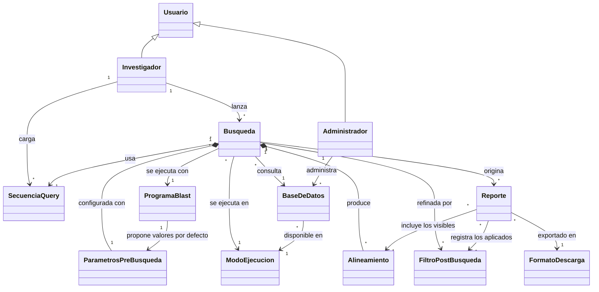
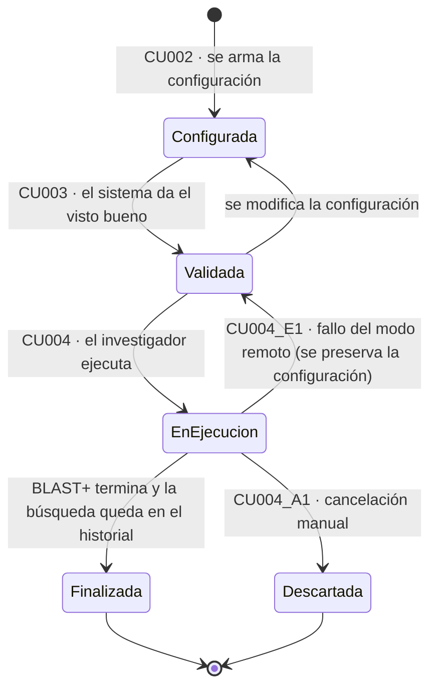

# Modelo de Dominio Conceptual — LocalBlast

Este modelo describe las **entidades esenciales del problema** y sus relaciones, sin atributos, sin tipos de dato, sin métodos ni visibilidad. El detalle interno de las clases (atributos, operaciones y tipos) se define en el diseño detallado de cada historia de usuario: ver [`docs/design/diseno-detallado.md`](../design/diseno-detallado.md).

Es un modelo del dominio del problema, no de la implementación: expresa "qué cosas existen y cómo se relacionan en el mundo del usuario", no cómo se van a codificar.

> **Versión revisada.** El modelo original se escribió al inicio del proyecto, antes de partir los casos de uso en seis capacidades y antes de la arquitectura. Al bajar al diseño detallado de `HU08_CU004_B` se revisó contra los casos de uso, el SRS y la arquitectura vigentes, y se corrigieron las inconsistencias que se listan en la sección [Registro de cambios](#registro-de-cambios).

---

## Entidades y su rol en el dominio

**Usuario**: persona que interactúa con el sistema. Se especializa en dos roles:

- **Investigador**: quien carga secuencias y lanza búsquedas BLAST. Es el actor principal del proceso de búsqueda. Cada búsqueda queda asociada al investigador que la lanzó, y esa asociación es la que define su **historial**: el conjunto de sus búsquedas finalizadas.
- **Administrador**: quien mantiene el catálogo de bases de datos que el sistema ofrece para las búsquedas locales.

**Búsqueda**: la entidad central del dominio. Representa una consulta BLAST completa: una secuencia query enviada contra una base de datos, con un programa BLAST y un conjunto de parámetros del algoritmo, ejecutada en un modo (local o remoto), que produce alineamientos y da origen a reportes descargables. Pasa por un ciclo de vida (ver más abajo) que determina qué se puede hacer con ella en cada momento.

**SecuenciaQuery**: la secuencia biológica (ADN, ARN o proteína) que el investigador quiere alinear. Se carga una vez y puede usarse en varias búsquedas.

**ProgramaBlast**: la variante del algoritmo que se ejecuta (`blastn`, `blastp`, `blastx`, `tblastn`, `tblastx`). Determina qué tipo de secuencia query y qué tipo de base de datos son compatibles, y qué valores por defecto se proponen para los parámetros.

**ParametrosPreBusqueda**: el conjunto de valores que afectan directamente al algoritmo BLAST: matriz de sustitución, E-value máximo, tamaño de palabra, penalización de gaps, y demás. Se llaman "pre" porque se fijan **antes** de correr la búsqueda y determinan cómo se calculan los resultados. Pertenecen a una única búsqueda.

**FiltroPostBusqueda**: criterios que el investigador aplica **después** de que BLAST devolvió los alineamientos, para reducir la lista sin volver a ejecutar el algoritmo (por ejemplo umbrales de % de identidad, % de cobertura, rango de E-value observado, taxonomía).

**ModoEjecucion**: la elección entre correr BLAST+ localmente (contra un índice del catálogo del laboratorio) o remotamente (invocando a BLAST+ con la flag `-remote`, tras lo cual es BLAST+ el que dialoga con los servidores de NCBI del otro lado). Cada base de datos está disponible en uno de los dos modos.

**BaseDeDatos**: una base de datos BLAST utilizable para una búsqueda. En modo local es un índice construido por `makeblastdb` (ya sea a partir de una base de datos pública como SwissProt, o de secuencias propias del laboratorio); en modo remoto es una base de datos ofrecida por NCBI.

**Alineamiento**: cada uno de los "hits" que devuelve BLAST: la comparación entre la query y una secuencia de la base de datos, con sus métricas asociadas (score, E-value, % identidad, cobertura, etc.). Forma parte de la búsqueda que lo produjo y no existe sin ella.

**Reporte**: la salida entregable al usuario: los alineamientos visibles al momento de descargar, junto con los filtros aplicados, en un formato descargable determinado.

**FormatoDescarga**: el formato en que se puede exportar un reporte (CSV, JSON, FASTA, tabular BLAST, XML).

---

## Ciclo de vida de una Búsqueda

Los casos de uso `CU002` a `CU004` mueven a la búsqueda por distintos estados, y varias reglas del dominio dependen del estado en que está (por ejemplo, solo se ejecuta una búsqueda validada). Se documenta el ciclo para que esas reglas tengan un lugar explícito en el modelo.

Una búsqueda **Finalizada** es la que forma parte del historial del investigador (almacén D2 del DFD). Las transiciones de cancelación y de fallo remoto se diseñan en sus propias historias (`HU09_CU004_A1` y `HU10_CU004_E1`).

---

## Nota sobre el alcance

El modelo incluye deliberadamente al **Administrador** y su relación `administra` con **BaseDeDatos** para dejar registrada la visión integral del dominio. Esa parte del modelo **queda fuera del alcance de implementación del cuatrimestre por restricciones de tiempo** (ver [SRS 1.4](srs.md#14-fuera-del-alcance)). Se profundiza la mitad del modelo que rodea a **Búsqueda** (Investigador, SecuenciaQuery, ProgramaBlast, ParametrosPreBusqueda, ModoEjecucion, BaseDeDatos como entidad ya existente en el catálogo, Alineamiento, FiltroPostBusqueda, Reporte, FormatoDescarga) y se asume que las instancias de BaseDeDatos ya existen, cargadas por fuera del sistema.

---

## Registro de cambios

Cambios hechos al revisar el modelo contra los casos de uso, el SRS y la arquitectura vigentes:

| # | Cambio | Motivo |
|---|---|---|
| 1 | `Busqueda "1" --> "1" SecuenciaQuery` pasa a `Busqueda "*" --> "1" SecuenciaQuery`, y se agrega `Investigador "1" --> "*" SecuenciaQuery : carga` | `CU001` deja la secuencia en la sesión "para ser usada por una o varias búsquedas subsiguientes". Con multiplicidad 1 a 1, cada búsqueda nueva exigía volver a cargar la secuencia. |
| 2 | Se agrega la entidad **ProgramaBlast** y la relación `Busqueda "*" --> "1" ProgramaBlast` | RF-05 y RF-07 hacen depender la compatibilidad (query / base de datos) y los valores por defecto (RF-06) del programa elegido. Es un concepto con reglas propias que el modelo original no tenía. Se agrega también `ProgramaBlast --> ParametrosPreBusqueda : propone valores por defecto`. |
| 3 | `Busqueda "1" --> "1" ModoEjecucion` y `Busqueda "1" --> "1" BaseDeDatos` pasan a `"*" --> "1"`; se agrega `BaseDeDatos "*" --> "1" ModoEjecucion : disponible en` | Muchas búsquedas usan el mismo modo y la misma base. RF-04 ofrece las bases según el modo elegido (catálogo local o bases de NCBI), relación que el modelo original no mostraba. |
| 4 | `ParametrosPreBusqueda` y `Alineamiento` pasan a ser **composición** de `Busqueda` | Los parámetros y los alineamientos no existen sin la búsqueda a la que pertenecen: se guardan y se recuperan con ella (RF-10). |
| 5 | Se agregan `Reporte --> Alineamiento : incluye los visibles` y `Reporte --> FiltroPostBusqueda : registra los aplicados` | `CU006` arma el archivo con los alineamientos visibles e incluye los filtros aplicados en los metadatos; el modelo original no decía qué contenía un reporte. |
| 6 | Se documenta el **ciclo de vida de la Búsqueda** | Las reglas "solo se ejecuta una búsqueda validada" (`CU004`) y "modificar la configuración invalida la validación" (escenario 2 de operabilidad) dependen del estado de la búsqueda, que el modelo original no explicitaba. |
| 7 | El **historial** (D2) se define como el conjunto de búsquedas finalizadas de cada investigador, sin entidad propia | Agregar una entidad `Historial` sin reglas ni datos propios no aporta al modelo: alcanza con la relación `Investigador lanza Busqueda` y el estado *Finalizada*. En el diseño se materializa como un repositorio. |
